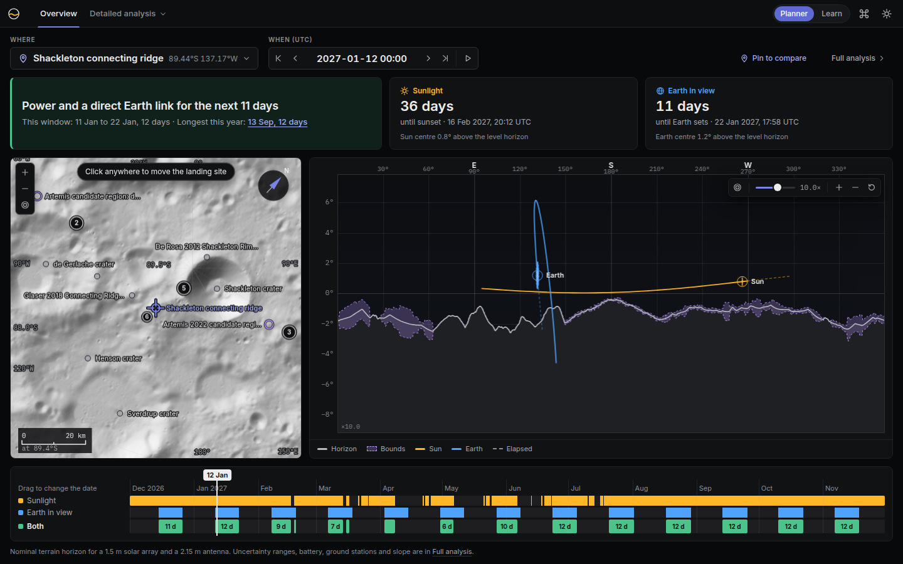

# Lunar Landing Site Navigator

A planning tool for lunar landing sites and dates, built for the NASA Space Apps Challenge 2026
[Lunar Landing Site Navigator](https://www.spaceappschallenge.org/2026/challenges/lunar-landing-site-navigator/)
challenge ([problem statement](problem-statement.md)).

The first screen answers one question: if the landing site or the landing date moves, is the mission still
viable, and where is the nearest alternative? Click the map to move the site, drag the year timeline to move
the date, and pin a site to keep its row while you try another. For the chosen site and date it shows the Sun
and Earth against the terrain horizon, how long until sunset and Earthset, and every window in the year with
both sunlight and a direct Earth link, computed from SPICE ephemerides and LOLA terrain.

Behind it, the detailed pages add power and battery survival through dark spans, ground-station contact,
landing-ellipse statistics, slip analysis and site search. Every number carries its terrain uncertainty and a
link to the validation that measured it.



## What is in it

- **Engine** (`src/lunarnav`): SPICE-backed Sun/Earth/ground-station geometry (`ephem`), terrain stores
  built from LOLA and PGDA products (`terrain`), horizon profiles (`horizon`), disc visibility, power,
  battery and link budgets (`visibility`), gridded regional layers (`regional`), and planner answers on top:
  site evaluation, opportunity calendars, slip analysis, landing-ellipse statistics, site search
  (`scenario`).
- **HTTP service** (`lunarnav serve`): FastAPI over the engine, with a job pool for long analyses, exports
  (CSV, JSON, CCSDS AEM) and HTML/PDF mission reports.
- **Web app** (`web/`): React interface. The overview is the home page; map, site, calendar, compare, ellipse
  and evidence pages sit under "Detailed analysis", next to Explorer, an interactive mode for students and the public.
- **Analysis agent** (`lunarnav agent`): a Claude agent that answers planning questions through typed
  engine tools, with a ledger of every computation it cites, running in an OS sandbox.
- **Validation** (`docs/validation`): how each part was checked against JPL Horizons, published
  illumination studies, LRO NAC imagery and real missions, with the measured errors.

## Where the numbers come from

Every number on screen is computed by this repository's engine from public NASA data: NAIF SPICE kernels for
where the Sun, Earth and the ground stations are, and LOLA and PGDA terrain models for the horizon at each
site. The results are checked against JPL Horizons, NASA's published illumination and Earth-visibility maps,
LRO NAC images and real missions. How far to trust them, including the checks that miss their targets:
[`docs/validation/`](docs/validation). Every dataset, kernel, library and image, with its source and terms:
[`REFERENCES.md`](REFERENCES.md).

AI tools used to build this are listed task by task: [`AI_USAGE.md`](AI_USAGE.md).

## Setup

Linux, Python 3.12+, [uv](https://docs.astral.sh/uv/) and [bun](https://bun.sh/).

```bash
scripts/bootstrap.sh            # system packages, Python and web dependencies, SPICE kernels, web build
scripts/bootstrap.sh --no-sudo  # same, without apt packages and the agent sandbox profile
```

Or by hand:

```bash
uv sync
uv run lunarnav kernels                  # download and verify the pinned SPICE kernels into data/kernels
(cd web && bun install && bun run build)
```

Data lives in `data/` (or `$LUNARNAV_DATA`) and is not part of the repository.

### Data

Built terrain stores, kernels and caches are shared in the public bucket `gs://lunarnav-1114-19887-data`. Its
layout matches `data/`, and the deployed site reads from it. Install the
[gcloud CLI](https://cloud.google.com/sdk/docs/install) (no login needed), then pull what you need:

```bash
scripts/data.sh pull              # kernels and a starter set of stores (~3.5 GB): global, 60N/60S and the regional windows
scripts/data.sh pull lola_80s_20m # kernels and specific stores
scripts/data.sh pull --all        # everything (~52 GB)
scripts/data.sh list              # what the bucket holds
```

Pulls are incremental, so run them again to pick up changes. Stores are memory-mapped, so the API reads them from
local disk; it can't read them from the bucket directly.

Without the bucket, build any store from NASA's servers:

```bash
scripts/data.sh build lola_80s_20m   # fetch one source product and build its store
scripts/data.sh build --all          # everything the bucket holds: about 20 minutes on a cloud VM, longer at home
uv run python -m lunarnav.terrain.regional --lat 18.5623 --lon 61.8103 --product sldem2015_512   # one regional window
```

A regional window's id rounds its centre to 3 decimals, but the window is cut from the exact centre you pass. Use the
catalogue coordinates (`src/lunarnav/catalog/sites.yaml`), as `build --all` does, to reproduce the shared stores
exactly.

To change the shared data, merge the code change, then run the `data` workflow from the Actions tab (`all`, or
the store ids). It rebuilds them in Cloud Build and publishes them to the bucket, and the deployed site picks them up
within a few minutes.

Without terrain the engine falls back to a smooth sphere horizon.

## Running

```bash
uv run lunarnav serve            # API and built web app on http://127.0.0.1:8000
(cd web && bun run dev)          # web dev server on :5173, proxying /api to :8000
```

The service binds to loopback only and is meant for a single trusted operator. The analysis agent runs
model-written code, so it is off by default: set `LUNARNAV_API_AGENT_ENABLED=1` to serve its endpoints and
show Ask in the web app. Other settings also come from `LUNARNAV_*` environment variables (see
`src/lunarnav/api/settings.py`).

Other commands:

```bash
uv run lunarnav regional --help  # regional illumination/visibility GeoTIFFs for an area
uv run lunarnav agent run "..."  # analysis agent in the terminal (needs the Claude Code CLI, signed in)
uv run lunarnav openapi web/src/api/openapi.json && (cd web && bun run gen:api)
```

## Data sources

- SPICE kernels: NAIF (JPL).
- Terrain: LOLA GDR products (PDS Geosciences Node) and PGDA high-resolution site DEMs (NASA GSFC).
- Validation imagery: LRO NAC (LROC, Arizona State University / NASA).
- Globe textures in Explorer: NASA imagery (public domain).

Catalogue entries (`src/lunarnav/catalog/*.yaml`) cite their own sources.

## Working on it

Start with [`docs/SETUP.md`](docs/SETUP.md). The rules for working on this repo, for people and for coding
agents, are in [`AGENTS.md`](AGENTS.md); what is done and what is next is in
[`docs/PROGRESS.md`](docs/PROGRESS.md); anything unverified is in
[`docs/OPEN_QUESTIONS.md`](docs/OPEN_QUESTIONS.md); decisions are in [`docs/decisions/`](docs/decisions).

## License

[MIT](LICENSE)
