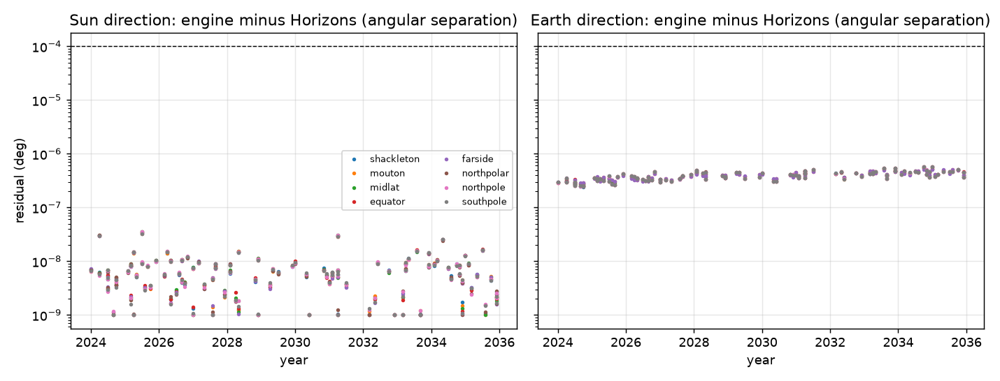
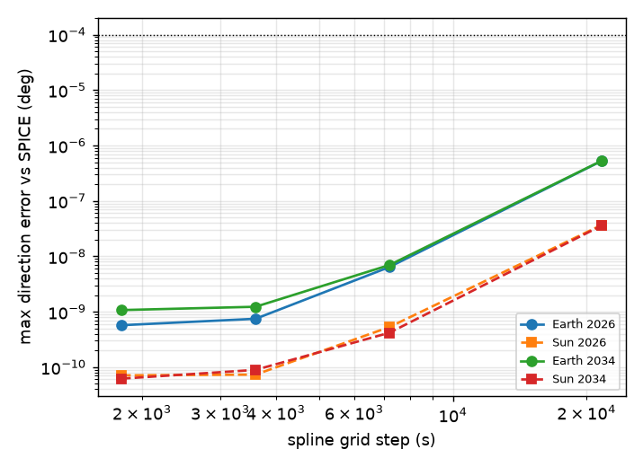

# Ephemeris engine validation (`lunarnav.ephem`)

## 1. Result in one paragraph

**Accuracy claim.** The engine's apparent Sun and Earth directions agree with JPL Horizons (JPL's online ephemeris service) to **3.6e-08 deg (Sun) and 5.8e-07 deg (Earth)** worst case. This holds for any lunar surface site and any epoch 2024-2035, and the test covered 100 epochs at 8 sites (800 samples). Both errors are below **1e-6 deg (0.004 arcsec)**. The directions include light time and stellar aberration, in the planetocentric mean-Earth (ME) frame, on a sphere of radius 1737.4 km. They also agree with a rigorous per-site SPICE solution to 1.0e-06 deg (Sun) and 1.0e-06 deg (Earth). SPICE is NASA's software and data for planet and spacecraft positions. The engine's own numerical approximations (spline table, first-order displaced-observer terms) cost at most 1.2e-09 deg. For mission planning the defensible statement is **"Sun and Earth directions are accurate to better than 1e-5 deg (0.04 arcsec), dominated by ephemeris uncertainty, not by this software"**. Against geometric reality, two other error sources dominate by orders of magnitude. One is the Earth-disc/atmosphere convention for eclipses (Section 6). The default enlarged Danjon shadow reproduces published contacts within 4.6 s. The other is terrain, which other modules handle.

**What this does and does not prove.** Agreement with Horizons validates the *implementation*, but not the ephemeris itself. Horizons and this engine share the same underlying planetary and lunar ephemeris family (DE440 vs DE441). They also share the same lunar body-fixed frame definition (NAIF/Horizons `MEAN_ME`). The implementation covers frames, light time, aberration, local-horizon maths, pole handling and time scales. The independent evidence on the ephemeris is the eclipse timing comparison (Section 6). Espenak computed the published contact times from VSOP87/ELP2000-85. They agree to a few seconds. This constrains the combined Sun-Earth-Moon geometry at the 0.001-0.002 deg level. The shadow moves 0.5 arcsec/s relative to the Moon, so 3 s = 1.5 arcsec = 4e-4 deg.

## 2. Method

* **Kernels** (`src/lunarnav/ephem/kernels.py`, SHA-256 pinned, downloaded from NAIF): `de440.bsp`, `naif0012.tls`, `pck00011.tpc`, `moon_pa_de440_200625.bpc` + `moon_de440_250416.tf` (`MOON_ME`), high-precision Earth orientation `earth_620120_260806.bpc` and predict `earth_2026_260806_2126_predict.bpc`, DSN `earthstns_itrf93_260814.bsp` + `earth_topo_260814.tf`.
* **Table** (`BodyFixedEphemeris`): one table serves many sites. For each epoch the table holds the Sun and Earth centre vectors in ME with light time only (`CN`), the solar-system barycentre (SSB) velocities and the Moon's ME angular velocity. For each site, numpy applies two corrections. The first is the displaced-observer light-time shift `v_target (u.s)/c`. The second is relativistic stellar aberration for the site velocity `v_moon + omega x s`.
* **Interpolation:** SPICE is sampled on a regular grid (1 h). Whenever epochs outnumber nodes, the engine interpolates with a cubic spline. Station geometry needs no per-epoch SPICE (see Section 5). Aberration is applied after interpolation and is never interpolated.
* **Conventions:** azimuth is clockwise from north. Elevation is measured from the plane normal to the sphere radial. Longitudes are planetocentric and east-positive. Time is ET internally and ISO-8601 UTC `Z` at the API. At a pole, local north is the continuation along the stated longitude.

## 3. Cross-validation against JPL Horizons (independent software path)

The engine matches Horizons to 3.6e-08 deg for the Sun and 5.8e-07 deg for the Earth, worst case. The test used 100 epochs spread over 2024-01-04T10:47:10 to 2035-12-22T06:14:10 UTC and 8 sites, including both exact poles. The Horizons request was an observer table with `CENTER='coord@301'` and `COORD_TYPE=GEODETIC` (on the 1737.4 km sphere, altitude 0). It asked for quantities 4 (azimuth/elevation, `ANG` apparent airless), 13 (angular diameter) and 20 (range). The responses are cached verbatim under `data/validation/horizons/`. Horizons returned these header lines for the Sun query:

```
Target body name: Sun (10)                        {source: DE441}
Center geodetic : 0.0, -90.0, 1.06385E-13         {E-lon(deg),Lat(deg),Alt(km)}
Center pole/equ : MEAN_ME (high precision)        {East-longitude positive}
Center radii    : 1737.4, 1737.4, 1737.4 km       {Equator_a, b, pole_c}
Rel. light bend : Sun, EARTH                      {source: DE441}
Atmos refraction: NO (AIRLESS)
EOP file        : eop.261111.p270207
```

The residual is engine - Horizons, as the angular separation of the apparent unit vectors (degrees):

| Site | lat, lon (deg) | Sun mean | Sun max | Earth mean | Earth max | Earth ang. diameter max (arcsec) | range rel. max |
|---|---|---|---|---|---|---|---|
| Shackleton rim | -89.45, 222.70 | 6.9e-09 | 3.3e-08 | 3.9e-07 | 5.7e-07 | 8.8e-04 | 1.6e-09 |
| Mons Mouton (IM-2 touchdown) | -84.79, 29.20 | 6.9e-09 | 3.3e-08 | 3.9e-07 | 5.7e-07 | 9.2e-04 | 1.6e-09 |
| Mid-latitude near side | +40.00, -20.00 | 7.0e-09 | 3.5e-08 | 3.9e-07 | 5.4e-07 | 9.4e-04 | 1.1e-09 |
| Equatorial near side | +0.00, 30.00 | 6.9e-09 | 3.4e-08 | 3.9e-07 | 5.3e-07 | 8.5e-04 | 8.4e-10 |
| Far side | -20.00, 190.00 | 6.8e-09 | 3.3e-08 | 3.9e-07 | 5.2e-07 | 9.4e-04 | 7.1e-10 |
| North polar | +89.50, 45.00 | 6.9e-09 | 3.6e-08 | 3.9e-07 | 5.7e-07 | 9.4e-04 | 1.6e-09 |
| North pole (exact) | +90.00, 0.00 | 6.9e-09 | 3.5e-08 | 3.9e-07 | 5.8e-07 | 9.5e-04 | 1.6e-09 |
| South pole (exact) | -90.00, 0.00 | 6.9e-09 | 3.3e-08 | 3.9e-07 | 5.7e-07 | 9.1e-04 | 1.6e-09 |



**Explained systematic (Earth direction, mean 3.9e-7 deg).** The Earth residual is the DE441-DE440 lunar-orbit difference, not an engine error. It is the *size of the ephemeris-version uncertainty*. Horizons used DE441 as its ephemeris source for these queries, and the engine uses DE440. DE441 "assumes no damping between the lunar liquid core and the solid mantle ... therefore DE441 is less accurate than DE440 for the current century" (Park et al. 2021, AJ 161:105, abstract at https://ssd.jpl.nasa.gov/doc/de440_de441.html).

The geocentric Moon position was compared directly between Horizons (`VECTORS`, `TIME_TYPE=UT`, ICRF) and DE440 over the same epochs. |DE441-DE440| has a mean of 2.60 m and a max of 3.26 m. It grows from 1.99 m in 2024 to 3.07 m in 2035. Almost all of it is along the orbit track (cross-track RMS 6.4 mm). Seen from the Moon at 384,400 km, that is 3.9e-07 deg. This matches the observed Earth residual (3.9e-07 deg).

The Sun residual (max 3.6e-8 deg) shows no such term. The Sun's direction from the Moon depends on the Earth-Moon vector only through the Moon's 1 AU-scale position, where a metre is 7e-12 rad. A 2025-03-14 spot check showed a 1e-6 deg Sun residual during the Earth eclipse. Horizons lists `Rel. light bend: Sun, EARTH`, and the engine has no gravitational light deflection. That attribution is plausible but was NOT isolated.

**Sub-points.** These come from the geocentric Horizons observer table, quantities 14 and 15, printed to 6 decimals, so the floor is ~1e-6 deg.

| Quantity | mean (deg) | max (deg) |
|---|---|---|
| `subearth_point(earth_view=True)` vs Horizons ObsSub (optical libration) | 6.9e-07 | 1.6e-06 |
| default `subearth_point` (zenith/received convention) vs Horizons ObsSub | 3.6e-03 | 5.9e-03 |
| `subsolar_point()` vs Horizons SunSub | 9.6e-07 | 1.4e-06 |
| `subsolar_point(stellar_aberration=False)` vs Horizons SunSub | 5.7e-03 | 6.0e-03 |

The two conventions differ by 0.004 deg, and the engine documents both rather than hiding the difference. Horizons evaluates its sub-observer point at the Moon epoch, with light time to the observer and *no* stellar aberration. Its sub-solar point includes aberration. The mean light time is 1.278 s.

## 4. Rigorous per-site SPICE reference and numerical-approximation budget

The engine agrees with a rigorous SPICE reference to 2.0e-07 deg or better away from the exact poles. The reference is `spkcpo` with `CN+S` from an ME-fixed observer on the sphere. SPICE applies the aberration, and no code is shared with the engine. The test used 200 random epochs over 400 days and 8 sites, with both the direct-sampled and the spline table:

| Site | Sun max direct / spline (deg) | Earth max direct / spline (deg) |
|---|---|---|
| shackleton | 1.6e-08 / 1.6e-08 | 1.9e-07 / 1.9e-07 |
| mouton | 1.7e-08 / 1.7e-08 | 2.0e-07 / 2.0e-07 |
| midlat | 1.3e-08 / 1.3e-08 | 1.7e-07 / 1.7e-07 |
| equator | 1.3e-08 / 1.3e-08 | 1.6e-07 / 1.6e-07 |
| farside | 1.3e-08 / 1.3e-08 | 1.6e-07 / 1.6e-07 |
| northpolar | 1.5e-08 / 1.5e-08 | 2.0e-07 / 2.0e-07 |
| northpole | 1.0e-06 / 1.0e-06 | 1.0e-06 / 1.0e-06 |
| southpole | 1.0e-06 / 1.0e-06 | 1.0e-06 / 1.0e-06 |

The ~1e-6 deg at the poles is the reference offset itself, not engine error. SPICE-side east and north are undefined at the pole. The exact-pole sites, and the reference for the 89.5 deg site, therefore use a reference latitude of 90 deg - 1e-6 deg. The engine itself is continuous at the pole. Between the exact pole and a point 1e-7 deg away on the same meridian, the maximum azimuth difference is 9.3e-09 deg.

Each correction is retained because neglecting it would move the Earth direction by far more than the engine error. The table gives the effect at an equatorial site:

| Neglected term | max effect (deg) |
|---|---|
| no displaced observer light time term | 2.5e-05 |
| no stellar aberration | 6.0e-03 |
| no site rotation velocity in aberration | 2.6e-05 |

**Interpolation error.** The default 3600 s grid keeps the spline error at or below 1.2e-09 deg. The reference is direct SPICE, at 4000 random epochs in each of two years sampled every 5 min. The table gives the maximum Earth-direction error by spline grid step:

| grid step | 2026 | 2034 |
|---|---|---|
| 1800 s | 5.7e-10 deg | 1.1e-09 deg |
| 3600 s | 7.5e-10 deg | 1.2e-09 deg |
| 7200 s | 6.4e-09 deg | 7.0e-09 deg |
| 21600 s | 5.3e-07 deg | 5.3e-07 deg |

The default grid for Sun and Earth is 3600 s. Station tables use the orientation spline of Section 5 on a 7200 s grid. That spline was tested on 3 stations x 2 spans (2028, 2033) against per-epoch SPICE. The worst position error is 0.8 cm, the worst direction error 1.2e-09 deg and the worst up-vector error 1.7e-08 deg. On a 21600 s grid these become 0.29 m and 4.9e-08 deg. 

## 5. Ground stations (DSN)

* At the kernel epoch, the engine's station positions match the NAIF kernel to 0.295 m or better. The input is the WGS84 geodetic coordinates of 19 antennas of the DSN (NASA Deep Space Network), from DSN 810-005 module 301 Rev. P, Table 5, https://deepspace.jpl.nasa.gov/dsndocs/810-005/301/301P.pdf. The engine's `station_position_itrf_km` converts them. They were compared with the NAIF `earthstns_itrf93` SPK at its epoch 2003.0: mean 0.018 m, max 0.295 m. At 2030-01-01 the kernel includes plate motion that the geodetic table does not, and the difference is mean 0.90 m, max 1.51 m. This is negligible, because 1 m = 3e-9 rad at the Moon.
* The geodetic up vector matches the z axis of the NAIF `DSS-nn_TOPO` frames to max 1.2e-05 deg.
* The site-to-station direction was compared with an explicit-iteration reference. The reference uses SPICE `stelab`, and `stlabx` for the station-side pointing, in ITRF93. The maximum differences are: direction max 2.0e-07 deg, station-side elevation 2.2e-07 deg, range 0.41 m.
* **Fast multi-station path.** The fast path gives the same accuracy as the direct table. Per-node `spkcpt`/`sxform` calls used to dominate multi-year tables (timings in Section 7). A station is the Earth-centre vector, which is already in the table, plus an Earth-fixed vector turned by `R(t)`: ITRF93 -> J2000. The table now removes the diurnal rotation analytically: `R = Q Rz(theta)`, with `theta` linear at the nominal rate 7.292115e-5 rad/s. It splines only the slow remainder `Q` and the J2000 -> ME rotation. Both come from two vectorised `sxform` calls on a 7200 s grid. The station-specific light time differs from the Earth-centre one by < 30 ms. It is applied as a first-order shift along the station SSB velocity, and the neglected second-order terms are < 1e-8 km. The fast path is used when epochs outnumber grid nodes. `interpolate=False` still samples SPICE per epoch, and that is the reference. The checks below were re-run with the fast table. They gave direction max 2.0e-07 deg, station-side elevation 2.2e-07 deg and range 0.41 m, the same as the direct table above. The pointing check against `spkcpt` uses the fast path.
* Station-side elevation matches SPICE-native `spkcpt` `XLT+S` in `DSS-nn_TOPO` to max 1.1e-05 deg, over 4 sites x 3 stations x 15 days.
* The station is evaluated at its retarded time. This includes the Earth rotation during the extra light time of the displaced site. Ignoring it would cost up to 2.4e-5 deg, and the engine removes it.
* Earth orientation: the pinned EOP file runs to 2026-08-06 and the predict kernel to 2126. Only the station window timing is affected. For lunar-site geometry, UT1 and polar-motion error are irrelevant. They affect the Earth direction only through the Earth-fixed frame of the *station*, at the arcsecond level. 1 s of UT1-UTC error = 15 arcsec of station azimuth about Earth's axis. In the far future this means a station-visibility timing error of seconds.

## 6. Earth-eclipse geometry versus published lunar-eclipse contacts

With the default Danjon shadow, the engine reproduces the published eclipse contact times to within 4.6 s. The independent reference is the NASA Goddard Space Flight Center (GSFC) contact times by F. Espenak, for the total lunar eclipses of 2025-03-14 and 2025-09-07, which Espenak computed with VSOP87/ELP2000-85 and the Danjon shadow convention. That convention enlarges the Earth radius by 1/85 - 1/594 = x1.01 (https://eclipse.gsfc.nasa.gov/LEcat5/shadow.html). The times are UT with delta-T = 75 s. They were read from https://eclipse.gsfc.nasa.gov/LEplot/LEplot2001/LE2025Mar14T.pdf and .../LE2025Sep07T.pdf.

The contacts are geometric tangency conditions of the Sun and Earth discs seen from limb sites. They therefore test `sun_track`, `earth_track` and the disc separation directly. The contact times are P1 to P4 (penumbral) and U1 to U4 (umbral). The table gives engine minus published, in seconds, on the TT time scale at the Moon-side epoch. The 1.3 s light time to Earth is *not* subtracted.

| Eclipse | Earth radius | P1 | U1 | U2 | U3 | U4 | P4 |
|---|---|---|---|---|---|---|---|
| 2025-03-14 | 1.01 x 6378.137 km (`shadow="danjon"`, default) | -1.7 | -3.0 | -4.6 | +0.3 | -0.9 | -0.7 |
| 2025-03-14 | 6371.0 km (`shadow="geometric"`) | +79.0 | +81.2 | +124.2 | -128.5 | -85.1 | -81.5 |
| 2025-09-07 | 1.01 x 6378.137 km (`shadow="danjon"`, default) | -2.2 | -2.4 | -3.0 | -0.2 | -0.1 | -0.2 |
| 2025-09-07 | 6371.0 km (`shadow="geometric"`) | +70.5 | +71.9 | +85.5 | -88.7 | -74.4 | -72.8 |

With the published convention, all twelve contacts agree to within 4.6 s. This convention is `shadow="danjon"`, the **default of `earth_eclipse_fraction`**. The published times are rounded to 1 s, and delta-T is rounded to 75 s.

**With a bare geometric Earth of radius 6371 km (`shadow="geometric"`), contacts are off by up to 129 s.** The umbral and total phases come out 1.2-2.1 minutes too short at each end. That is the effect of the atmosphere. It is an optimistic error for power planning, because the eclipse comes out too brief. The default is therefore the enlarged Danjon shadow. The bare sphere remains available as `shadow="geometric"`. `earth_radius_km` and `atmosphere_km` override or add to the model radius. `eclipse_occulting_radius_km(shadow, earth_radius_km, atmosphere_km)` returns the radius used, so that provenance can record it.

**What the eclipse fraction means.** The eclipse fraction tells *when* the published eclipse phases start and end. It does not give received irradiance. Under the enlarged-shadow convention it is a geometric obscuration proxy: the fraction of the Sun's disc area covered by a disc of the enlarged Earth, with uniform Sun brightness. Real penumbral and umbral light also depends on two effects that are not modelled. One is refraction through the atmosphere, which bends light into the geometric shadow, so the umbra is not dark. The other is atmospheric extinction (aerosols, ozone, clouds), which depends on the event.

### 6.1 Blue Ghost Mission 1 site (18.5623 N, 61.8103 E), 2025-03-14

All eight engine phase times fall within 2 min of Firefly's reported site times. The engine phases come from the public `earth_eclipse_fraction` on a 1 s grid. The partial phase is where fraction > 1e-6, and totality is where fraction = 1. The reference is Firefly's publicly reported site times, rounded to the minute (*Blue Ghost Mission 1: Live Updates*, https://fireflyspace.com/news/blue-ghost-mission-1-live-updates, entry of 13 March 2025). Firefly's post labels the times "CST". They are read as CDT, which is an INFERENCE, because the CST reading would end after P4. Totality end is 06:18 + 2 h 16 min, as stated by Firefly. The table gives engine minus reported, in seconds, with the engine UTC in brackets:

| Phase | Reported (UTC) | `danjon` (default) | `geometric` |
|---|---|---|---|
| Penumbral start | 05:00 | -28 (04:59:32) | +55 (05:00:55) |
| Totality start | 06:18 | -118 (06:16:02) | -22 (06:17:38) |
| Totality end | 08:34 | +113 (08:35:53) | +17 (08:34:17) |
| Penumbral end | 09:52 | +27 (09:52:27) | -56 (09:51:04) |

For the partial phase, Danjon agrees within 28 s. For the reported *totality* (2 h 16 min), the bare sphere matches within 22 s at both ends, with a duration of 2 h 16 min 38 s. The Danjon shadow is off by up to 118 s. It starts totality early and ends it late, with a duration of 2 h 19 min 50 s. All eight residuals are inside a +-2 min target (largest: 118 s) and inside GSFC P1-P4/U1-U4. Firefly does not state its convention. Its figures are rounded to the minute, and the source is a secondary public post. This difference is reported as found, not tuned away. The longer Danjon eclipse is the conservative direction for power planning.


## 7. Performance

A one-year Sun and Earth table builds in 0.27 s, and each extra site costs 16 ms per target. The figures were measured 2026-11-13 on x86_64, 16 logical CPUs, 28 GiB RAM (Ryzen 7 8845HS class), Python 3.14.6. The conditions are recorded in `data/validation/ephem/vs_spice.json`. The engine is single-threaded. SPICE is serialised by a lock, and the numpy work is element-wise. This run set OMP/OPENBLAS/NUMBA_NUM_THREADS = 1/1/1. Only this job of ours was running, but the user's own desktop and services were not stopped. The load average before the run was 1.8/2.8/4.1 (1/5/15 min), with 13 GiB memory available and 8 GiB swap in use. The figures are medians with the min-max range. They are indicative of this machine, not guarantees.

* 105120 epochs (one year at 5 min), 5 repeats: the table build takes 0.27 s (range 0.27-0.27). The Sun and Earth tracks for one site take 33 ms (range 33-38). Each further site takes 16 ms per target (range 16-16). The table with one ground station (orientation spline of Section 5, 3 repeats) takes 0.35 s (range 0.35-0.36), and that figure includes the Sun/Earth table.
* Exact per-epoch SPICE sampling (`interpolate=False`, 3 repeats, 5256 epochs): the Sun/Earth table takes 29 us per epoch, and one station 34 us per epoch.
* Five years, 43830 hourly epochs, 3 DSN stations (3 repeats): the Sun/Earth table takes 1.31 s (range 1.29-1.33), and with stations 1.52 s (range 1.50-1.52). The station part is therefore 0.21 s (range 0.20-0.21).
* For comparison, the station part with SPICE evaluated per epoch (`interpolate=False`) takes 5.7 s (range 5.71-5.73; extrapolated from every 10th epoch, 3 repeats). This is also what the engine did for this case before the orientation spline, because the hourly epochs did not outnumber a 900 s station grid.

## 8. Limitations and residual risks

* Agreement with Horizons proves the implementation, not the truth. Both use the JPL ephemeris and the same `MEAN_ME` lunar frame. DE440 and DE441 differ by 2-3 m in the lunar orbit (Section 3). This bounds the ephemeris-version uncertainty at ~4e-7 deg of Earth direction. The published DE440 lunar-orbit accuracy (centimetre-level from lunar laser ranging) is UNVERIFIED here: it was recalled, not fetched. The 2-3 m difference between versions is the verified bound.
* The ME frame is the NAIF mean-Earth/mean-rotation frame. It comes from the DE440 principal-axes orientation plus the NAIF offset kernel. Its realisation relative to the LRO/LOLA ME frame used for terrain is a separate frame-tie question, owned by the terrain module (arc-second-level for DE440-era products, UNVERIFIED). LRO is the Lunar Reconnaissance Orbiter, and LOLA is its laser altimeter.
* The engine does not model gravitational light deflection or atmospheric refraction or extinction. The Danjon enlargement stands in for the atmosphere geometrically only. `earth_eclipse_fraction` is therefore an obscuration proxy, not irradiance, and the real umbra is not dark. There is no Earth-disc oblateness beyond the chosen radius, and no Sun limb darkening here. The default `shadow="danjon"` lengthens eclipses relative to a bare Earth, which is the conservative direction for power. Firefly's reported Blue Ghost totality (2 h 16 min) is closer to the bare sphere (Section 6.1).
* The 0.4 m (1e-9 relative) range difference to both Horizons and SPICE is a known second-order light-time residual of the first-order displaced-observer model. It is irrelevant at the required accuracy.
* The default `earth_latest_high_prec.bpc` is not pinned, because it changes daily. Beyond 2026-08 the predicted EOP applies.
* The Horizons residuals are sampled (100 epochs x 8 sites), not exhaustive. The SPICE comparison is also sampled (200 epochs x 8 sites).
