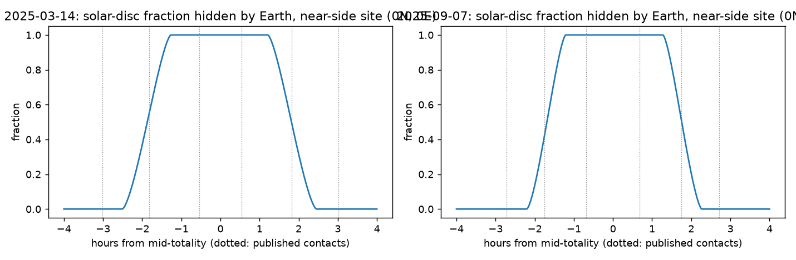

# Ephemeris engine validation (`lunarnav.ephem`)

## 1. Result in one paragraph

**Accuracy claim.** For any lunar surface site and any epoch 2024-2035, the engine's apparent Sun and Earth directions (light time, stellar aberration, planetocentric ME frame, sphere radius 1737.4 km) agree with JPL Horizons to **3.6e-08 deg (Sun) and 5.8e-07 deg (Earth)** worst case over 100 epochs at 8 sites (800 samples), i.e. below **1e-6 deg (0.004 arcsec)**, and agree with a rigorous per-site SPICE solution to 1.0e-06 deg (Sun) and 1.0e-06 deg (Earth). The engine's own numerical approximations (spline table, first-order displaced-observer terms) cost at most 1.2e-09 deg. For mission planning the defensible statement is **"Sun and Earth directions are accurate to better than 1e-5 deg (0.04 arcsec), dominated by ephemeris uncertainty, not by this software"**; against geometric reality the Earth-disc/atmosphere convention for eclipses (Section 6; the default enlarged Danjon shadow reproduces published contacts within 4.6 s) and terrain (other modules) dominate by orders of magnitude.

**What this does and does not prove.** Horizons and this engine share the same underlying planetary/lunar ephemeris family (DE440 vs DE441) and the same lunar body-fixed frame definition (NAIF/Horizons `MEAN_ME`). Agreement therefore validates the *implementation* (frames, light time, aberration, local-horizon maths, pole handling, time scales) but not the ephemeris itself. Independent evidence on the ephemeris is the eclipse timing comparison (Section 6): published contact times computed by Espenak from VSOP87/ELP2000-85 agree to a few seconds, which constrains the combined Sun-Earth-Moon geometry at the 0.001-0.002 deg level (the shadow moves 0.5 arcsec/s relative to the Moon; 3 s = 1.5 arcsec = 4e-4 deg).

## 2. Method

* **Kernels** (`src/lunarnav/ephem/kernels.py`, SHA-256 pinned, downloaded from NAIF): `de440.bsp`, `naif0012.tls`, `pck00011.tpc`, `moon_pa_de440_200625.bpc` + `moon_de440_250416.tf` (`MOON_ME`), high-precision Earth orientation `earth_620120_260806.bpc` and predict `earth_2026_260806_2126_predict.bpc`, DSN `earthstns_itrf93_260814.bsp` + `earth_topo_260814.tf`.
* **Table** (`BodyFixedEphemeris`): per epoch, Sun and Earth centre vectors in ME with light time only (`CN`), SSB velocities and the Moon's ME angular velocity. Per site, in numpy: displaced-observer light-time shift `v_target (u.s)/c`, then relativistic stellar aberration for the site velocity `v_moon + omega x s`. This lets one table serve many sites.
* **Interpolation:** SPICE is sampled on a regular grid (1 h) and cubic-spline interpolated whenever epochs outnumber nodes. Station geometry needs no per-epoch SPICE: see Section 5. Aberration is applied after interpolation (never interpolated).
* **Conventions:** azimuth clockwise from north, elevation from the plane normal to the sphere radial, planetocentric east-positive longitudes, ET internally, ISO-8601 UTC `Z` at the API. At a pole the local north is the continuation along the stated longitude.

## 3. Cross-validation against JPL Horizons (independent software path)

100 epochs spread over 2024-01-04T10:47:10 to 2035-12-22T06:14:10 UTC, 8 sites including both exact poles. Horizons request: observer table, `CENTER='coord@301'`, `COORD_TYPE=GEODETIC` (on the 1737.4 km sphere, altitude 0), quantities 4 (azimuth/elevation, `ANG` apparent airless), 13 (angular diameter), 20 (range); responses cached verbatim under `data/validation/horizons/`. Header lines Horizons returned for the Sun query:

```
Target body name: Sun (10)                        {source: DE441}
Center geodetic : 0.0, -90.0, 1.06385E-13         {E-lon(deg),Lat(deg),Alt(km)}
Center pole/equ : MEAN_ME (high precision)        {East-longitude positive}
Center radii    : 1737.4, 1737.4, 1737.4 km       {Equator_a, b, pole_c}
Rel. light bend : Sun, EARTH                      {source: DE441}
Atmos refraction: NO (AIRLESS)
EOP file        : eop.261111.p270207
```

Residual = engine - Horizons, as angular separation of the apparent unit vectors (degrees):

| Site | lat, lon (deg) | Sun mean | Sun max | Earth mean | Earth max | Earth ang. diameter max (arcsec) | range rel. max |
|---|---|---|---|---|---|---|---|
| Shackleton rim | -89.45, 222.70 | 6.9e-09 | 3.3e-08 | 3.9e-07 | 5.7e-07 | 8.8e-04 | 1.6e-09 |
| Mons Mouton (IM-2 touchdown) | -84.79, 29.20 | 6.9e-09 | 3.3e-08 | 3.9e-07 | 5.7e-07 | 9.2e-04 | 1.6e-09 |
| Mid-latitude near side | +40.00, -20.00 | 7.0e-09 | 3.5e-08 | 3.9e-07 | 5.4e-07 | 9.4e-04 | 1.1e-09 |
| Equatorial near side | +0.00, 30.00 | 6.9e-09 | 3.4e-08 | 3.9e-07 | 5.3e-07 | 8.5e-04 | 8.4e-10 |
| Far side | -20.00, 190.00 | 6.8e-09 | 3.3e-08 | 3.9e-07 | 5.2e-07 | 9.4e-04 | 7.1e-10 |
| North polar | +89.50, 45.00 | 6.9e-09 | 3.6e-08 | 3.9e-07 | 5.7e-07 | 9.4e-04 | 1.6e-09 |
| North pole (exact) | +90.00, 0.00 | 6.9e-09 | 3.5e-08 | 3.9e-07 | 5.8e-07 | 9.5e-04 | 1.6e-09 |
| South pole (exact) | -90.00, 0.00 | 6.9e-09 | 3.3e-08 | 3.9e-07 | 5.7e-07 | 9.1e-04 | 1.6e-09 |


**Explained systematic (Earth direction, mean 3.9e-7 deg).** Horizons' ephemeris source for these queries is DE441; the engine uses DE440 (DE441 "assumes no damping between the lunar liquid core and the solid mantle ... therefore DE441 is less accurate than DE440 for the current century", Park et al. 2021, AJ 161:105, abstract at https://ssd.jpl.nasa.gov/doc/de440_de441.html). Directly comparing the geocentric Moon position (Horizons `VECTORS`, `TIME_TYPE=UT`, ICRF) with DE440 over the same epochs gives |DE441-DE440| mean 2.60 m (max 3.26 m; 1.99 m in 2024 growing to 3.07 m in 2035), essentially all along the orbit track (cross-track RMS 6.4 mm). Seen from the Moon at 384,400 km that is 3.9e-07 deg, matching the observed Earth residual (3.9e-07 deg). So the Earth residual is the DE441-DE440 lunar-orbit difference, not an engine error, and it is the *size of the ephemeris-version uncertainty*. The Sun residual (max 3.6e-8 deg) shows no such term: the Sun's direction from the Moon depends on the Earth-Moon vector only through the Moon's 1 AU-scale position, where a metre is 7e-12 rad. A 2025-03-14 spot check showed a 1e-6 deg Sun residual during the Earth-eclipse of the Sun; Horizons lists `Rel. light bend: Sun, EARTH` and the engine has no gravitational light deflection. That attribution is plausible but was NOT isolated.

**Sub-points** (geocentric Horizons observer table, quantities 14 and 15, printed to 6 decimals, so the floor is ~1e-6 deg):

| Quantity | mean (deg) | max (deg) |
|---|---|---|
| `subearth_point(earth_view=True)` vs Horizons ObsSub (optical libration) | 6.9e-07 | 1.6e-06 |
| default `subearth_point` (zenith/received convention) vs Horizons ObsSub | 3.6e-03 | 5.9e-03 |
| `subsolar_point()` vs Horizons SunSub | 9.6e-07 | 1.4e-06 |
| `subsolar_point(stellar_aberration=False)` vs Horizons SunSub | 5.7e-03 | 6.0e-03 |

Horizons' sub-observer point is evaluated at the Moon epoch with light time to the observer and *no* stellar aberration, and its sub-solar point includes aberration; the engine documents both conventions rather than hiding the 0.004 deg difference between them (light time 1.278 s mean).

## 4. Rigorous per-site SPICE reference and numerical-approximation budget

Reference: `spkcpo` with `CN+S` from an ME-fixed observer on the sphere (aberration by SPICE, no code shared with the engine). 200 random epochs over 400 days, 8 sites, both the direct-sampled and the spline table:

| Site | Sun max direct / spline (deg) | Earth max direct / spline (deg) |
|---|---|---|
| shackleton | 1.6e-08 / 1.6e-08 | 1.9e-07 / 1.9e-07 |
| mouton | 1.7e-08 / 1.7e-08 | 2.0e-07 / 2.0e-07 |
| midlat | 1.3e-08 / 1.3e-08 | 1.7e-07 / 1.7e-07 |
| equator | 1.3e-08 / 1.3e-08 | 1.6e-07 / 1.6e-07 |
| farside | 1.3e-08 / 1.3e-08 | 1.6e-07 / 1.6e-07 |
| northpolar | 1.5e-08 / 1.5e-08 | 2.0e-07 / 2.0e-07 |
| northpole | 1.0e-06 / 1.0e-06 | 1.0e-06 / 1.0e-06 |
| southpole | 1.0e-06 / 1.0e-06 | 1.0e-06 / 1.0e-06 |

The exact-pole sites (and the 89.5 deg site's reference) use a reference latitude of 90 deg - 1e-6 deg because SPICE-side east/north are undefined at the pole, so ~1e-6 deg there is the reference offset itself, not engine error. Pole continuity of the engine itself (exact pole vs 1e-7 deg away on the same meridian): max azimuth difference 9.3e-09 deg.

Size of each correction (moves the Earth direction at an equatorial site; shows why each is retained):

| Neglected term | max effect (deg) |
|---|---|
| no displaced observer light time term | 2.5e-05 |
| no stellar aberration | 6.0e-03 |
| no site rotation velocity in aberration | 2.6e-05 |

**Interpolation error** versus direct SPICE (4000 random epochs in each of two years sampled every 5 min), maximum Earth-direction error by spline grid step:

| grid step | 2026 | 2034 |
|---|---|---|
| 1800 s | 5.7e-10 deg | 1.1e-09 deg |
| 3600 s | 7.5e-10 deg | 1.2e-09 deg |
| 7200 s | 6.4e-09 deg | 7.0e-09 deg |
| 21600 s | 5.3e-07 deg | 5.3e-07 deg |

Default 3600 s grid for Sun/Earth. Station tables use the orientation spline of Section 5 on a 7200 s grid: worst of 3 stations x 2 spans (2028, 2033) vs per-epoch SPICE position error 0.8 cm, direction 1.2e-09 deg, up vector 1.7e-08 deg (21600 s: 0.29 m, 4.9e-08 deg). 

## 5. Ground stations (DSN)

* WGS84 geodetic coordinates of 19 DSN antennas (DSN 810-005 module 301 Rev. P, Table 5, https://deepspace.jpl.nasa.gov/dsndocs/810-005/301/301P.pdf) converted by the engine's `station_position_itrf_km` against the NAIF `earthstns_itrf93` SPK at its epoch 2003.0: mean 0.018 m, max 0.295 m. At 2030-01-01 the kernel includes plate motion that the geodetic table does not: mean 0.90 m, max 1.51 m (1 m = 3e-9 rad at the Moon: negligible).
* Geodetic up vector versus the z axis of the NAIF `DSS-nn_TOPO` frames: max 1.2e-05 deg.
* Site-to-station direction versus an explicit-iteration reference (SPICE `stelab`; reference station-side pointing with `stlabx`, in ITRF93): max 2.0e-07 deg, station-side elevation 2.2e-07 deg, range 0.41 m.
* **Fast multi-station path.** Per-node `spkcpt`/`sxform` calls dominated multi-year tables (timings in Section 7). A station is the Earth-centre vector already in the table plus an Earth-fixed vector turned by `R(t)`: ITRF93 -> J2000. The table now removes the diurnal rotation analytically (`R = Q Rz(theta)`, `theta` linear at the nominal rate 7.292115e-5 rad/s) and splines only the slow remainder `Q` and the J2000 -> ME rotation from two vectorised `sxform` calls on a 7200 s grid; the station-specific light time (differing from the Earth-centre one by < 30 ms) is applied as a first-order shift along the station SSB velocity (neglected second-order terms < 1e-8 km). It is used when epochs outnumber grid nodes; `interpolate=False` still samples SPICE per epoch (the reference). Re-running the checks below with the fast table: direction max 2.0e-07 deg, station-side elevation 2.2e-07 deg, range 0.41 m (the same as the direct table above; the pointing check against `spkcpt` uses the fast path).
* Station-side elevation versus SPICE-native `spkcpt` `XLT+S` in `DSS-nn_TOPO`: max 1.1e-05 deg over 4 sites x 3 stations x 15 days.
* The station is evaluated at its retarded time, including the Earth rotation during the extra light-time of the displaced site (up to 2.4e-5 deg if ignored; removed).
* Earth orientation: the pinned EOP file runs to 2026-08-06 and the predict kernel to 2126. For lunar-site geometry UT1/polar-motion error is irrelevant (the Earth-direction sensitivity is at the arcsecond level only through the Earth-fixed frame of the *station*: 1 s of UT1-UTC error = 15 arcsec of station azimuth about Earth's axis, i.e. a station-visibility timing error of seconds in the far future). Only the station window timing is affected.

## 6. Earth-eclipse geometry versus published lunar-eclipse contacts

Independent reference: NASA/GSFC (F. Espenak) contact times for the total lunar eclipses of 2025-03-14 and 2025-09-07, computed with VSOP87/ELP2000-85 and the Danjon shadow convention (Earth radius enlarged by 1/85 - 1/594 = x1.01; https://eclipse.gsfc.nasa.gov/LEcat5/shadow.html); times are UT with delta-T = 75 s, read from https://eclipse.gsfc.nasa.gov/LEplot/LEplot2001/LE2025Mar14T.pdf and .../LE2025Sep07T.pdf. Contacts are geometric tangency conditions of the Sun/Earth discs seen from limb sites, so they test `sun_track`, `earth_track` and the disc separation directly. Engine minus published (seconds, TT time scale, Moon-side epoch; the 1.3 s light time to Earth is *not* subtracted):

| Eclipse | Earth radius | P1 | U1 | U2 | U3 | U4 | P4 |
|---|---|---|---|---|---|---|---|
| 2025-03-14 | 1.01 x 6378.137 km (`shadow="danjon"`, default) | -1.7 | -3.0 | -4.6 | +0.3 | -0.9 | -0.7 |
| 2025-03-14 | 6371.0 km (`shadow="geometric"`) | +79.0 | +81.2 | +124.2 | -128.5 | -85.1 | -81.5 |
| 2025-09-07 | 1.01 x 6378.137 km (`shadow="danjon"`, default) | -2.2 | -2.4 | -3.0 | -0.2 | -0.1 | -0.2 |
| 2025-09-07 | 6371.0 km (`shadow="geometric"`) | +70.5 | +71.9 | +85.5 | -88.7 | -74.4 | -72.8 |

With the published convention (`shadow="danjon"`, the **default of `earth_eclipse_fraction`**) all twelve contacts agree to within 4.6 s (published times are rounded to 1 s; delta-T is rounded to 75 s). **With a bare geometric Earth of radius 6371 km (`shadow="geometric"`), contacts are off by up to 129 s**: umbral and total phases come out 1.2-2.1 minutes too short at each end. That is the effect of the atmosphere, and an optimistic error for power planning (eclipse too brief), so the default is the enlarged Danjon shadow. The bare sphere remains available as `shadow="geometric"`; `earth_radius_km` and `atmosphere_km` override or add to the model radius, and `eclipse_occulting_radius_km(shadow, earth_radius_km, atmosphere_km)` returns the radius used so that provenance can record it.

**What the eclipse fraction means.** Under the enlarged-shadow convention it is a geometric obscuration proxy: the fraction of the Sun's disc area covered by a disc of the enlarged Earth, uniform Sun brightness. It reproduces *when* the published eclipse phases start and end. It is not received irradiance: real penumbral/umbral light also depends on refraction through the atmosphere (which bends light into the geometric shadow, so the umbra is not dark) and on atmospheric extinction (aerosols, ozone, clouds, event-dependent); neither is modelled.

### 6.1 Blue Ghost Mission 1 site (18.5623 N, 61.8103 E), 2025-03-14

Site-level phases from the public `earth_eclipse_fraction` on a 1 s grid (partial: fraction > 1e-6; total: fraction = 1). Reference: Firefly's publicly reported, minute-rounded site times (*Blue Ghost Mission 1: Live Updates*, https://fireflyspace.com/news/blue-ghost-mission-1-live-updates, entry of 13 March 2025; the "CST" labels in Firefly's post are read as CDT, an INFERENCE because the CST reading would end after P4). Totality end is 06:18 + 2 h 16 min as stated by Firefly. Engine minus reported, seconds (engine UTC in brackets):

| Phase | Reported (UTC) | `danjon` (default) | `geometric` |
|---|---|---|---|
| Penumbral start | 05:00 | -28 (04:59:32) | +55 (05:00:55) |
| Totality start | 06:18 | -118 (06:16:02) | -22 (06:17:38) |
| Totality end | 08:34 | +113 (08:35:53) | +17 (08:34:17) |
| Penumbral end | 09:52 | +27 (09:52:27) | -56 (09:51:04) |

Partial phase: Danjon agrees within 28 s. Reported *totality* (2 h 16 min): the bare sphere matches within 22 s at both ends (duration 2 h 16 min 38 s), the Danjon shadow is off by up to 118 s (starts totality early and ends it late; duration 2 h 19 min 50 s). All eight residuals are inside a +-2 min target (largest: 118 s) and inside GSFC P1-P4/U1-U4. Firefly's convention is not stated, its figures are rounded to the minute, and the source is a secondary public post; this is reported as found, not tuned away. The conservative direction for power planning is the longer Danjon eclipse.



## 7. Performance

Measured 2026-11-13 on x86_64, 16 logical CPUs, 28 GiB RAM (Ryzen 7 8845HS class), Python 3.14.6 (conditions recorded in `data/validation/ephem/vs_spice.json`). The engine is single-threaded (SPICE is serialised by a lock and the numpy work is element-wise; OMP/OPENBLAS/NUMBA_NUM_THREADS = 1/1/1 for this run). Conditions: only this job of ours was running, but the user's own desktop and services were not stopped; load average before the run 1.8/2.8/4.1 (1/5/15 min), 13 GiB memory available, 8 GiB swap in use. Figures are medians with the min-max range; they are indicative of this machine, not guarantees.

* 105120 epochs (one year at 5 min), 5 repeats: table build 0.27 s (range 0.27-0.27), Sun+Earth tracks for one site 33 ms (range 33-38), each further site 16 ms per target (range 16-16); table with one ground station (orientation spline of Section 5, 3 repeats) 0.35 s (range 0.35-0.36); that figure includes the Sun/Earth table.
* Exact per-epoch SPICE sampling (`interpolate=False`, 3 repeats, 5256 epochs): Sun/Earth table 29 us per epoch, one station 34 us per epoch.
* Five years, 43830 hourly epochs, 3 DSN stations (3 repeats): Sun/Earth table 1.31 s (range 1.29-1.33), with stations 1.52 s (range 1.50-1.52), so the station part is 0.21 s (range 0.20-0.21).
* For comparison, the station part with SPICE evaluated per epoch (`interpolate=False`; also what the engine did for this case before the orientation spline, because the hourly epochs did not outnumber a 900 s station grid) takes 5.7 s (range 5.71-5.73; extrapolated from every 10th epoch, 3 repeats).

## 8. Limitations and residual risks

* Agreement with Horizons proves implementation, not truth: both use the JPL ephemeris and the same `MEAN_ME` lunar frame. DE440 vs DE441 differ by 2-3 m in the lunar orbit (Section 3), which bounds the ephemeris-version uncertainty at ~4e-7 deg of Earth direction. The published DE440 lunar-orbit accuracy (centimetre-level from lunar laser ranging) is UNVERIFIED here: it was recalled, not fetched; the 2-3 m inter-version difference is the verified bound.
* The ME frame is the NAIF mean-Earth/mean-rotation frame from the DE440 principal-axes orientation plus the NAIF offset kernel; its realisation relative to the LRO/LOLA ME frame used for terrain is a separate frame-tie question owned by the terrain module (arc-second-level for DE440-era products, UNVERIFIED).
* No gravitational light deflection, no atmospheric refraction or extinction (the Danjon enlargement stands in for the atmosphere geometrically only, so `earth_eclipse_fraction` is an obscuration proxy, not irradiance; the real umbra is not dark), no Earth-disc oblateness beyond the chosen radius, no Sun limb darkening here. Default `shadow="danjon"` lengthens eclipses relative to a bare Earth, the conservative direction for power; Firefly's reported Blue Ghost totality (2 h 16 min) is closer to the bare sphere (Section 6.1).
* The 0.4 m (1e-9 relative) range difference to both Horizons and SPICE is a known second-order light-time residual of the first-order displaced-observer model; it is irrelevant at the required accuracy.
* The default `earth_latest_high_prec.bpc` is not pinned (changes daily); beyond 2026-08 the predicted EOP applies.
* Horizons residuals are sampled (100 epochs x 8 sites), not exhaustive; the SPICE comparison is also sampled (200 epochs x 8 sites).
