# Imagery validation: engine shadows against real orbital images

Question: at the instant an orbital image was taken, do the shadows the engine predicts match the shadows in the image, and do the engine's optimistic/pessimistic horizon bounds (`elev_lo`, `elev_hi`) cover the difference?

Per-scene results are cached in `data/validation/imagery/cache/`; the 21 input files are listed with their hashes in `data/validation/imagery/MANIFEST.json` (all 21 re-hashed and passing).

## What a planner can take from this

Read first. 10 scenes, 375,824 comparison cells, Sun elevation -2.0 to +6.3 deg, **default terrain stack after the precedence change** (equal pixel size: better stated error first, PGDA 5 m tiles before the PDS 5 m grid). Results on the previous default stack are kept beside them (table in the section "Rerun on the corrected default stack").

**1. The error bracket a planner sees (the horizon widened by the terrain error budget) covers most, not all, of what is wrong, and it does so by becoming wide.** Pooled over the ten scenes, at k = 1 / 2 / 3 sigma it contains 62.9 % / 68.2 % / 70.6 % of the 9,565 observed shadow-boundary cells and covers 81.8 % / 87.0 % / 89.4 % of the 14,528 disagreeing cells (2,644 / 1,893 / 1,544 disagreeing cells stay outside), with a band that is 14.9 % / 17.7 % / 19.4 % of all cells (the observed shadow is 0.1-14.7 % of the cells of a scene). It is **not** a uniform 2-sigma statement: k = 2 covers 39-40 % of boundary cells at Shackleton, 36 % at Malapert03 (the same at k = 1, 2, 3: those boundaries lie where even the pessimistic horizon is lit), 62-95 % elsewhere; at Malapert01 the k = 2 band is 40 % of the scene and at `pgda_m139729686` 29 %. The band is one-sided in practice: the optimistic edge (widened lower horizon) removes the shadow almost everywhere (at k = 2, 3 the optimistic prediction has no shadow at all in Malapert01 and `pgda_m1188426614`), its median distance from the nominal boundary is 80-740 m, i.e. several hours of sunrise/sunset time at the 10-25 m/h edge speeds, while the pessimistic edge moves 0-26 m (0-82 min). Read it as "this site may be lit hours longer than predicted" rather than as a two-sided time window. Shackleton edge speeds were not measurable in the rerun (no edges for the time scan), so Shackleton is given in metres only.

**2. The engine can be trusted for large shadows.** Shadows of at least 64 cells (about 4,000 m2 at 8 m cells) are placed with a median boundary error of 5.7 to 8.0 m and IoU 0.59 and 0.40 at Sun 5.6-6.3 deg (Malapert01, the two images of the pair); these are predicted-to-observed distances, the observed-to-predicted medians are 8.0 and 10.6 m. On the 20 m PGDA grid at Sun 4.3 deg the IoU is 0.898 (0.931 at 64 cells) with a 20 m median boundary distance, one cell. At the 20 m scale a boundary error of one to two cells, at shadow-edge speeds of 10-24 m/h, is **26 to 41 minutes** of sunrise/sunset timing at those sites (62 minutes for the 20 m scene).

**3. It cannot be trusted for cell-scale (1-3 cell) shadows, nor at grazing Sun.** On the corrected default stack the Shackleton engine now **under-predicts** shadow (0.30 % and 0.28 % predicted against 0.63 % and 0.52 % observed; on the previous stack 3.3 % and 3.1 %, a factor 5 too much): IoU rose from 0.038/0.040 to 0.093/0.099, median boundary distance fell from 80 m to 16 m, but only 37 of 295 and 34 of 245 observed shadow cells are predicted shadow. `pgda_m139729686` (15.3 % predicted against 3.8 % observed, IoU 0.187) and `pgda_m1188426614` (IoU 0.021) still fail. Overall 9 of 10 scenes have IoU below 0.2; pooled TP 6,041 / FP 11,046 / FN 3,482 / TN 355,255 (previous stack 6,138 / 14,400 / 3,385 / 351,901); pooled boundary distance predicted to observed median 40.0 m, p90 140.2 m (n = 19,539; previous 46.5 m, 152.4 m); observed to predicted median 14.1 m, p90 91.1 m (n = 9,398; previous 12.9 m, 81.4 m). Of the eight other scenes only `pgda_m139729686` changed with the stack.

**4. The numerical bracket alone is not an error bracket.** The lo/hi bracket of the horizon search (`elev_lo`/`elev_hi`, no terrain error) contains 18.6 % of the 9,565 observed boundary cells and leaves 13,980 of 14,528 disagreeing cells (96 %) outside; band 0 to 2 % of cells. It is only the tolerance of the search.

**5. What sets the limit is the terrain data, not the geometry.** Sun time is excluded (a +-5 h scan changes IoU by 0 to 0.033; at most 24 % of disagreeing cells reconcile within 5 h); registration of one or two cells explains little (IoU gain 0.01-0.05); a coarser 20 m store helps the two failing 20 m PGDA scenes (0.187 to 0.356, 0.021 to 0.086) and Malapert01 slightly, but worsens Shackleton, Malapert02 and leaves Malapert03 unchanged. At Shackleton what both masks contain is mostly 1-3 cell shadows (removing components under 4 cells takes the predicted shadow from 0.30 % to 0.04 % and the observed from 0.63 % to 0.38 %), and DTM-to-LOLA differences of 1-3 m RMS lie inside the comparison.

**6. Threshold-free check (section below; run on the corrected default stack).** Predicted brightness (Lommel-Seeliger, nadir view) correlates with the image at 0.41-0.93 (Pearson), but slope shading alone does as well or better in all ten scenes (at Shackleton 0.870 against 0.865): the engine's cast shadows add no brightness correlation at cell scale. Counting observed-shadow cells that are predicted dark by slope as agreement removes 12 % of the observed-shadow/predicted-lit disagreements (434 of 3,482) and lifts the IoU only partly (Shackleton 0.093/0.099 to 0.22, Malapert02 0.15/0.10 to 0.20/0.19, `pgda_m184288222` 0.898 to 0.915); 7 of 10 scenes remain below 0.2 with the brightness rule (9 of 10 with cast shadow alone).

## Terrain stack of this result

Every scene result (`data/validation/imagery/cache/<scene>.json`, `*_photometry.json`) records the hash of the terrain stack it was computed on (`stack_hash`); the tables below do not mix hashes. This result: stack hash `241d5855d6bea91306a85a5855128106e24c662652672b0ad42847c6fe5106bd`, all ten scenes computed on 2026-11-13 on the tree that has the store precedence by stated error (`terrain` commits `4f9f46f` and `a76aaeb`). The earlier results (2026-11-12, before the precedence change) are kept only as the "old" columns in `data/validation/imagery/cache/old_default_stack/`. The store that supplies the ground of each window is listed below; the experiments that name a store (20 m, 60 m, PDS 5 m grid first) open it by explicit identifier and do not depend on the default order.

| scene | stack hash (first 12) | first stores of the stack order | stores supplying the window ground (share of cells) |
|---|---|---|---|
| shackrdge02_m139797542 | 241d5855d6be | pgda78_site04_5m, pgda78_site11_5m, pgda78_site01_5m | pgda78_site01_5m 100.0% |
| shackrdge02_m139811097 | 241d5855d6be | pgda78_site04_5m, pgda78_site11_5m, pgda78_site01_5m | pgda78_site01_5m 100.0% |
| malapert01_m139939938 | 241d5855d6be | pgda78_site04_5m, pgda78_site11_5m, pgda78_site01_5m | lola_85s_10m 100.0% |
| malapert01_m139946735 | 241d5855d6be | pgda78_site04_5m, pgda78_site11_5m, pgda78_site01_5m | lola_85s_10m 100.0% |
| malapert02_m139906018 | 241d5855d6be | pgda78_site04_5m, pgda78_site11_5m, pgda78_site01_5m | pgda78_site23_5m 100.0% |
| malapert02_m139919591 | 241d5855d6be | pgda78_site04_5m, pgda78_site11_5m, pgda78_site01_5m | pgda78_site23_5m 100.0% |
| malapert03_m141080135 | 241d5855d6be | pgda78_site04_5m, pgda78_site11_5m, pgda78_site01_5m | lola_85s_10m 100.0% |
| pgda_m139729686 | 241d5855d6be | pgda78_site04_5m, pgda78_site11_5m, pgda78_site01_5m | pgda78_lm1_5m 26.6%, lola_875s_5m 73.4% |
| pgda_m1188426614 | 241d5855d6be | pgda78_site04_5m, pgda78_site11_5m, pgda78_site01_5m | lola_85s_10m 100.0% |
| pgda_m184288222 | 241d5855d6be | pgda78_site04_5m, pgda78_site11_5m, pgda78_site01_5m | lola_85s_10m 100.0% |

## Scenes and why

Selection criteria: label-stated acquisition time, map-projected so no camera model is needed, inside the area where `data/dem/store/` holds a 5 m or 10 m store (window cells must satisfy |x|, |y| <= 150 km polar stereographic metres), spanning Sun azimuth and elevation, with same-area pairs at different times.

| scene | role |
|---|---|
| `shackrdge02_m139797542`, `shackrdge02_m139811097` | Shackleton - de Gerlache ridge, 3.5 m orthoimage, same area 3.75 h apart (2010-09-22 12:24:53 and 16:10:48 UTC), Sun 1.2 deg grazing, az 143/141 deg |
| `malapert01_m139939938`, `malapert01_m139946735` | Malapert massif, 4 m, same area 1.9 h apart (2010-09-24), Sun 6.3 deg, az 354 deg: the highest Sun available inside a 10 m store |
| `malapert02_m139906018`, `malapert02_m139919591` | Malapert west, 4 m, 3.8 h apart (2010-09-23), Sun 5.6 deg, az 354/353 deg |
| `malapert03_m141080135` | Malapert south, Sun at -2.0 deg: a near-dark control; the image is not black, so the observed rule picks the darkest 2 % |
| `pgda_m139729686` | Shackleton region, 20 m I/F, Sun 1.9 deg az 11 deg (2010-09-21) |
| `pgda_m1188426614` | south pole region, Sun 0.9 deg az 264 deg (2015-06-08) |
| `pgda_m184288222` | south pole region, Sun 4.3 deg az 348 deg (2012-02-19) |

Same-area pairs: three (Shackleton, Malapert 01, Malapert 02). A "higher Sun" than about 6.5 deg is not reachable at 5-10 m store resolution because the 10 m store ends at about 85 deg S; this is a limit of the scene set.

Not used (reasons recorded in `MANIFEST.json` `rejected_products`): raw NAC EDR/CDR (no map projection without ISIS and SPICE camera kernels, registration would become our own error budget), DLR 2 m ESALL orthoimages (label time spans the whole DTM, 2010-09-22 to 10-11, no per-product time), WAC polar movie (100 m pixels), ShadowCam mosaics (1-2 day span), NAC polar mosaics. An earlier version of this work also listed six further PGDA 20 m images (Connecting ridge region); they **do not exist on the server** (it answers HTTP 200 with a "Not Found" page). They were removed, the downloader now rejects HTML responses, and no result here used them.

## Label verification (projection, frame, time, addressing)

* ASU orthoimage PDS3 label: south polar stereographic, centre latitude -90, longitude 0, sphere 1737.4 km, planetocentric east-positive, `MAP_SCALE` 3.5 or 4.0 m. Image data start at `LABEL_RECORDS x RECORD_BYTES` (2 records); the PDS4 `.xml` offset is one record short and the file size confirms the PDS3 value (SHACKRDGE02: 5,037,488 B = 1436 x 3508 bytes).
* Addressing follows the LOLA catalogue formula `X = (I - N/2 - 0.5) MAP_SCALE`: with 0-based sample and line and label offset O, `x = (sample - O) px`, `y = (O - line) px`. This is the addressing the label comment states (centre of the upper-left pixel is (1, 1)), and it is Main's corrected formula.
* **Check against the label's own bounding coordinates.** Every ASU label also states `MAXIMUM_LATITUDE`, `MINIMUM_LATITUDE`, `EASTERNMOST_LONGITUDE`, `WESTERNMOST_LONGITUDE`. Outlining the raster with the formula above leaves a residual of about one pixel (rms 3.4 m on the 3.5 m Shackleton product, 4.0 m on the 4 m Malapert products; per product N/S/W/E in m: MALAPERT01 -4.4/-4.3/+3.4/+3.7, MALAPERT02 and 03 -4.1/-4.0/+3.8/+4.0, SHACKRDGE02 -0.1/+0.2/-4.8/-4.8). The residual is **0.00 m** only if the whole grid is moved one pixel west and one pixel north (x0 = -(O+1) px, y0 = +(O+1) px). So the label text and the label bounding box disagree by one pixel.
* **Arbitration against the terrain, not against the label.** The Lambertian hillshade of the engine's own terrain store, at the image's solar position, was correlated with the image at native-pixel shifts (table "hillshade registration"). In all 7 ASU products the label-offset placement correlates better than the bounding-box placement, by 0.015 to 0.036 in correlation coefficient (e.g. Malapert02 0.851 against 0.815, Shackleton 0.729 against 0.714), and the best shifts are not at the bounding-box placement. For SHACKRDGE02 the README states DTM-to-LOLA mean offsets of X -2.88 m, Y -6.47 m; we measure the best image offset (0, -7) m, consistent with the label-offset convention to within one 3.5 m pixel and with no sign of a one-pixel convention error. The discrimination between the two placements is modest (a few hundredths of correlation) but is the same sign in all 7 products. I therefore **keep the label-offset (PDS) convention and treat the bounding box as a label inconsistency**, not a correction. This is a [INFERENCE] about the cause of the bounding-box discrepancy (the bounding box is probably written for the outer pixel corners of an origin shifted by one pixel); the data do not identify it.
* The three PGDA GeoTIFFs are georeferenced by GDAL (affine, `+proj=stere +lat_0=-90 +R=1737400`), independent of the PDS3 convention; a test checks the affine mapping against rasterio.
* Time: ASU label `START_TIME`/`STOP_TIME` (whole seconds) and, for PGDA, the saved EDR label. Cross-checked against the ODE index of the same NAC image: all starts and stops agree within 1 s (ASU) and exactly (PGDA). Scene time is the mid-exposure (exposure 37-53 s, negligible Sun motion).

## Method

1. **Cells.** Native pixels are block-averaged by f x f to cells of 10.5 m (Shackleton, f=3), 8 m (Malapert, f=2) or 20 m (PGDA, f=1). A window of at most 224 x 224 cells is chosen per DTM group by shadow-edge density, requiring a minimum fraction of valid cells and of cells brighter than 0.25 x the image's 95th percentile (so the window median is the lit level), inside the 5/10 m store extent. Windows are shared by the images of a pair. **This selection favours windows with shadow edges; the numbers are not whole-image statistics.**
2. **Prediction.** For each cell: apparent Sun azimuth, elevation and angular radius at the acquisition time (`lunarnav.ephem.sun_track`, ground height from the stack); horizon at 4 azimuths across the Sun disc (`lunarnav.horizon.horizon_arrays_at`, bin half-width 0.25 deg, range 150 km; a range-cap check on `shackrdge02_m139797542` shows 0 of 47,110 cells change with an uncapped range), observer height 0, solar disc fraction from `lunarnav.visibility`. Predicted shadow: nominal disc fraction < 0.5. Optimistic and pessimistic predictions use `elev_lo` and `elev_hi`.
3. **Observed rule.** A cell is shadow if its brightness is below **0.15 x the window median** of finite cells. Otsu on log brightness was tried first and rejected: at grazing incidence the lit population is broad and Otsu put 31 % of cells in shadow (kept only as `otsu_*_for_reference`). The sweep over 0.33, 0.5, 1, 2, 3 x this threshold and the minimum-connected-component sweep (1, 4, 16, 64 cells, applied to both masks) are in the scene cache; the component sweep is tabulated below. The best-fit gain in the shift search shows how far the rule is from optimal per scene.
4. **Metrics.** Confusion matrix; boundary displacement: distance (m) from each predicted boundary cell to the nearest observed boundary cell, and the reverse, boundaries nearer than 200 m (larger counted as unmatched, footprint edges excluded); bracket coverage: an observed boundary cell is covered if the optimistic prediction is lit and the pessimistic shadow there; a disagreeing cell is covered if observed shadow and pessimistic shadow, or observed lit and optimistic lit.

## Per-scene results

| scene | image, UTC mid-exposure | Sun el / az (deg) | cell (m) | valid cells | obs shadow | pred shadow (opt / nom / pess) | accuracy | shadow IoU | median d, pred to obs (m) | p90 (m) | median signed (m) | obs edge in bracket |
|---|---|---|---|---|---|---|---|---|---|---|---|---|
| shackrdge02_m139797542 | M139797542LE 2010-09-22T12:24:53 | 1.18 / 143.1 | 10.5 | 47110 | 0.6% | 0.3 / 0.3 / 0.3% | 0.992 | 0.093 | 15.8 | 129.1 | 12.2 | 8% |
| shackrdge02_m139811097 | M139811097LE 2010-09-22T16:10:48 | 1.19 / 141.2 | 10.5 | 47110 | 0.5% | 0.3 / 0.3 / 0.3% | 0.993 | 0.099 | 15.8 | 136.1 | 15.8 | 8% |
| malapert01_m139939938 | M139939938LE 2010-09-24T03:58:09 | 6.27 / 354.5 | 8.0 | 47240 | 1.5% | 1.1 / 1.3 / 1.4% | 0.979 | 0.138 | 16.3 | 75.9 | 16.3 | 10% |
| malapert01_m139946735 | M139946735RE 2010-09-24T05:51:26 | 6.27 / 353.6 | 8.0 | 47240 | 1.8% | 1.1 / 1.4 / 1.4% | 0.977 | 0.143 | 15.3 | 53.3 | 12.9 | 8% |
| malapert02_m139906018 | M139906018LE 2010-09-23T18:32:49 | 5.60 / 354.2 | 8.0 | 19636 | 1.3% | 0.4 / 0.4 / 0.5% | 0.988 | 0.149 | 5.7 | 16.3 | 0.0 | 10% |
| malapert02_m139919591 | M139919591LE 2010-09-23T22:19:01 | 5.59 / 352.6 | 8.0 | 40041 | 0.8% | 0.3 / 0.3 / 0.3% | 0.991 | 0.098 | 5.7 | 45.6 | 5.7 | 12% |
| malapert03_m141080135 | M141080135LE 2010-10-07T08:41:27 | -1.98 / 188.4 | 8.0 | 46144 | 2.0% | 11.1 / 11.3 / 11.8% | 0.880 | 0.050 | 32.0 | 89.8 | 32.0 | 18% |
| pgda_m139729686 | M139729686LE 2010-09-21T17:34:01 | 1.89 / 11.2 | 20.0 | 36076 | 3.8% | 14.6 / 15.3 / 16.5% | 0.869 | 0.187 | 68.5 | 164.7 | 68.5 | 44% |
| pgda_m1188426614 | M1188426614LE 2015-06-08T18:16:14 | 0.90 / 263.9 | 20.0 | 14340 | 0.1% | 2.8 / 2.9 / 3.1% | 0.971 | 0.021 | 97.4 | 179.2 | 97.4 | 6% |
| pgda_m184288222 | M184288222LE 2012-02-19T10:56:22 | 4.31 / 348.0 | 20.0 | 30887 | 14.7% | 13.6 / 13.7 / 13.7% | 0.985 | 0.898 | 20.0 | 40.6 | -14.1 | 9% |

Confusion and bracket:

| scene | confusion: TP / FP / FN / TN (cells) | disagreeing cells | of which inside bracket | bracket band (% of cells) | obs edges outside bracket, median miss (m) | nominal-to-optimistic / -to-pessimistic boundary distance, median (m) |
|---|---|---|---|---|---|---|
| shackrdge02_m139797542 | 37 / 103 / 258 / 46712 | 361 | 1% | 0.0 | 36.0 | 0.0 / 0.0 |
| shackrdge02_m139811097 | 34 / 100 / 211 / 46765 | 311 | 0% | 0.0 | 37.2 | 0.0 / 0.0 |
| malapert01_m139939938 | 158 / 442 / 542 / 46098 | 984 | 7% | 0.3 | 32.9 | 0.0 / 0.0 |
| malapert01_m139946735 | 183 / 456 / 644 / 45957 | 1100 | 9% | 0.3 | 34.7 | 0.0 / 0.0 |
| malapert02_m139906018 | 43 / 41 / 204 / 19348 | 245 | 1% | 0.0 | 33.0 | 0.0 / 0.0 |
| malapert02_m139919591 | 39 / 78 / 279 / 39645 | 357 | 1% | 0.0 | 23.1 | 0.0 / 0.0 |
| malapert03_m141080135 | 295 / 4907 / 643 / 40299 | 5550 | 2% | 0.7 | 8.0 | 0.0 / 0.0 |
| pgda_m139729686 | 1089 / 4432 / 297 / 30258 | 4729 | 5% | 1.9 | 14.1 | 0.0 / 0.0 |
| pgda_m1188426614 | 9 / 413 / 5 / 13913 | 418 | 4% | 0.3 | 14.1 | 0.0 / 0.0 |
| pgda_m184288222 | 4154 / 74 / 399 / 26260 | 473 | 3% | 0.1 | 40.6 | 0.0 / 0.0 |

## Overlays

Predicted nominal boundary (and lo/hi) over the image, every scene, including the poor ones:

| | | |
|---|---|---|
| 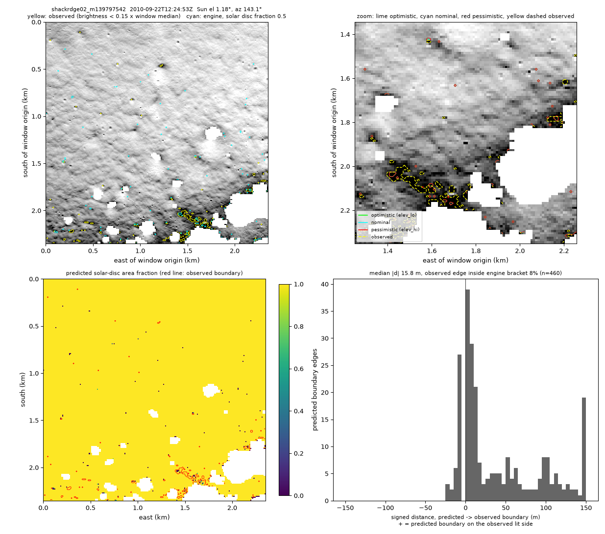 | 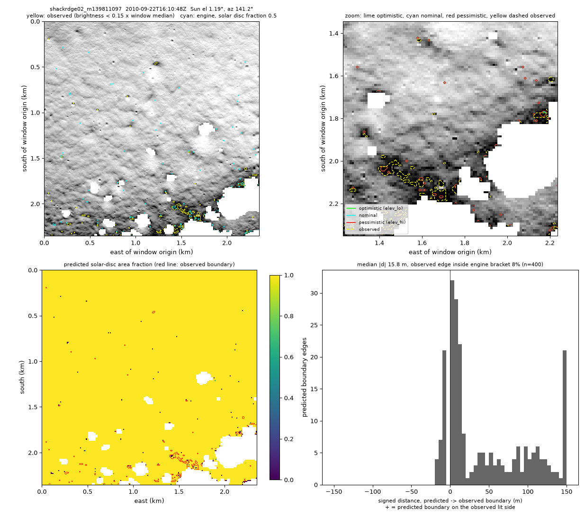 | 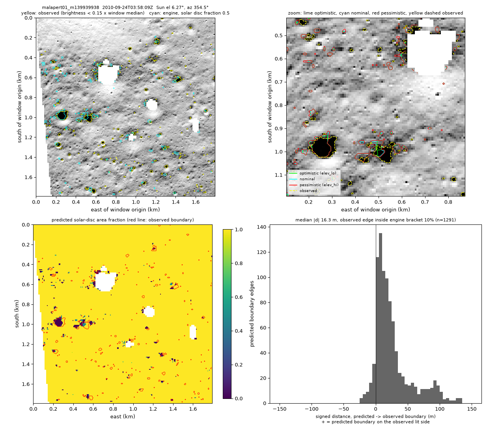 |
| 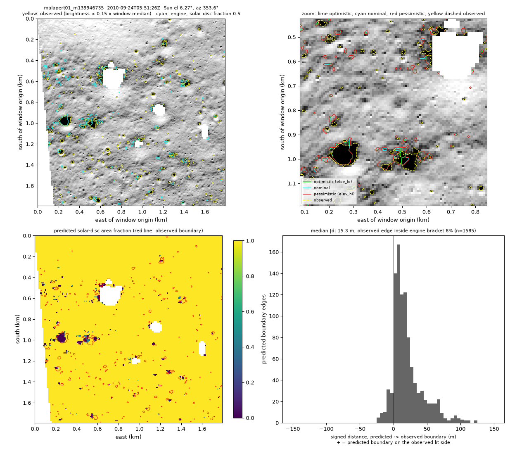 | 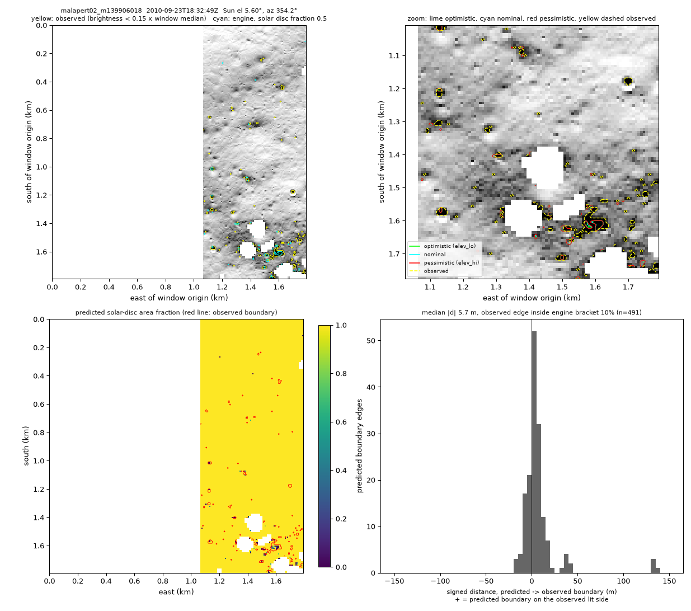 | 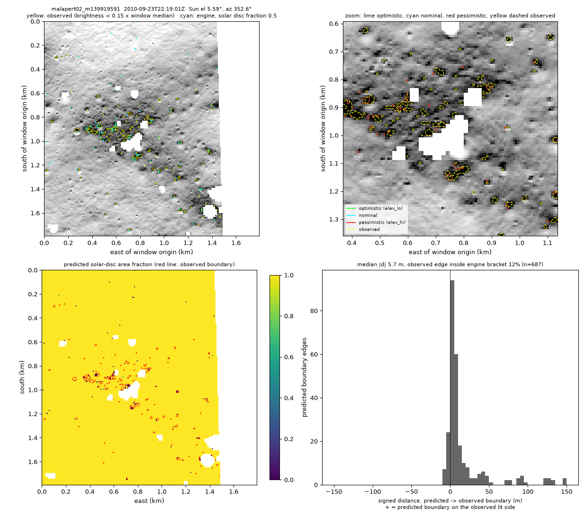 |
| 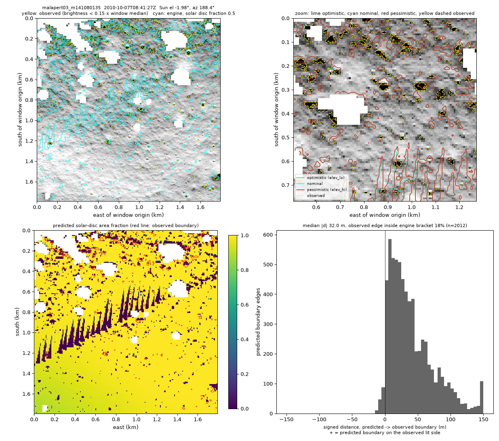 | 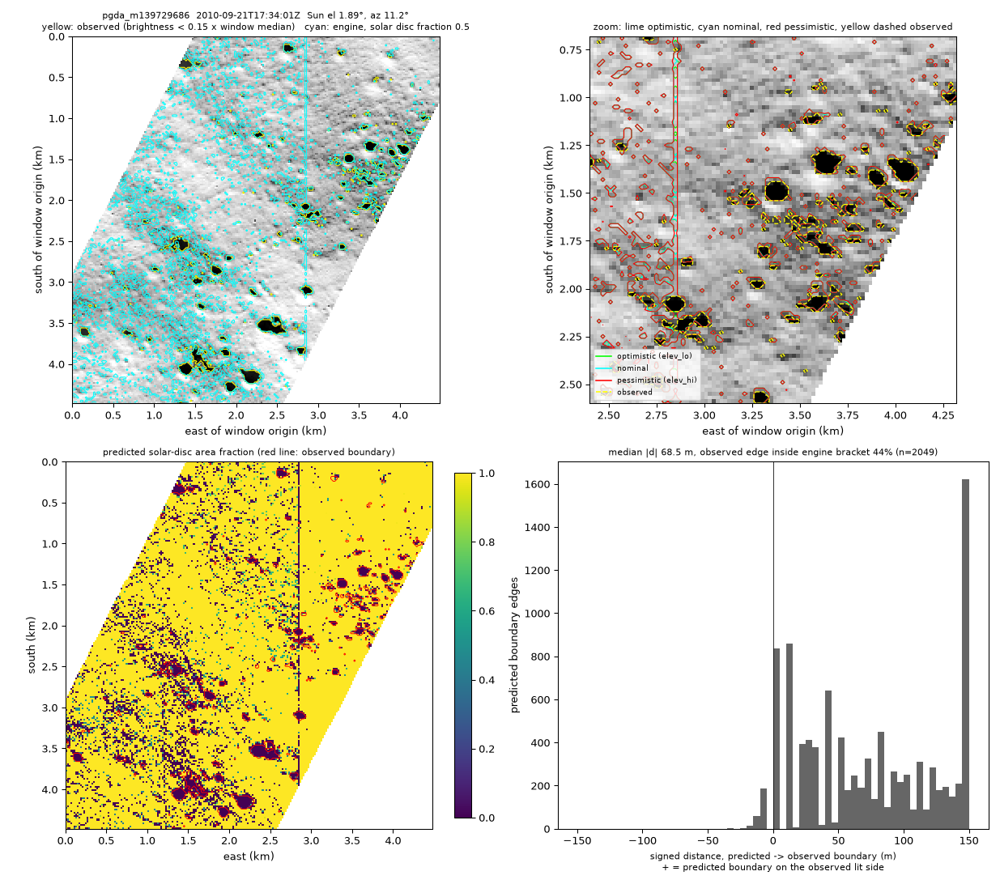 | 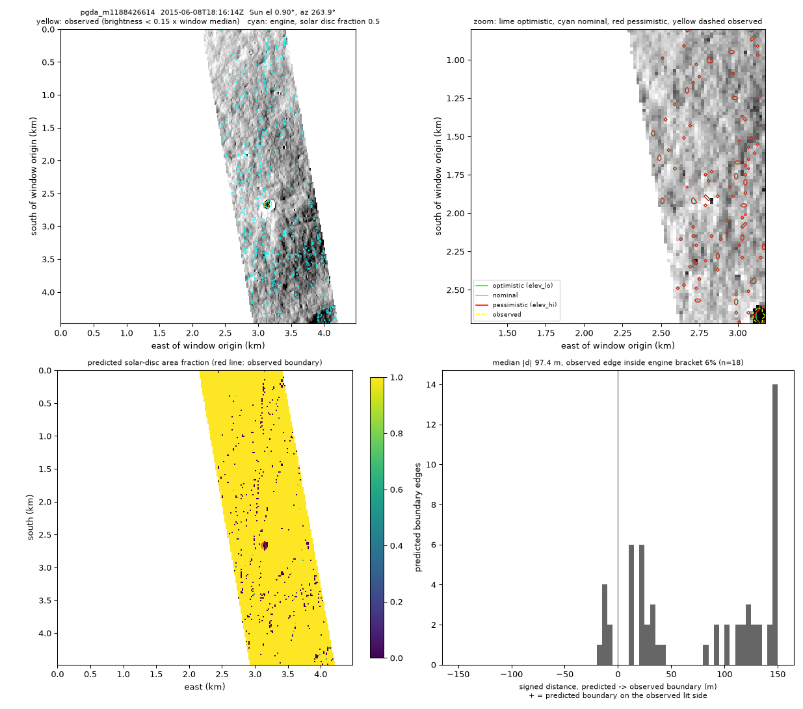 |
| 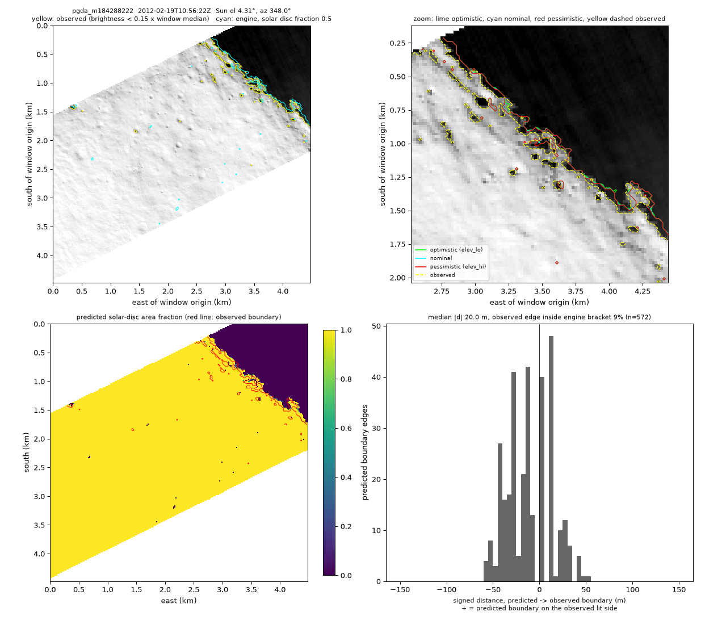 | | |

Summary and shift search: 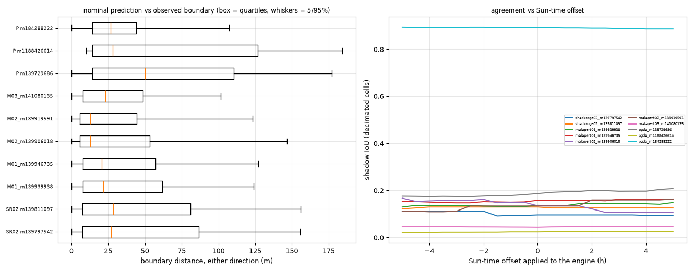 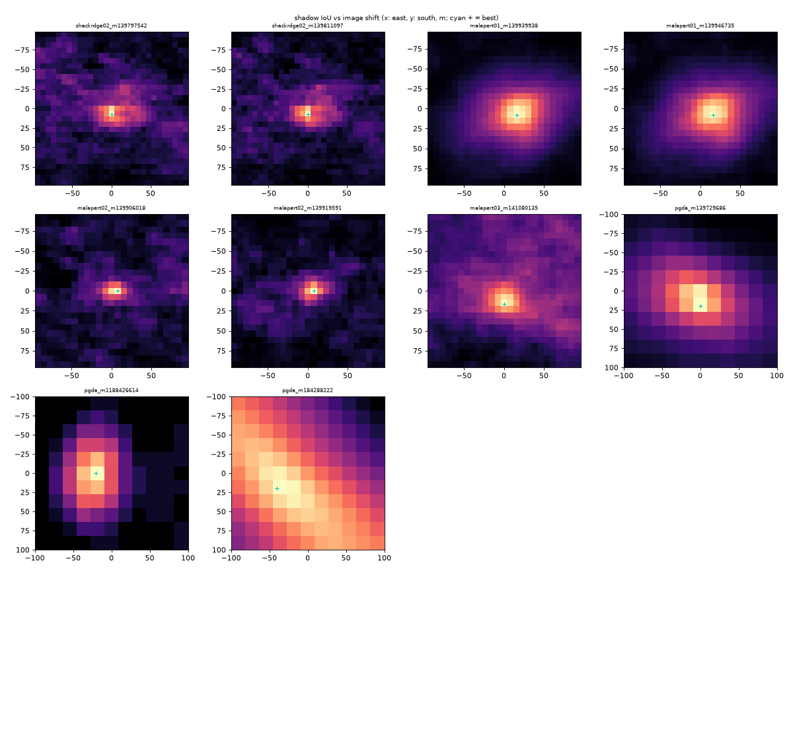

## Error-source experiments

**Registration (shift and gain).** Native-pixel shift of the image against the prediction within +-100 m with the threshold gain free (columns 2-5 below). IoU improves from 0.138 to 0.184 (Malapert01), 0.149 to 0.162, 0.098 to 0.118 (Malapert02), 0.050 to 0.062 (Malapert03) and 0.021 to 0.034, 0.898 to 0.933 (PGDA); Shackleton and `pgda_m139729686` do not move. The best offsets are 8-40 m, about 1-2 cells, consistent with the README-level DTM-to-LOLA offsets and with the hillshade offsets (+12/0, +8/0, 0/-7, 0/-16 m), but the shadow-IoU optimum and the hillshade optimum differ, so the registration is determined to roughly one cell at best. Registration of one or two cells explains little of the disagreement.

**Coarser terrain.** Replacing the stack by the 20 m or 60 m LOLA store (columns 6-7; opened by explicit store identifiers). On the corrected default stack a 20 m store **lowers** the Shackleton IoU (0.093/0.099 to 0.048/0.060), raises `pgda_m139729686` from 0.187 to 0.356 and `pgda_m1188426614` from 0.021 to 0.086, raises the two Malapert01 images slightly (0.138/0.143 to 0.155/0.151), lowers Malapert02 (0.149/0.098 to 0.054/0.017) and leaves Malapert03 at 0.050. The 60 m store is worse almost everywhere (it is better only for the three PGDA 20 m scenes: 0.187 to 0.278, 0.021 to 0.067, 0.898 to 0.915). Predicted shadow fraction per store (last table): at Shackleton the default stack predicts 0.28-0.30 % shadow against 0.52-0.63 % observed, the 20 m store 0.35 %, the 60 m store 0.12-0.13 %. The component-size sweep shows that at Shackleton both masks consist of cell-scale shadows: removing components of fewer than 4 cells takes the predicted shadow from 0.30 % to 0.04 % and the observed from 0.63 % to 0.38 %, and fewer than 16 cells leaves 0.00 % predicted and 0.19 % observed. The earlier [INFERENCE] that vertical noise of the PDS 5 m grid made isolated one-cell shadows (previous-default predicted shadow 3.3 %, falling to 0.99 % and 0.10 % under the same sweep) was not retested on the corrected stack. The previous default order cannot be recreated for an experiment: `TerrainStack` sorts any store list by its precedence key.

| scene | best image offset east / north (m) | IoU: unshifted -> best shift | threshold gain at best | median d at best (m) | in bracket at best | 20 m store: IoU / median d (m) | 60 m store: IoU / median d (m) |
|---|---|---|---|---|---|---|---|
| shackrdge02_m139797542 | +0 / -7 | 0.093 -> 0.100 | 0.63 | 13.9 | 15% | 0.048 / 24.2 | 0.006 / 13.9 |
| shackrdge02_m139811097 | +0 / -7 | 0.099 -> 0.110 | 0.74 | 13.9 | 16% | 0.060 / 23.1 | 0.007 / 13.9 |
| malapert01_m139939938 | +16 / -8 | 0.138 -> 0.184 | 0.99 | 16.0 | 9% | 0.155 / 8.0 | 0.026 / 8.0 |
| malapert01_m139946735 | +16 / -8 | 0.143 -> 0.180 | 0.85 | 15.7 | 10% | 0.151 / 5.7 | 0.028 / 5.7 |
| malapert02_m139906018 | +8 / +0 | 0.149 -> 0.162 | 0.74 | 4.0 | 19% | 0.054 / 35.4 | 0.000 / n/a |
| malapert02_m139919591 | +8 / +0 | 0.098 -> 0.118 | 0.63 | 8.0 | 21% | 0.017 / 27.4 | 0.000 / n/a |
| malapert03_m141080135 | +0 / -16 | 0.050 -> 0.062 | 2.80 | 10.6 | 15% | 0.050 / 27.4 | 0.004 / 4.0 |
| pgda_m139729686 | +0 / -20 | 0.187 -> 0.192 | 2.80 | 30.0 | 38% | 0.356 / 20.0 | 0.278 / 14.1 |
| pgda_m1188426614 | -20 / +0 | 0.021 -> 0.034 | 2.80 | 102.2 | 31% | 0.086 / 14.1 | 0.067 / 12.1 |
| pgda_m184288222 | -40 / -20 | 0.898 -> 0.933 | 0.63 | 10.0 | 27% | 0.909 / 20.0 | 0.915 / 14.1 |

**Brightness separation and time.** Independently of any threshold, brightness AUC (probability that a predicted-shadow cell is darker than a predicted-lit cell) is 0.59-0.99 (0.96-0.99 where predicted shadows are large, 0.59-0.70 for the Shackleton, Malapert03 and `pgda_m1188426614` scenes). The time scan moves the Sun by +-5 h in 30 min steps (decimated cells, per-cell time to the nearest 0.5 disc-fraction crossing): IoU barely changes (e.g. 0.044 to 0.066), the best offsets are scattered (-5.0 to +5.0 h, five on the scan edge, meaning no interior optimum) and at most 22 % of disagreeing cells are reconciled by a 5 h shift. **Sun-time error is not the cause.**

| scene | brightness AUC (pred shadow darker than pred lit) | pred-shadow / pred-lit median brightness (x window median) | pred-shadow cells below the observed threshold | best Sun-time offset (h) | IoU at 0 -> best | shadow-edge speed, median (m/h) | median d / speed (min) | disagreeing cells reconciled by a Sun-time shift of <= 1 h / <= 5 h |
|---|---|---|---|---|---|---|---|---|
| shackrdge02_m139797542 | 0.846 | 0.31 / 1.00 | 26% | -5.00* | 0.095 -> 0.111 | n/a | n/a | 0% / 3% |
| shackrdge02_m139811097 | 0.859 | 0.33 / 1.00 | 25% | -3.75 | 0.129 -> 0.129 | n/a | n/a | 0% / 0% |
| malapert01_m139939938 | 0.873 | 0.37 / 1.00 | 26% | 5.00* | 0.136 -> 0.148 | 23.9 | 40.8 | 3% / 11% |
| malapert01_m139946735 | 0.872 | 0.34 / 1.01 | 29% | 3.25 | 0.158 -> 0.162 | n/a | n/a | 0% / 9% |
| malapert02_m139906018 | 0.960 | 0.14 / 1.00 | 51% | -5.00* | 0.134 -> 0.167 | 13.0 | 26.1 | 2% / 7% |
| malapert02_m139919591 | 0.889 | 0.22 / 1.00 | 33% | 5.00* | 0.133 -> 0.163 | 10.5 | 32.3 | 3% / 13% |
| malapert03_m141080135 | 0.645 | 0.77 / 1.03 | 6% | 3.13 | 0.043 -> 0.047 | 14.2 | 135.7 | 7% / 20% |
| pgda_m139729686 | 0.765 | 0.61 / 1.06 | 20% | 5.00* | 0.186 -> 0.208 | 26.1 | 157.3 | 9% / 24% |
| pgda_m1188426614 | 0.592 | 0.95 / 1.00 | 2% | 4.25 | 0.023 -> 0.024 | 18.6 | 313.6 | 5% / 12% |
| pgda_m184288222 | 0.993 | 0.03 / 1.04 | 98% | -5.00* | 0.892 -> 0.894 | 19.5 | 61.6 | 2% / 6% |

**Hillshade registration (convention check).**

| scene | hillshade correlation at zero shift (label offsets) | one pixel west and north (placement implied by the label bounding box; ASU only) | at best shift | best image offset east / north (m) | peak minus median over shifts | shift step (m) |
|---|---|---|---|---|---|---|
| shackrdge02_m139797542 | 0.874 | 0.851 | 0.908 | +4 / -10 | 0.238 | 4 |
| shackrdge02_m139811097 | 0.874 | 0.850 | 0.909 | +4 / -10 | 0.234 | 4 |
| malapert01_m139939938 | 0.713 | 0.689 | 0.732 | +12 / +0 | 0.328 | 4 |
| malapert01_m139946735 | 0.717 | 0.694 | 0.736 | +12 / +0 | 0.324 | 4 |
| malapert02_m139906018 | 0.851 | 0.815 | 0.866 | +8 / +0 | 0.365 | 4 |
| malapert02_m139919591 | 0.869 | 0.841 | 0.885 | +8 / +0 | 0.253 | 4 |
| malapert03_m141080135 | 0.510 | 0.483 | 0.571 | +0 / -16 | 0.198 | 4 |
| pgda_m139729686 | 0.746 | n/a | 0.830 | +0 / -20 | 0.376 | 20 |
| pgda_m1188426614 | 0.488 | n/a | 0.488 | -20 / +0 | 0.185 | 20 |
| pgda_m184288222 | 0.933 | n/a | 0.958 | -20 / -20 | 0.052 | 20 |

**Size filter.** Removing connected components smaller than N cells in both masks:

| scene | min component (cells) | pred / obs shadow fraction | accuracy | IoU | median pred->obs (m) | median obs->pred (m) | observed edges inside bracket |
|---|---|---|---|---|---|---|---|
| shackrdge02_m139797542 | 1 | 0.30% / 0.63% | 0.992 | 0.093 | 15.8 | 28.5 | 8% |
| shackrdge02_m139797542 | 4 | 0.04% / 0.38% | 0.996 | 0.026 | 70.9 | 103.0 | 1% |
| shackrdge02_m139797542 | 16 | 0.00% / 0.19% | 0.998 | 0.000 | n/a | n/a | 0% |
| shackrdge02_m139797542 | 64 | 0.00% / 0.00% | 1.000 | nan | n/a | n/a | n/a% |
| shackrdge02_m139811097 | 1 | 0.28% / 0.52% | 0.993 | 0.099 | 15.8 | 30.3 | 8% |
| shackrdge02_m139811097 | 4 | 0.05% / 0.31% | 0.997 | 0.057 | 7.4 | 86.6 | 3% |
| shackrdge02_m139811097 | 16 | 0.00% / 0.11% | 0.999 | 0.000 | n/a | n/a | 0% |
| shackrdge02_m139811097 | 64 | 0.00% / 0.00% | 1.000 | nan | n/a | n/a | n/a% |
| malapert01_m139939938 | 1 | 1.27% / 1.48% | 0.979 | 0.138 | 16.3 | 28.5 | 10% |
| malapert01_m139939938 | 4 | 0.96% / 0.98% | 0.987 | 0.185 | 20.6 | 16.3 | 12% |
| malapert01_m139939938 | 16 | 0.57% / 0.58% | 0.993 | 0.239 | 15.7 | 10.6 | 17% |
| malapert01_m139939938 | 64 | 0.21% / 0.25% | 0.999 | 0.593 | 5.7 | 8.0 | 27% |
| malapert01_m139946735 | 1 | 1.35% / 1.75% | 0.977 | 0.143 | 15.3 | 28.5 | 8% |
| malapert01_m139946735 | 4 | 1.04% / 1.13% | 0.985 | 0.190 | 16.3 | 16.3 | 12% |
| malapert01_m139946735 | 16 | 0.58% / 0.60% | 0.993 | 0.248 | 12.5 | 8.0 | 16% |
| malapert01_m139946735 | 64 | 0.21% / 0.40% | 0.997 | 0.403 | 8.0 | 10.6 | 10% |
| malapert02_m139906018 | 1 | 0.43% / 1.26% | 0.988 | 0.149 | 5.7 | 25.1 | 10% |
| malapert02_m139906018 | 4 | 0.20% / 0.71% | 0.993 | 0.154 | 5.7 | 28.4 | 11% |
| malapert02_m139906018 | 16 | 0.00% / 0.23% | 0.998 | 0.000 | n/a | n/a | 0% |
| malapert02_m139906018 | 64 | 0.00% / 0.00% | 1.000 | nan | n/a | n/a | n/a% |
| malapert02_m139919591 | 1 | 0.29% / 0.79% | 0.991 | 0.098 | 5.7 | 16.3 | 12% |
| malapert02_m139919591 | 4 | 0.13% / 0.48% | 0.995 | 0.118 | 4.0 | 35.4 | 11% |
| malapert02_m139919591 | 16 | 0.00% / 0.15% | 0.999 | 0.000 | n/a | n/a | 0% |
| malapert02_m139919591 | 64 | 0.00% / 0.00% | 1.000 | nan | n/a | n/a | n/a% |
| malapert03_m141080135 | 1 | 11.27% / 2.03% | 0.880 | 0.050 | 32.0 | 8.0 | 18% |
| malapert03_m141080135 | 4 | 9.69% / 1.12% | 0.900 | 0.040 | 60.6 | 7.3 | 19% |
| malapert03_m141080135 | 16 | 6.45% / 0.22% | 0.934 | 0.009 | 141.5 | 32.9 | 3% |
| malapert03_m141080135 | 64 | 4.15% / 0.00% | 0.958 | 0.000 | n/a | n/a | n/a% |
| pgda_m139729686 | 1 | 15.30% / 3.84% | 0.869 | 0.187 | 68.5 | 10.0 | 44% |
| pgda_m139729686 | 4 | 9.42% / 3.26% | 0.927 | 0.268 | 40.6 | 10.0 | 42% |
| pgda_m139729686 | 16 | 5.65% / 2.36% | 0.962 | 0.359 | 26.5 | 10.0 | 42% |
| pgda_m139729686 | 64 | 2.76% / 0.91% | 0.980 | 0.291 | 32.4 | 12.1 | 34% |
| pgda_m1188426614 | 1 | 2.94% / 0.10% | 0.971 | 0.021 | 97.4 | 14.1 | 6% |
| pgda_m1188426614 | 4 | 0.42% / 0.10% | 0.996 | 0.138 | 14.1 | 14.1 | 6% |
| pgda_m1188426614 | 16 | 0.13% / 0.00% | 0.999 | 0.000 | n/a | n/a | n/a% |
| pgda_m1188426614 | 64 | 0.00% / 0.00% | 1.000 | nan | n/a | n/a | n/a% |
| pgda_m184288222 | 1 | 13.69% / 14.74% | 0.985 | 0.898 | 20.0 | 33.5 | 9% |
| pgda_m184288222 | 4 | 13.59% / 14.61% | 0.987 | 0.910 | 20.0 | 38.3 | 8% |
| pgda_m184288222 | 16 | 13.49% / 14.35% | 0.990 | 0.928 | 26.5 | 32.4 | 8% |
| pgda_m184288222 | 64 | 13.49% / 14.29% | 0.990 | 0.931 | 26.5 | 32.4 | 9% |

Large shadows agree much better (Malapert01 IoU 0.138 to 0.593 at >= 64 cells, median boundary 5.7 m); at 16 and 64 cells the Shackleton and some Malapert scenes have no shadows left in one or both masks, so IoU is 0 or undefined there (shown as 0.000 or nan, not dropped).

| scene | observed shadow | engine default stack | 20 m store | 60 m store |
|---|---|---|---|---|
| shackrdge02_m139797542 | 0.63% | 0.30% | 0.35% | 0.12% |
| shackrdge02_m139811097 | 0.52% | 0.28% | 0.35% | 0.13% |
| malapert01_m139939938 | 1.48% | 1.27% | 0.55% | 0.08% |
| malapert01_m139946735 | 1.75% | 1.35% | 0.57% | 0.08% |
| malapert02_m139906018 | 1.26% | 0.43% | 0.63% | 0.01% |
| malapert02_m139919591 | 0.79% | 0.29% | 0.41% | 0.00% |
| malapert03_m141080135 | 2.03% | 11.27% | 3.85% | 0.05% |
| pgda_m139729686 | 3.84% | 15.30% | 6.41% | 1.73% |
| pgda_m1188426614 | 0.10% | 2.94% | 0.96% | 0.01% |
| pgda_m184288222 | 14.74% | 13.69% | 13.65% | 13.62% |

## Threshold-free comparison: predicted brightness

The shadow metrics above depend on a brightness threshold (0.15 x window median), and at grazing incidence a lit slope facing away from the Sun is dark in the image too. The photometry check therefore compares **brightness** directly, with no threshold, on the same cells and the cached disc fractions.

* **Prediction.** B = f_vis x LS, with f_vis the engine's visible solar-disc fraction (0 in cast shadow, 1 fully lit) and LS = mu0 / (mu0 + mu) the Lommel-Seeliger law. mu0 = cos(incidence) = n.s from the surface normal of the terrain store (central differences of the stack heights on the 8-20 m cell grid, the Sun direction at each cell at the exposure mid-time), clipped at 0, so a slope facing away from the Sun is dark. Lommel-Seeliger was chosen because it is the standard first-order single-scattering law for a dark regolith, it is smooth as mu0 tends to 0 (incidence here is 84-92 deg), and it has no fitted parameter. Lambert (B = f_vis x mu0) is reported beside it. No phase function is used: the phase angle is not known per pixel.
* **Viewing geometry: what the labels give and what is assumed.** The orthoimage labels carry no per-pixel viewing direction. The ODE index gives only the scene-centre emission angle (manifest `ode_edr.emission_angle_deg`): 1.1-1.7 deg for eight scenes and **20.7 deg for `shackrdge02_m139811097` and `malapert01_m139939938`**; the viewing azimuth is not given. The viewer is assumed along the local vertical (mu = cos of the slope). The other extreme, viewer along every surface normal (mu = 1), is tabulated: it changes the all-cell correlation by at most 0.005 in nine scenes and by 0.011 in Malapert03, so the result is not sensitive to this assumption at these incidences, including for the two 20.7 deg slews (their viewing azimuth is untested beyond this bound).
* **Correlation.** Pearson and Spearman between image brightness and B (scale free; the I/F or DN calibration is not used), over all valid cells and over the cells predicted lit by the cast-shadow test only (f_vis >= 0.5 and B > 0). 'Slope shading only' sets f_vis = 1 everywhere and shows how much of the correlation is the sun-facing slope rather than cast shadow.
* **Dark by slope.** The model's own dark rule is the image rule applied to the model: B < 0.15 x the window median of B. An observed-shadow cell that the cast-shadow test calls lit but that is predicted dark by this rule is a slope-dark cell, an agreement in brightness, not a miss. The confusion table is shown both ways.
* **Residual maps** (image minus prediction in window-median units, with the classes grey lit/lit, black shadow/shadow, green observed shadow predicted dark by slope, red observed shadow predicted bright, blue predicted cast shadow while the image is lit): `img/imagery_photometry_<scene>.png`.

| scene | cells (predicted lit) | all cells: Pearson / Spearman | predicted-lit cells: Pearson / Spearman | Lambert instead of Lommel-Seeliger, all cells (Pearson) | viewer along the normal (mu = 1), all cells (Pearson) | slope shading only, no cast shadow, all cells / lit cells (Pearson) |
|---|---|---|---|---|---|---|
| shackrdge02_m139797542 | 47110 (46968) | 0.865 / 0.844 | 0.869 / 0.844 | 0.870 | 0.866 | 0.870 / 0.869 |
| shackrdge02_m139811097 | 47110 (46973) | 0.867 / 0.839 | 0.870 / 0.839 | 0.871 | 0.867 | 0.871 / 0.870 |
| malapert01_m139939938 | 47240 (46637) | 0.710 / 0.683 | 0.707 / 0.677 | 0.713 | 0.709 | 0.711 / 0.707 |
| malapert01_m139946735 | 47240 (46597) | 0.713 / 0.684 | 0.711 / 0.677 | 0.717 | 0.713 | 0.714 / 0.711 |
| malapert02_m139906018 | 19636 (19551) | 0.850 / 0.853 | 0.848 / 0.851 | 0.850 | 0.849 | 0.851 / 0.848 |
| malapert02_m139919591 | 40041 (39924) | 0.864 / 0.865 | 0.867 / 0.865 | 0.867 | 0.864 | 0.868 / 0.867 |
| malapert03_m141080135 | 46144 (40884) | 0.466 / 0.525 | 0.502 / 0.562 | 0.466 | 0.477 | 0.517 / 0.518 |
| pgda_m139729686 | 36076 (30475) | 0.696 / 0.707 | 0.738 / 0.730 | 0.706 | 0.695 | 0.745 / 0.741 |
| pgda_m1188426614 | 14340 (13915) | 0.413 / 0.463 | 0.485 / 0.475 | 0.435 | 0.411 | 0.482 / 0.485 |
| pgda_m184288222 | 30887 (26647) | 0.934 / 0.830 | 0.801 / 0.741 | 0.932 | 0.934 | 0.936 / 0.801 |

Confusion both ways, and the observed-shadow cells predicted lit that are dark by slope:

| scene | shadow = cast shadow only: TP / FP / FN / TN, IoU | shadow = predicted brightness < 0.15 x window median: TP / FP / FN / TN, IoU | observed shadow and predicted lit (cast shadow test) | of which predicted dark by slope (agreement) |
|---|---|---|---|---|
| shackrdge02_m139797542 | 37 / 103 / 258 / 46712, 0.093 | 118 / 235 / 177 / 46580, 0.223 | 258 | 81 (31%) |
| shackrdge02_m139811097 | 34 / 100 / 211 / 46765, 0.099 | 109 / 263 / 136 / 46602, 0.215 | 211 | 75 (36%) |
| malapert01_m139939938 | 158 / 442 / 542 / 46098, 0.138 | 176 / 520 / 524 / 46020, 0.144 | 542 | 21 (4%) |
| malapert01_m139946735 | 183 / 456 / 644 / 45957, 0.143 | 199 / 515 / 628 / 45898, 0.148 | 644 | 22 (3%) |
| malapert02_m139906018 | 43 / 41 / 204 / 19348, 0.149 | 64 / 75 / 183 / 19314, 0.199 | 204 | 21 (10%) |
| malapert02_m139919591 | 39 / 78 / 279 / 39645, 0.098 | 83 / 128 / 235 / 39595, 0.186 | 279 | 44 (16%) |
| malapert03_m141080135 | 295 / 4907 / 643 / 40299, 0.050 | 317 / 4942 / 621 / 40264, 0.054 | 643 | 27 (4%) |
| pgda_m139729686 | 1089 / 4432 / 297 / 30258, 0.187 | 1103 / 4357 / 283 / 30333, 0.192 | 297 | 31 (10%) |
| pgda_m1188426614 | 9 / 413 / 5 / 13913, 0.021 | 11 / 406 / 3 / 13920, 0.026 | 5 | 2 (40%) |
| pgda_m184288222 | 4154 / 74 / 399 / 26260, 0.898 | 4264 / 108 / 289 / 26226, 0.915 | 399 | 110 (28%) |
| all scenes | | | 3482 | 434 (12%) |

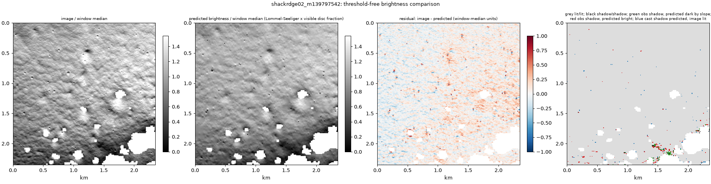

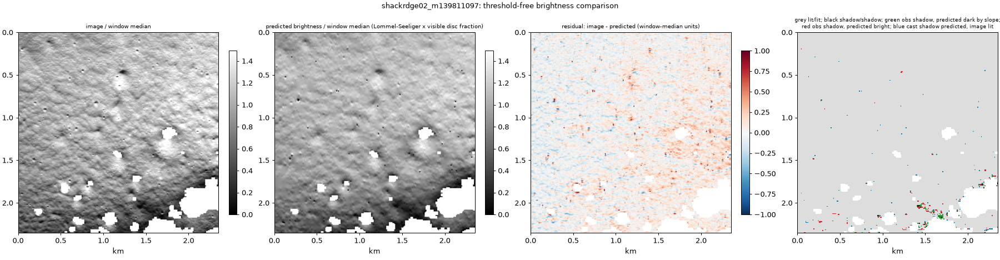

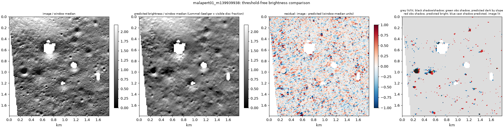

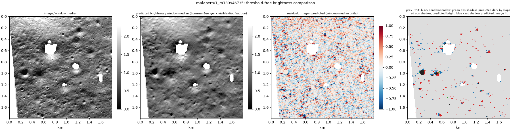

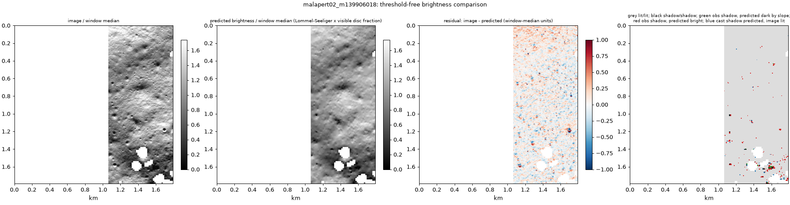

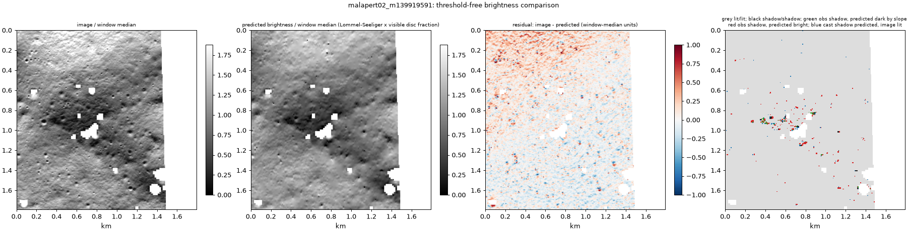

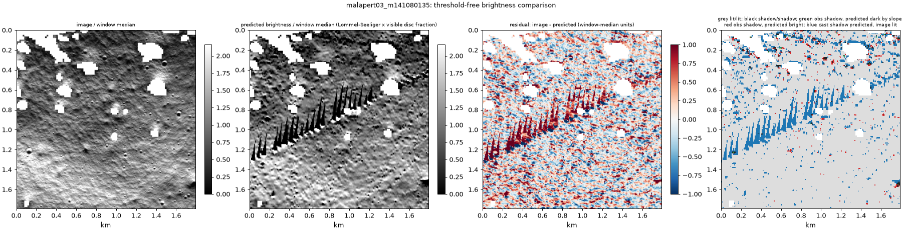

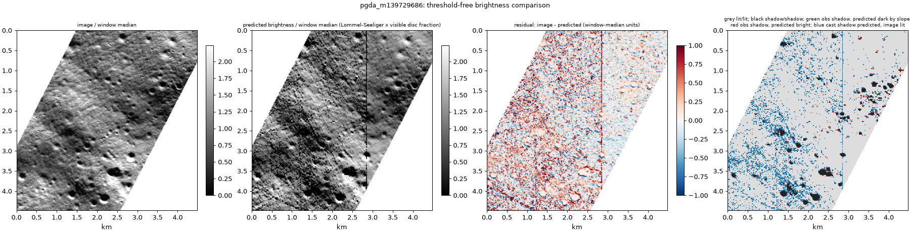

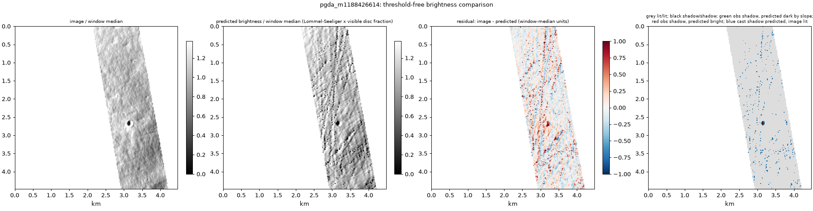

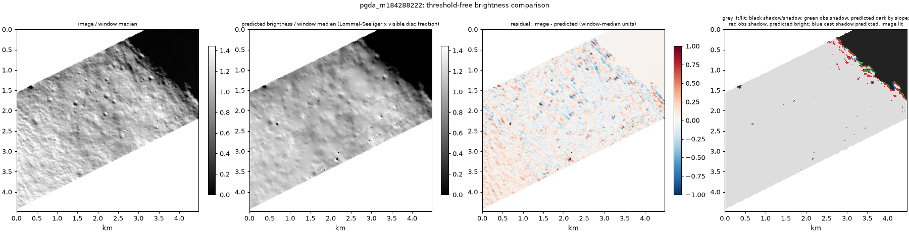

**What the threshold-free comparison shows.**

* Brightness correlation over all cells is 0.41 to 0.93 (Pearson; 0.46 to 0.87 Spearman): high where the terrain is well resolved (Malapert02 0.85-0.86, `pgda_m184288222` 0.93), low for Malapert03 (0.47, Sun below the reference horizon) and `pgda_m1188426614` (0.41).
* **The cast-shadow term adds no correlation.** Slope shading alone (f_vis = 1 everywhere) correlates as well or better than the full prediction in every scene (0.711-0.936 against 0.710-0.934; at Shackleton 0.87 against 0.77). At 8-20 m cells the image brightness is dominated by which way the slope faces; the engine's cast shadows are a small fraction of the cells (0.3-17 %). At Shackleton the predicted cast shadows lower the correlation because many are isolated cells where the image is lit (blue cells in the residual maps).
* Lommel-Seeliger is not better than Lambert in correlation here (Lambert is equal or higher by 0.000-0.022 in nine scenes, 0.002 lower in one); at incidence 84-92 deg the two laws are nearly identical.
* **Slope-dark cells.** Of the 3,385 observed-shadow cells the cast-shadow test calls lit, **433 (13 %)** are predicted dark by slope (3-40 % per scene; 36-39 % at Shackleton, 28 % for `pgda_m184288222`, 3-4 % for Malapert01 and 03). They are agreement in brightness. The other 87 % are observed dark and predicted bright: not explained by slope.
* Counting them as agreement (the brightness-rule confusion) raises the shadow IoU modestly: Shackleton 0.093/0.099 to 0.223/0.215, Malapert02 0.149/0.098 to 0.199/0.186, `pgda_m184288222` 0.898 to 0.915, other scenes by 0.004-0.006. It does not change the verdict: 7 of 10 scenes are still below 0.2 with the brightness rule (9 of 10 with cast shadow alone).

## Rerun on the corrected default stack

`TerrainStack.open()` now orders equal-pixel-size stores by stated error (PGDA 5 m tiles before `lola_875s_5m`). All ten scenes were rerun on it; the previous default (PDS 5 m grid first) is kept in the old columns (`data/validation/imagery/cache/old_default_stack/`).

| scene | first stores, new default | pred shadow old / new (obs) | IoU old / new | median d pred to obs (m) old / new | obs edges in numerical bracket old / new | TP / FP / FN / TN old | TP / FP / FN / TN new |
|---|---|---|---|---|---|---|---|
| shackrdge02_m139797542 | pgda78_site04_5m, pgda78_site11_5m | 3.28% / 0.30% (0.63%) | 0.038 / 0.093 | 80.9 / 15.8 | 19% / 8% | 67 / 1478 / 228 / 45337 | 37 / 103 / 258 / 46712 |
| shackrdge02_m139811097 | pgda78_site04_5m, pgda78_site11_5m | 3.10% / 0.28% (0.52%) | 0.040 / 0.099 | 80.3 / 15.8 | 19% / 8% | 65 / 1397 / 180 / 45468 | 34 / 100 / 211 / 46765 |
| malapert01_m139939938 | pgda78_site04_5m, pgda78_site11_5m | 1.27% / 1.27% (1.48%) | 0.138 / 0.138 | 16.3 / 16.3 | 10% / 10% | 158 / 442 / 542 / 46098 | 158 / 442 / 542 / 46098 |
| malapert01_m139946735 | pgda78_site04_5m, pgda78_site11_5m | 1.35% / 1.35% (1.75%) | 0.143 / 0.143 | 15.3 / 15.3 | 8% / 8% | 183 / 456 / 644 / 45957 | 183 / 456 / 644 / 45957 |
| malapert02_m139906018 | pgda78_site04_5m, pgda78_site11_5m | 0.43% / 0.43% (1.26%) | 0.149 / 0.149 | 5.7 / 5.7 | 10% / 10% | 43 / 41 / 204 / 19348 | 43 / 41 / 204 / 19348 |
| malapert02_m139919591 | pgda78_site04_5m, pgda78_site11_5m | 0.29% / 0.29% (0.79%) | 0.098 / 0.098 | 5.7 / 5.7 | 12% / 12% | 39 / 78 / 279 / 39645 | 39 / 78 / 279 / 39645 |
| malapert03_m141080135 | pgda78_site04_5m, pgda78_site11_5m | 11.27% / 11.27% (2.03%) | 0.050 / 0.050 | 32.0 / 32.0 | 18% / 18% | 295 / 4907 / 643 / 40299 | 295 / 4907 / 643 / 40299 |
| pgda_m139729686 | pgda78_site04_5m, pgda78_site11_5m | 17.29% / 15.30% (3.84%) | 0.173 / 0.187 | 70.8 / 68.5 | 43% / 44% | 1125 / 5114 / 261 / 29576 | 1089 / 4432 / 297 / 30258 |
| pgda_m1188426614 | pgda78_site04_5m, pgda78_site11_5m | 2.94% / 2.94% (0.10%) | 0.021 / 0.021 | 97.4 / 97.4 | 6% / 6% | 9 / 413 / 5 / 13913 | 9 / 413 / 5 / 13913 |
| pgda_m184288222 | pgda78_site04_5m, pgda78_site11_5m | 13.69% / 13.69% (14.74%) | 0.898 / 0.898 | 20.0 / 20.0 | 9% / 9% | 4154 / 74 / 399 / 26260 | 4154 / 74 / 399 / 26260 |
| all scenes | | | | | | 6138 / 14400 / 3385 / 351901 | 6041 / 11046 / 3482 / 355255 |

Reading: the change moves only the Shackleton scenes (where the PGDA 5 m tiles overlap the window) and `pgda_m139729686`; the Malapert, `pgda_m1188426614` and `pgda_m184288222` windows do not draw on the tiles and are identical. At Shackleton the over-prediction of the old default (3.3 % shadow) is replaced by an under-prediction (0.3 %): 258 of 295 and 211 of 245 observed shadow cells are predicted lit, so the improvement in IoU (0.04 to 0.09-0.10) and in median boundary distance (80 m to 16 m) comes largely from predicting far fewer false shadow cells, not from finding the observed ones. The share of observed boundary cells inside the numerical bracket falls from 19 % to 8 %.

## The bracket a planner sees: horizon widened by the terrain error budget

The numerical bracket (`elev_lo`/`elev_hi`) above is only the tolerance of the horizon search. The planner-visible bracket widens it with the terrain error budget: per sampled azimuth, the budget of the store that supplies the height at the limiting blocker (`TerrainStack.error_at` at the blocker point, as `scenario.horizons.TerrainProvider.error_budget` does for a whole profile; PGDA per-pixel sigma_z where available, the registry figure otherwise), converted to a horizon-elevation sigma with the formula of `visibility.uncertainty.horizon_sigma_deg` (vertical, along-ray and across-ray terms), then `elev_lo - k sigma` and `elev_hi + k sigma`, k = 1, 2, 3 (as `widen_horizon`). The widening is computed per cell on the four azimuth samples around the Sun, with the azimuth gradient from the two samples that have both neighbours and the end samples taking their neighbour's value, so it is the library formula on a subset of azimuths, not a call of `widen_horizon` on full 720-azimuth profiles (tests compare the two on a synthetic full profile). Coverage is computed as for the numerical bracket: share of observed boundary cells inside the band (optimistic lit and pessimistic shadow), share of disagreeing cells covered, band width as a share of cells, and in time at each scene's edge speed (half-widths of the band to the optimistic and the pessimistic boundary).

| scene | k | observed boundary cells inside the band | disagreeing cells covered | band width (% of cells) | band half-width to optimistic / pessimistic boundary, median (m) | same in time (min) at the scene's edge speed |
|---|---|---|---|---|---|---|
| shackrdge02_m139797542 | 1 | 34% of 460 | 46% of 361 | 1.0 | 118.7 / 0.0 | n/a |
| shackrdge02_m139797542 | 2 | 39% of 460 | 55% of 361 | 1.2 | 350.7 / 0.0 | n/a |
| shackrdge02_m139797542 | 3 | 43% of 460 | 61% of 361 | 1.3 | 438.9 / 0.0 | n/a |
| shackrdge02_m139811097 | 1 | 35% of 400 | 48% of 311 | 0.9 | 189.6 / 0.0 | n/a |
| shackrdge02_m139811097 | 2 | 40% of 400 | 56% of 311 | 1.0 | 296.3 / 0.0 | n/a |
| shackrdge02_m139811097 | 3 | 43% of 400 | 61% of 311 | 1.1 | 402.1 / 0.0 | n/a |
| malapert01_m139939938 | 1 | 74% of 1291 | 81% of 984 | 32.1 | 526.5 / 9.7 | 1320 / 24 |
| malapert01_m139939938 | 2 | 81% of 1291 | 88% of 984 | 39.9 | n/a / 12.9 | n/a / 32 |
| malapert01_m139939938 | 3 | 86% of 1291 | 91% of 984 | 44.5 | n/a / 17.6 | n/a / 44 |
| malapert01_m139946735 | 1 | 71% of 1585 | 78% of 1100 | 32.4 | 519.2 / 9.7 | n/a |
| malapert01_m139946735 | 2 | 80% of 1585 | 86% of 1100 | 40.2 | n/a / 13.9 | n/a |
| malapert01_m139946735 | 3 | 84% of 1585 | 90% of 1100 | 44.8 | n/a / 17.6 | n/a |
| malapert02_m139906018 | 1 | 58% of 491 | 57% of 245 | 11.2 | 95.1 / 4.0 | 439 / 18 |
| malapert02_m139906018 | 2 | 67% of 491 | 66% of 245 | 14.0 | 101.3 / 4.0 | 468 / 18 |
| malapert02_m139906018 | 3 | 72% of 491 | 73% of 245 | 16.0 | 151.7 / 5.7 | 701 / 26 |
| malapert02_m139919591 | 1 | 64% of 687 | 62% of 357 | 9.7 | 79.3 / 4.0 | 453 / 23 |
| malapert02_m139919591 | 2 | 72% of 687 | 72% of 357 | 12.4 | 104.3 / 4.0 | 596 / 23 |
| malapert02_m139919591 | 3 | 77% of 687 | 78% of 357 | 14.2 | 232.6 / 5.7 | 1330 / 32 |
| malapert03_m141080135 | 1 | 36% of 2012 | 79% of 5550 | 11.4 | 97.3 / 0.0 | 412 / 0 |
| malapert03_m141080135 | 2 | 36% of 2012 | 85% of 5550 | 12.1 | 192.2 / 0.0 | 815 / 0 |
| malapert03_m141080135 | 3 | 36% of 2012 | 87% of 5550 | 12.4 | 278.1 / 0.0 | 1179 / 0 |
| pgda_m139729686 | 1 | 90% of 2049 | 94% of 4729 | 27.4 | 153.0 / 0.0 | 351 / 0 |
| pgda_m139729686 | 2 | 95% of 2049 | 97% of 4729 | 29.3 | 303.6 / 0.0 | 697 / 0 |
| pgda_m139729686 | 3 | 96% of 2049 | 98% of 4729 | 30.2 | 740.3 / 0.0 | 1700 / 0 |
| pgda_m1188426614 | 1 | 78% of 18 | 98% of 418 | 5.4 | 303.4 / 0.0 | 977 / 0 |
| pgda_m1188426614 | 2 | 89% of 18 | 100% of 418 | 5.5 | n/a / 0.0 | n/a / 0 |
| pgda_m1188426614 | 3 | 89% of 18 | 100% of 418 | 5.5 | n/a / 0.0 | n/a / 0 |
| pgda_m184288222 | 1 | 58% of 572 | 69% of 473 | 8.6 | 96.6 / 20.0 | 298 / 62 |
| pgda_m184288222 | 2 | 62% of 572 | 72% of 473 | 9.9 | 140.0 / 25.3 | 431 / 78 |
| pgda_m184288222 | 3 | 63% of 572 | 74% of 473 | 10.7 | 168.2 / 26.5 | 518 / 82 |
| all scenes | 1 | 62.9% of 9565 | 81.8% of 14528 | 14.9 | | |
| all scenes | 2 | 68.2% of 9565 | 87.0% of 14528 | 17.7 | | |
| all scenes | 3 | 70.6% of 9565 | 89.4% of 14528 | 19.4 | | |

Reading (all numbers from the table; `n/a` = no shadow boundary of that kind exists, or the scene has no measured edge speed):

* **k = 2 covers a lot only where it is wide.** Pooled: 68.2 % of observed boundary cells and 87.0 % of disagreeing cells with a band of 17.7 % of the cells. A comparison against the share of cells that are shadow in a scene (0.1-14.7 %) shows the band is much larger than the shadow it brackets. Malapert01 reaches 80-81 % of edges and 86-88 % of disagreeing cells with a band of 40 % of the scene; `pgda_m139729686` 95 % and 97 % with 29 %.
* **It covers little where the error is a missing shadow.** Shackleton: 39-40 % of boundary cells and 55-56 % of disagreeing cells at k = 2 with a band of 1.0-1.2 % of cells (at k = 3 43 % and 61 %); the observed shadows are mostly not in the predicted-shadow neighbourhood at all (the engine predicts 0.3 % shadow). Malapert03: 36 % at every k, because those edges lie where even the pessimistic horizon is lit.
* **Time width.** At the scene's measured edge speed the pessimistic half-width is 0-82 min (at k = 2: 0 at pgda_m139729686 and Malapert03, 32 min Malapert01, 18-23 min Malapert02, 78 min `pgda_m184288222`); the optimistic half-width is 298-1,700 min (5-28 h) where defined, and undefined (no optimistic boundary) at k = 2, 3 in the Malapert01 images and `pgda_m1188426614`.
* A band wider than the observed shadow, with one side essentially unbounded, is what "cover the disagreement" costs here: the budget (a metre or a few metres of height) is of the order of the 1-3 m DTM-to-LOLA differences, but the geometry of a 1-6 deg Sun turns metres of height into hundreds of metres of boundary.
* Sigma is computed per cell on the four azimuth samples around the Sun with the library formula (tested against `horizon_sigma_deg`); the azimuth gradient of the two end samples is taken from their neighbour, so sigma differs from a full-profile `widen_horizon` call by that approximation.

## Implied uncertainty in sunrise and sunset time

A boundary that is displaced by d metres moves in time by d / v, where v is the speed at which the shadow edge crosses the ground (median of d/tau over cells near the nominal boundary, with tau the time to the nearest 0.5 crossing; measured 5-25 m/h). Dividing each scene's median predicted-to-observed displacement by its edge speed gives (table "median d / speed"): 26-41 min for the Malapert scenes with a measurable speed (5.7-16 m displacement, Sun 5.6-6.3 deg), 62 min for pgda_m184288222, 136 min for Malapert03, 157 min for pgda_m139729686 (68.5 m displacement) and 314 min for pgda_m1188426614 (97 m). For Shackleton the corrected-stack rerun has no measurable edge speed (too few predicted-shadow edges); on the previous stack it was 5-9 m/h with an 80 m displacement, 546-997 min (9-17 h), and the corrected displacement is 16 m, which at those speeds would be about 2-3 h ([INFERENCE]: speed not re-measured). The conversion is approximate (one speed per scene, edge speed varies by an order of magnitude along a boundary), and `malapert01_m139946735` has no measurable speed. **The numerical lo/hi bracket does not cover it**: its optimistic-to-pessimistic band is at most a cell wide (nominal-to-bound median 0 m), against displacements of 6-97 m. The terrain-error bracket of the section above is the planner-visible one; it covers 87 % of disagreeing cells at k = 2 but its optimistic side is hours wide. A planner should therefore not read the lo/hi bracket as the uncertainty of a sunrise or sunset time computed on a 5-10 m store; on the evidence here a defensible stated uncertainty is the observed one: tens of minutes to a few hours at Sun elevations above 1 deg, and more at 1 deg.

## What is and is not validated

Validated: the engine's solar geometry at the image instant places the shadow-versus-lit pattern correctly for large shadows (brightness AUC up to 0.99, IoU 0.90 on `pgda_m184288222`, median boundary 5.7-8 m for the largest Malapert shadows); time error is excluded as the main cause (zero or small sensitivity to +-5 h); registration conventions were checked against the terrain.

Not validated or failing: Shackleton predictions are poor (IoU 0.093/0.099 on the corrected stack, with 0.30 %/0.28 % predicted against 0.63 %/0.52 % observed and 37 of 295 observed shadow cells found; on the previous stack IoU 0.04 with 3.3 % predicted); `pgda_m139729686` over-predicts shadow 4 times (15.3 % against 3.8 %); `pgda_m1188426614` IoU 0.021; Malapert01/02 IoU 0.10-0.15 at cell scale; Malapert03 (Sun at -2.0 deg) is predicted 11.3 % shadow and 88.7 % lit (terrain well above the reference sphere has a depressed horizon), while the image is not black and the observed rule only picks its darkest 2 %; IoU 0.050. Every scene is shown above; none was dropped.

Limits and risks: (1) image brightness is not a shadow indicator below the sensor noise or where the image is dominated by scattered light, and the threshold rule is a choice; (2) a 20 m cell cannot resolve sub-cell shadows; (3) the window selection favours shadow edges; (4) only 3 same-area pairs and only three Sun azimuth groups around 354 deg, 143 deg, 11 deg; (5) the ASU DTMs themselves are tied to LOLA with RMS 1.1-3.4 m vertical, the engine's terrain is LOLA, so the comparison also contains DTM-to-LOLA differences that cannot be separated from engine error here; (6) the 1-pixel bounding-box discrepancy is resolved only by the weak hillshade test; (7) per-scene runtimes of 75-325 s were measured under heavy load on a shared machine and are not performance figures.
