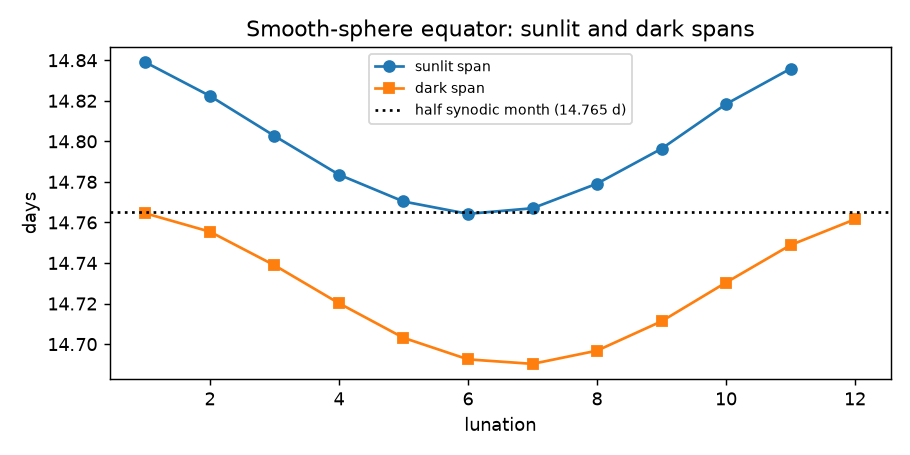
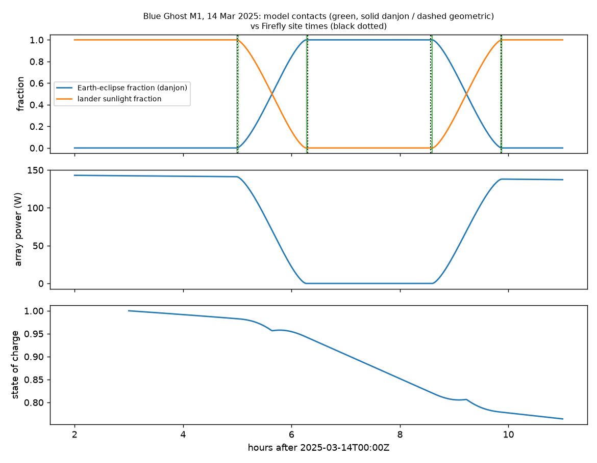
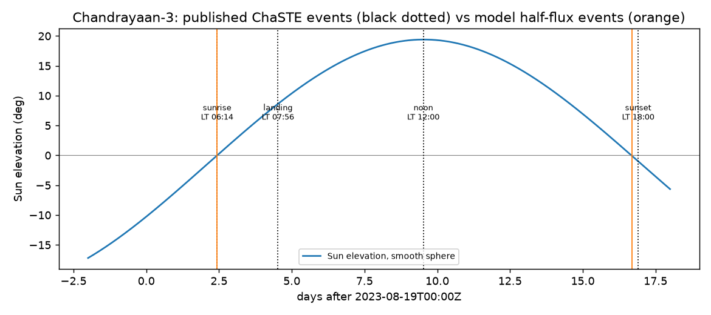
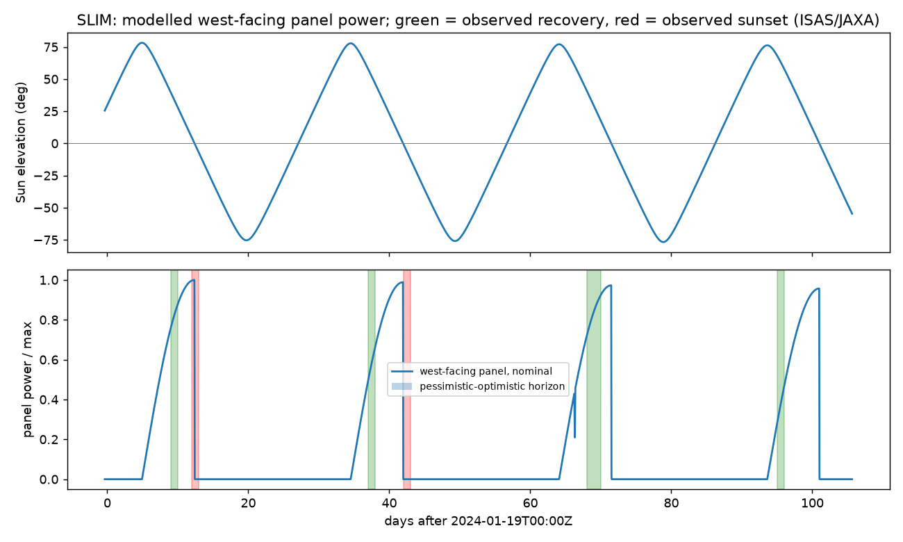
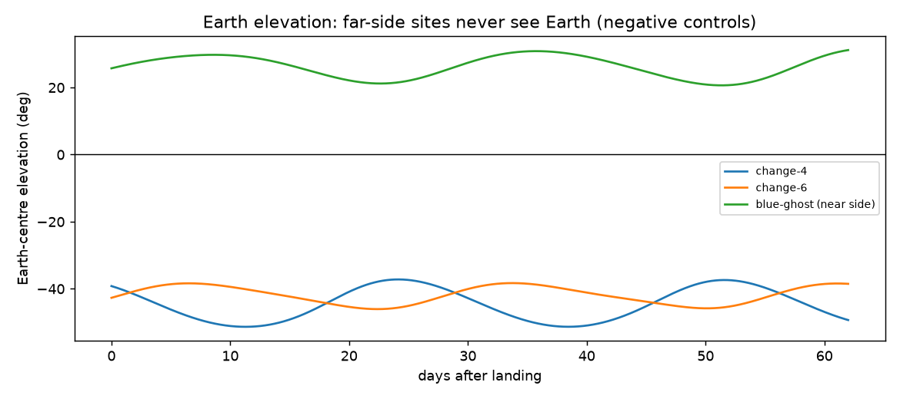
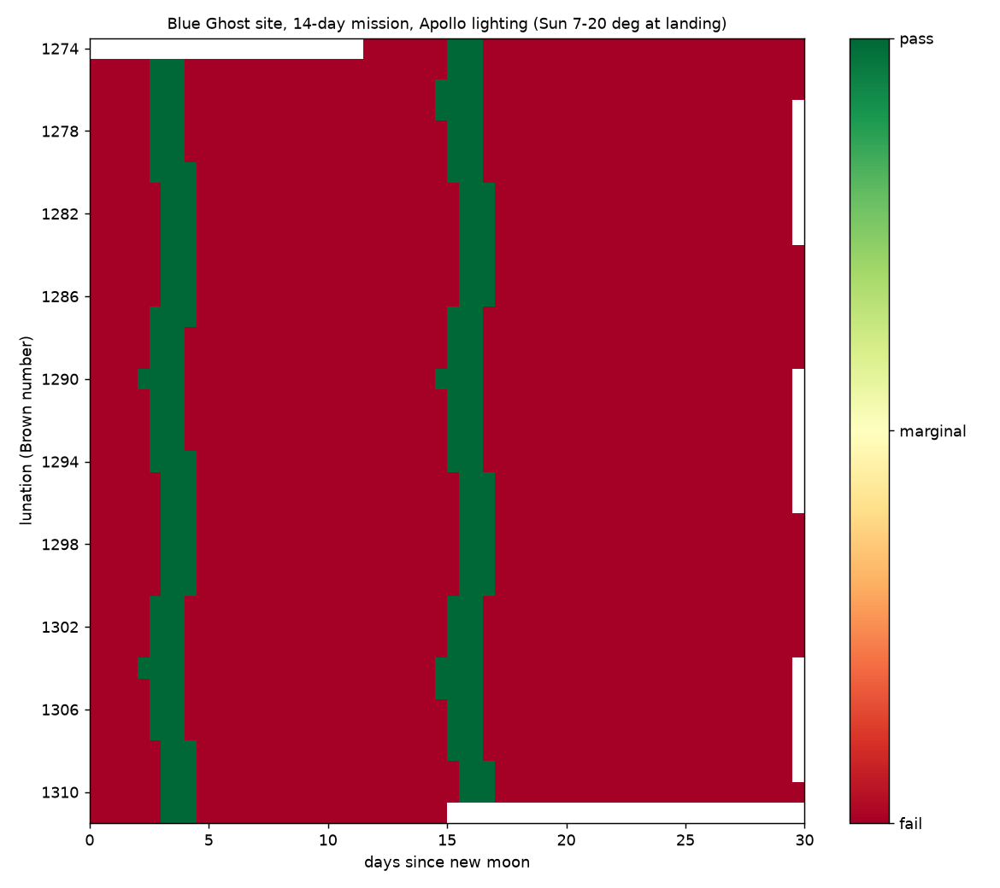
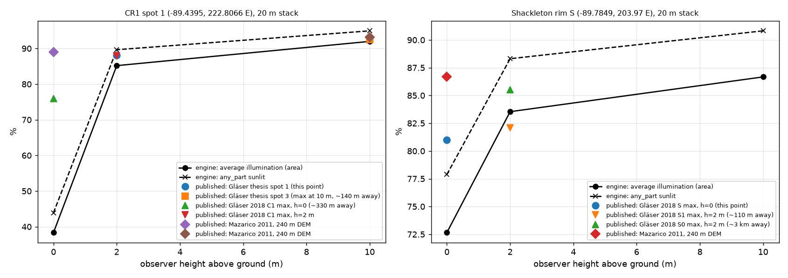
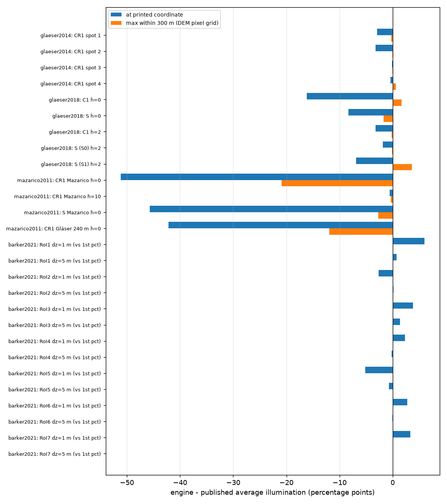

# Scenario layer validation

Module: `lunarnav.scenario`.
Raw results: `data/validation/scenario/*.json`. Figures: `docs/validation/img/scenario_*.png`.

This report validates **composition**. The scenario layer adds no new physics. It combines validated modules into planner
answers: `ephem`, `visibility`, `catalog` and, optionally, `horizon`/`terrain`. The answers are time series, intervals, verdicts,
opportunity scans, slip, sensitivity, attribution, comparison and exports. The report checks three things:

* The pipeline reproduces independent results and the published events.
* The fast scan equals the evaluation of each landing time on its own.
* Where the answers are sensitive to choices that no published source pins down.

## 1. Method and conventions

* Sunlight = terrain flux (three horizon worlds: nominal, optimistic, pessimistic) times `1 - Earth-eclipse fraction`.
  "Sunlit" means flux above 0.5. Verdicts use the **half-flux crossing** as the event time. The engine finds it by linear
  interpolation of the sampled signal and refines it at the sampling step. The default step is 600 s for a site evaluation
  and 1800 s for scans.
* The Earth-eclipse shadow convention is an explicit scenario setting. The default is `danjon`, and provenance records the
  occulting radius. `geometric` is also available.
* Each requirement gets one of three verdicts. PASS: the limit holds in all three horizon worlds. MARGINAL: only the
  nominal world meets it. FAIL: otherwise. NaN counts as a failure. Slope without terrain is UNKNOWN and is excluded.
  The overall verdict is the minimum over the requirements with a known verdict.
* Scans evaluate candidate landing times on the lattice `first_et + k * 1800 s`, with a spacing that is a multiple of that step.
  The state-of-charge (SOC) simulation runs only for candidates that do not already fail another requirement. For the skipped
  candidates the SOC requirement is reported as not evaluated, never as the limiting one.
* All mission checks below use the smooth-sphere horizon (`SmoothSphereProvider`).

## 2. Unit-level validation

| Check | Result |
|---|---|
| Equator day length, 12 lunations (smooth sphere) | 11 complete sunlit spans: mean 14.798 d (min 14.764, max 14.839); 12 dark spans: mean 14.726 d (min 14.690, max 14.764). Half synodic month 14.765 d. Day + night mean 29.521 d versus synodic 29.531 d, maximum deviation 0.074 d. |
| Scan versus brute force (same 1800 s lattice) | 46 epochs (random + first/middle/last of each state present) compared against full single-site evaluation: 0 state mismatches; maximum value difference 1.6e-8 (landing Sun elevation 1.6e-8 deg, dark span and sunlit hours 5.9e-9 h; floating-point level, inside the 1e-7 tolerance; the first stored run gave 7e-8, the rerun of 2026-11-13 1.6e-8, so read it as rounding noise, not as a result). States present in the 2-month scan: 1414 fail, 51 pass (no marginal state is possible on a smooth sphere: the three horizon worlds coincide). |
| Edge-time error versus signal step (6 lunations, mid-latitude site, reference 60 s lattice) | 120 s: mean 0.007 s, max 0.011 s; 600 s: mean 0.80 s, max 1.4 s; 1800 s: mean 33.9 s, max 42.7 s; 3600 s: mean 376 s, max 498 s (12 edges). Scans therefore carry up to about 45 s edge uncertainty from the step; the candidate spacing (1 h) is far larger. |

## 3. Mission ground-truth checks (no terrain)

### 3.1 Blue Ghost Mission 1 (Firefly), 2025-03-14 lunar eclipse and 2025-03-16 sunset

Site 18.5623 N, 61.8103 E, landing 2025-03-02T08:34Z. The reference is Firefly's *Blue Ghost Mission 1: Live Updates*
(https://fireflyspace.com/news/blue-ghost-mission-1-live-updates). It gives the eclipse contact times at the site, to the minute,
in CDT (read as UTC-5), and a statement about sunset. The pipeline ran with a 1 s sampling step around each contact.

| Contact | Firefly | Danjon model | Residual | EphemCore residual | Geometric model | Residual | EphemCore residual |
|---|---|---|---|---|---|---|---|
| P1 | 05:00 | 04:59:31.0 | -29.0 s | -28 s | 05:00:54.0 | +54.0 s | +55 s |
| U2 | 06:18 | 06:16:02.0 | -118.0 s | -118 s | 06:17:38.0 | -22.0 s | -22 s |
| U3 | 08:34 | 08:35:53.0 | +113.0 s | +113 s | 08:34:17.0 | +17.0 s | +17 s |
| P4 | 09:52 | 09:52:28.0 | +28.0 s | +27 s | 09:51:05.0 | -55.0 s | -56 s |

The scenario pipeline reproduces the residuals of the ephemeris module to within 1 s,
which is the quantisation of the 1 s sampling. So the composition adds nothing to the eclipse timing. All residuals are within the 1-minute rounding of the published
times plus the shadow-convention difference of tens of seconds. The Danjon-model U2 and U3 residuals (about 2 min) are the
largest. They are the shadow-convention effect that the ephemeris validation already reports.

The scenario layer adds the following at the site. The lander is the generic Blue Ghost profile: 1000 Wh battery, 150 W / 50 W loads,
all flagged as **estimates** in the profile. The Earth-eclipse fraction reaches 1.0. The lander sunlight fraction is 0 during totality (about
2.3 h). Half flux occurs at 05:38 and 09:13 UTC. The battery draw-down depends entirely on the estimated profile, and it is not validated against telemetry.

**The heading of the generic profile is unknown** (section 6), so there is no nominal array power. The earlier figures in this paragraph were
computed at an arbitrary default heading of 0 deg: peak array power 181.8 W, 160.5 Wh drawn,
minimum state of charge 0.839 at 09:35 UTC. They are withdrawn as expected outcomes. The check now reports the mean over 36 headings.
That mean is not an expected outcome either: peak array power 142.4 W, minimum 0 W (eclipse), energy drawn 236.0 Wh, minimum state of charge
0.764 at 11:00 UTC (`missions_blue_ghost.json`). The eclipse timing and sunlight fraction above do not depend on heading and are unchanged.
To get a result that says what depends on heading, evaluate the scenario (section 6.1).

**Sunset is later than the published statement.** On the smooth sphere (flat horizon), half flux is at 2025-03-16 20:21:28 UTC and the last solar limb at 20:54:54 UTC.
Firefly's statement puts sunset at 18:00-18:30 UTC, and 346 h after landing is 18:34. The model is **+1.86 h later than the window edge and +1.79 h later than
the 346 h mark. This misses the 1 h target.** At the last data time (23:15 UTC, 2.9 h after our
sunset) the Sun is at -1.47 deg.

The repository's default terrain stack moves the event in the right direction. At this site the stack uses the 59 m regional SLDEM2015 store (Section 3.5).
Half flux is then at 19:07 UTC (range 18:00:23 to 20:10:52), 37 min after the end of the window. The range starts 23 s after the window does,
so it covers the window except its first 23 s. Terrain makes the model event earlier, which is the correct sign.
This is a sensitivity, not a validation: there is no ground truth for the local horizon, and the pixels are 59 m. We therefore do not claim that the remainder is explained.

Earth is continuously visible from the site (elevation 25.0-29.7 deg over the mission), as reported.

### 3.2 Chandrayaan-3 (Vikram), site 69.373 S, 32.319 E

The reference is ChaSTE Table 2 (Chandra's Surface Thermophysical Experiment). It gives event times: sunrise 2023-08-21 10:26, landing 12:34, noon 08-28 12:30, sunset 09-04 21:42.
The table labels them with local times 06:14, 07:56, 12:00 and 18:00. The horizon is the smooth sphere.

| Event | Published (UTC) | Model | Residual |
|---|---|---|---|
| Local solar time at landing | 7.93 h | 7.94 h | +0.008 h |
| Sunrise (half flux) | 08-21 10:26 | 08-21 10:07 | -0.32 h |
| Local time 06:14 instant | 08-21 10:26 | 08-21 10:15 | -0.18 h |
| Noon, local solar time 12:00 | 08-28 12:30 | 08-28 12:20 | -0.16 h |
| Noon, maximum Sun elevation (19.4 deg) | 08-28 12:30 | 08-28 12:55 | +0.42 h |
| Sunset (half flux) | 09-04 21:42 | 09-04 16:30 | **-5.2 h** |
| Local time 18:00 instant | 09-04 21:42 | 09-04 21:41 | -0.01 h |

**Sunrise, noon and landing agree within the 1-3 h target. The sunset misses it by 5.2 h.**

The published instants match *local solar time*. They agree with it to 0.2 h at all three of 06:14, 12:00, 18:00, but not with a geometric horizon event.
At the published sunset instant the model Sun is at -0.99 deg elevation. The elevation rate there is only
-0.18 deg/h, so a horizon difference of 1 deg shifts the event by 5.5 h. On the smooth sphere the last solar limb is at 17:58 UTC.
Our reading is that ChaSTE's "sunset" is the local-time label rather than a horizon crossing [INFERENCE]. We cannot
confirm that from the source.

Consequence for users: at this latitude the unknown horizon dominates event times. The verdict machinery therefore reports the half-flux and
last-limb times and the range over the horizon worlds, not a single instant.

The terrain horizon makes the residuals worse than on the sphere: sunrise +6.1 h and sunset -16.0 h from the published values
(Section 3.5, `ldem_512` regional store, about 1.3 deg median). At 69 S the terrain sensitivity is larger than any published-event residual here.

### 3.3 SLIM, site 13.316 S, 25.251 E

The reference is the ISAS/JAXA operations record (https://www.isas.jaxa.jp/home/slim/SLIM/operation_status/index.html).
The model treats the west-facing panel as `normal_body (0,0,1)`, tilt 90 deg, azimuth 270 deg. **The tilt and azimuth are our assumption**:
the lander came to rest on its nose and the panels faced west. The power threshold for recovery is unpublished.

**All four sunsets fall within the 1-day target.** Model half flux, with geometric flux and no Earth eclipse:

* 2024-01-31 09:01 UTC, inside the published day.
* 2024-02-29 22:55 UTC. The published date is 1 March, so the model is **1.08 h before the start of that day**.
* 2024-03-30 11:51.
* 2024-04-28 23:50. The last contact was reported on 28 April.

**The model does not predict the day of recovery.** It does show power at every observed recovery. All four observed recovery windows
(28 Jan, 25 Feb, 27-28 Mar, 23 Apr) lie inside a modelled interval in which the west panel produces power. That interval runs from the first 5 % of maximum to the sunset.
At the 28 Jan signal time (19:32 UTC; Sun az 276 deg, el 30 deg) the panel power fraction is 0.86. Over the four observation windows the fraction ranges
0.76-0.88, 0.50-0.66, 0.72-0.92 and 0.28-0.46. Power exceeds
25 % of maximum on 25 Jan, 23 Feb, 24 Mar and 22 Apr, one to four days before the observed recoveries. JAXA has not published its
actual recovery conditions (thermal, power-on threshold).

Sensitivity to the assumed attitude: on the first lunar day, the date of first 10 % power is 23 Jan at tilt 80 deg and 25 Jan at tilt 100 deg.
For azimuth 285 to 255 deg it is 24 Jan 03:20 to 15:50 UTC. Sunsets do not depend on attitude. The check therefore validates the sunset dates and the
"power available at recovery" statement, not a prediction of the recovery time.

The sunlight series shows the 2024-03-25 penumbral lunar eclipse as a short power dip near day 66 in the figure, as it should.

### 3.4 Chang'e 4 and 6: far-side negative controls

**Earth is below the horizon at every sample for 62 days at both sites.** The maximum Earth elevation is -37.2 deg at Chang'e 4
and -38.3 deg at Chang'e 6. There are 0 visible samples, and the contact fraction with the DSN triad (three NASA Deep Space Network stations) is 0.0.
The same pipeline at the Blue Ghost site gives contact fraction 0.9995.

Chang'e 4: the Sun elevation is 31.5 deg at landing, 7.0 deg at the rover wake-up
(about 2019-01-29 12:00 UTC) and 15.6 deg at the lander wake-up (2019-01-30 12:39 UTC). The modelled sunrise is
2019-01-28 16:05 UTC, and the site stays sunlit at both wake-ups.

Chang'e 6: the sunlight fraction is 1.0 for the whole span from landing to ascender liftoff (Sun elevation 36.7 to 46.1 deg).
This is consistent with the requirement that the Sun must be up.

The wake-up thresholds are unpublished, so the check covers only the sunlit state.

### 3.5 Supplement: the same events with the repository's terrain horizon (not a validation)

**These terrain runs show the size of the effect only.** The DEMs (digital elevation models) do not have the resolution a site needs: 59 m regional pixels at best.
There is no ground truth for local terrain.

Set-up: `TerrainProvider(TerrainStack.open(), n_az=720)`, 2 m mast, horizon engine `horizon-bnb/4`.
The runs were repeated on 2026-11-13, and again after the catalogue coordinate change below. The SLIM and Chandrayaan numbers reproduce to 1e-9 relative.

* Blue Ghost sunset: half flux 19:07:17 UTC (published window
  18:00 to 18:30 UTC), last limb 19:41:28 UTC. A 0.500 deg horizon at the limb azimuth 269.9 deg (0.495 deg at 270 deg), 807 m away, limits the event.
  The attribution includes the `blocker` coordinates.
* Chandrayaan-3: last limb 09-04 07:08 UTC. The horizon at the sunset limb is 1.86 deg.
* SLIM sunsets: 31 Jan 04:03, 29 Feb 17:58, 30 Mar 07:02, 28 Apr 19:09 UTC.

**Terrain product used.** `TerrainStack.open()` with its default stores. Precedence is finest pixel wins, over the global, polar and on-demand regional
stores.

* At the Blue Ghost site the stack uses the regional `sldem2015_512_n18.562_e061.810_r50km` (SLDEM2015, 59 m pixels, 50 km radius).
* At the Chandrayaan-3 site it uses the regional `ldem_512_s69.373_e032.319_r50km`. This is the LOLA (Lunar Orbiter Laser Altimeter) LDEM at 512 pixels per degree, about 59 m.
  It was observed with `TerrainStack.height_and_store` at the site.

The stack hash is in `data/validation/scenario/missions_terrain_supplement.json`.

**Chandrayaan-3: with terrain the residuals are worse than on the smooth sphere.** The sphere gives sunrise
-0.32 h and sunset -5.2 h against the published local-time boundaries (section 3.2). With the terrain horizon, sunrise is **+6.1 h** late and sunset **-16.0 h** early.
The model sunrise is 08-21 16:32 UTC against the published 10:26 UTC. At 69 S the Sun moves 0.18 deg/h at the horizon, so a horizon difference of 1 deg
shifts the event by more than 5 h. The terrain run is not closer to the published instants than the sphere.
As in 3.2, the published instants follow the local-time labels, not a geometric horizon event [INFERENCE]. So this is not
evidence that the terrain is wrong. It is not evidence that the terrain is right either. The terrain supplement here is a sensitivity, not a validation.

**What changed between the two runs: the data, not the engine.** This is the answer from the horizon owner, `TerrainHorizon` (`docs/validation/terrain.md` 3.6).

* `TerrainStack.open()` now also picks up the on-demand regional store `sldem2015_512_n18.562_e061.810_r50km`. This regional window (SLDEM2015, 59 m pixels, 50 km radius around the Blue
  Ghost site) was built by `python -m lunarnav.terrain.regional`.
* Finest-pixel-wins precedence uses this store instead of the 474 m global grid. With it, a rise 854 m away
  that is a 59 m-scale feature becomes visible.
* At azimuth 270 deg with a 2 m mast the horizon is 0.180 deg (0.178 to 0.187) with the global stack. With the regional window it is 0.446 deg (0.444 to 0.459).
* The engine change from `horizon-bnb/2` to `/3` only adds exact ray seeds for pruning. It changes the lower/upper bracket by at most 0.005 deg, and the upper is unchanged.
  So it cannot produce a shift of 0.28 deg.
* To reproduce the old value, use `TerrainStack.open(dem_ids=[ids without the regional sldem2015_/ldem_512_ ones])`. The stack hash differs and
  is in the provenance.

*What changed with the final stack.* These are the numbers recorded when this section was written. The previous run used the global stack only. Each pair is before to after:

* Blue Ghost sunset half flux: 19:48:13 to 19:11:50 UTC.
* Limiting sample: 3744 m at 0.180 deg to 854 m at 0.466 deg.
* Edge range: 19:32 to 20:04 UTC to 18:03 to 20:20 UTC.
* Chandrayaan-3 sunrise residual: +4.9 h to +6.1 h. Sunset residual: -15.7 h to -16.0 h.
* SLIM sunsets: 15 to 19 min earlier.

*Freshness check, 2026-11-13.* This is a rerun of `terrain_supplement` on the current tree.

* The stored JSON already held a later state than the paragraph above, and the text
  had not been updated. The JSON gave half flux 18:54:05 at the catalogue coordinates of that time. The text said 19:11:50.
* The cause is an engine change made after the text was written:
  horizon engine `horizon-bnb/4`, store precedence by stated error, and a per-product error registry (commit `4f9f46f` and later). I did not isolate which of these.
* Chandrayaan-3 is unchanged (sunrise +6.1 h, sunset -16.0 h).
* SLIM sunsets: 31 Jan 04:03:18,
  29 Feb 17:57:59, 30 Mar 07:01:52, 28 Apr 19:08:40 UTC. These are 19, 15, 6 and under 1 min earlier than the text said.
* The smooth-sphere results of sections 3.2 to 3.4 do not depend on the horizon engine and are unchanged. The reruns of `missions_chandrayaan` and `missions_slim` show 0 differences.

*Blue Ghost position, 2026-11-13.* The catalogue position was corrected, and the sunset moved with it.

* The catalogue entry `blue-ghost-m1` held (18.562 N, 61.810 E). This was the 4 Mar 2025 LROC (Lunar Reconnaissance Orbiter Camera) post at 3 decimals.
  It now holds (18.5623 N, 61.8103 E), the 7 Mar 2025 LROC post. This is the position that section 3.1 of this document and `terrain.md` section 3.6 always printed.
  The two positions are 30 m apart.
* Blue Ghost sunset, before to after:
  * half flux 18:54:05 to 19:07:17 UTC;
  * last limb 19:28:16 to 19:41:28, limiting blocker 798.5 m at 0.606 deg to 807 m at 0.500 deg (0.495 deg at azimuth 270 deg);
  * edge range (default stack, product budget) from 17:46:34 to 19:59:29 to 18:00:22.6 to 20:10:52.0 (start and end);
  * old-budget range 17:51:24 to 20:19:38. At the rounded position, with a 4 m / 10 m budget, it was 17:37:34 to 20:08:32. The explicit-stack files differ by the same offsets.
* **Does the range contain the whole 18:00 to 18:30 window? No: it starts 22.6 s after the window does.** This is for the product budget. The old, wider budget does contain the window.
* The nominal sunset is 37 min after the end of the window, and the last limb 1.2 h after it.

**Measured sensitivity: 30 m of position moved the Blue Ghost sunset by 13 min.** The horizon at azimuth 270 deg is 0.495 deg against 0.599 deg,
because the limiting blocker is 800 m away on 59 m terrain. A planner should not treat a rounded landing position as exact near a local rise.
The eclipse and sunlight results of section 3.1 move by at most 0.1 s (Danjon U2 06:16:01.9 to 06:16:02.0 UTC). The smooth-sphere sunset moves by 2 s.

*Consistency with `terrain.md` section 3.6 (Blue Ghost, current stack `241d5855...`, SLDEM2015 first).* With the catalogue at the `terrain.md` coordinates, the two documents agree.

* `terrain.md`: horizon 0.50 deg at azimuth 270, Sun-centre crossing 19:07 UTC, upper limb 19:41, and the gap to the published 18:00 to 18:30 statement is 0.6 h (centre) and 1.2 h (limb).
* This section: horizon 0.500 deg at the limb azimuth (0.495 deg at 270 deg), half flux 19:07:17, last limb 19:41:28, which are 37 min and 71 min after the end of the statement (0.62 h and 1.19 h).

Half flux and Sun-centre crossing are different definitions of the event. Half flux means half of the disc is covered. Sun-centre crossing means the centre is on the horizon.
Here they agree to the minute. The sampled signal step is 600 s with refinement, so I do not claim better than about a minute.
Before 2026-11-13 the two documents differed by 13 minutes, because the catalogue held the rounded coordinates (section above).

## 4. Performance

**Conditions of every figure in this section.** The figures were re-measured on 2026-11-13 from 05:36 to 05:45 UTC, in two runs. The
figures below are from the second run (05:41 UTC, 3 repeats). The tables show the median, with the range.

* Machine: AMD Ryzen 7 8845HS, 16 threads (numba
  default, 16), 28 GB, Python 3.14.6, numpy 2.5.4, numba 0.68.1, one process, wall clock, peak resident set 474 MB.
* The machine was not idle. The user's desktop and service processes were running, swap was full and about 13 GB of memory was available. The load average was 3 to 5
  during the runs. No other job of ours ran.
* All repeats are in `data/validation/scenario/profile.json`.

The same profiler measured both columns. It keeps the old per-epoch loops as `reference_min_soc_values` and `reference_build_calendar`. The reference
loop follows the same rule as the engine about the power it integrates (`verdict_power_w`): with the heading unknown, the nominal slot holds the
upper bound over headings. The reference loop is still an independent per-epoch `simulate_window` computation, not a call into the batch path.
Batch and reference agreed to 1e-9, including a case with the heading unknown.

**What changed.**

* `visibility.simulate_battery_scan` replaces the per-epoch `simulate_battery` loop of `min_soc_values`.
  It makes one call per horizon world over a shared power series. The load profile is built once from the edges of the nominal sunlit windows.
* The scenario layer calls two
  numba kernels: `disc_fraction` and the battery scan. At these item
  counts they were slower when they woke all 16 threads. So `signals.thread_budget` picks the thread count from the item count and restores the caller's setting afterwards.
  For example, `disc_fraction` on 1537 epochs takes 0.4 ms on one thread against 48 ms on 16. This figure is from the original run on a loaded machine and was not re-measured.
* `build_calendar` is vectorised.

| 5-year scan, 1 h spacing, 43,824 candidates (median of 3, range) | before (s) | after (s) |
|---|---|---|
| (a) SOC-heavy: DSN triad, SOC >= 0.3 and contact >= 0.5 only, every candidate SOC-evaluated | 8.69 (8.59 to 8.80) | 0.780 (0.775 to 0.789) |
| of which the SOC kernel (second run, one repeat's stage timer) | 7.84 | 0.139 |
| of which the calendar (one repeat's stage timer) | 0.050 | 0.0016 |
| (b) lighting constraints, no network | 0.197 (0.195 to 0.199) | 0.130 (0.129 to 0.132) |
| (b) lighting constraints, DSN triad | 0.255 (0.253 to 0.255) | 0.193 (0.191 to 0.194) |

**Scan (a) gives 23,605 FAIL and 20,219 MARGINAL candidates, no PASS, and 63 open windows.** These are not the numbers of the first version of this section:
23,837 FAIL, 19,987 MARGINAL and 79 open windows, stored 2026-11-12 09:27 UTC. Since then, a scan with the lander heading unknown fails a candidate
only when even the upper bound over headings fails (`verdict_power_w`, section 6). This moves candidates from FAIL to MARGINAL. The engine
has had other changes since that stored run: heading naming, the minimum-charge instant and per-case requirement facts. The move was not
bisected change by change.

The before and after columns agree exactly. State, margins, values, limiting requirements, calendar and windows are all
`state_equal` and equal to 1e-9, with maximum difference 0.0. So every figure of this section is for identical results, and the table no longer shows
the older (a) result. (b) is unchanged: 42,234 FAIL, 1,590 PASS.

The times above are for evaluation only. The shared ephemeris table is built once per configuration. In the run above it costs 1.93 s (a, DSN, repeats 1.93 and 1.89 s), 1.51 s (b, no
network) and 1.92 s (b, DSN). About 76 % of that is the 223,010 `spkez` calls of `ephem/table.py:_core_samples` (profile of the
first run). Stations add about 0.45 s at the 3600 s station grid (3 stations: 1.88 s against 1.43 s with none, 2 repeats each). The same
table at the commit `HEAD` of the run (9556ff2) costs 1.91 and 1.84 s. That part belongs to `lunarnav.ephem`.

| 500 sample sites (blue-ghost profile, smooth sphere, 48 h, 30 min sampling, one shared table and one batched `horizons` call) | before | after |
|---|---|---|
| total | 21.0 s | 14.98 s |
| per sample | 42.0 ms | 30.0 ms |

This is a single run of 500 samples. The table costs 0.18 s and the batched horizons 0.007 s on top. The first version of this table, 27.5 s and
8.41 s (55 and 16.8 ms per sample), is superseded.

* The after column is slower than then (30.0 against 16.8 ms per sample). The per-sample work has
  grown since that result was stored. Evaluations now label edge causes, carry per-case requirement facts and resimulate the battery for the
  minimum-charge instant.
* The before column is faster (42.0 against 55 ms). I attribute this to the machine having been loaded during the first run (not
  verified).

Per-sample time after the change, by stage (ms of 30.0): `compute_signals` 4.0 (13 %; station track 1.4, eclipse 1.1,
flux worlds 0.45), `array_power` 9.3 (31 %), interval windows 11.7 (39 %), `epoch_values` 0.6 (2 %), battery series 0.44 (1.5 %), provenance
0.28. Before, `disc_fraction` was 11.3 of the 42.0 ms.

The `soc_series` stage ran 1,500 times per 500 samples in the
stored run (3 per sample, one per case). It now runs 2,500 times (5 per sample). The two extra runs are the optimistic and pessimistic simulations that locate the minimum-charge instant
(`Metric.when`, section 14.5). The nominal is skipped with the heading unknown. This is attributed from the code, not bisected.

**Identity.** Every figure above is for identical results. The checks were:

* The batched SOC against the old loop, on five scenario kinds
  (mixed, charging clamp, brown-out, long dark, tiny window) with 3 seeds. Windows were on samples, on edges and at the data edge. Max absolute
  SOC difference 0.0, tolerance 1e-9.
* `build_calendar` equals the old version with `array_equal`.
* The profiler compares scan
  candidates, states, margins, values (censoring included), limiting requirements, calendar and windows (max difference 0.0 in all three
  configurations). It also compares all 500 sample evaluations (verdict, margins, metrics, power, SOC, intervals, provenance, slope).

Other single operations. These are log figures from round 1 on a loaded machine, not re-measured: catalogue site evaluation (48 h mission) 0.82 s, slip
analysis (5 slips) 0.59 s, height sensitivity 0.68 s, position sensitivity (16 variants) 1.2 s.

The remaining hotspots are all outside the scenario layer's files:

* `visibility.power.power_over_yaws` (29 % of the per-sample time). It
  recomputes `sun_direction_enu` per yaw.
* `ephem.tracks.station_track` and the eclipse stages.
* `visibility.intervals` crossings.

The calendar figure shows the Blue Ghost site with the Apollo lighting window (Sun 7-20 deg at landing), 2026-2028.
There are two openings per lunation, each three days wide, and 74 open windows in the 3 years.

## 5. What is and is not validated

Validated:

* composition of eclipse timing (reproduces the ephemeris residuals to 1 s);
* day-length symmetry;
* scan equals
  brute force;
* mission sunrise/noon/sunset dates within the stated targets, except as listed below;
* negative controls.

Not validated, or missing the targets:

* Blue Ghost sunset (+1.9 h, target 1 h).
* Chandrayaan-3 sunset (-5.2 h, target 1-3 h).
* SLIM recovery days. The model has power available earlier than observed, and the recovery threshold is unknown.
* all battery and SOC results (lander
  profiles are generic estimates, no telemetry).
* terrain-horizon events (no ground truth at the required resolution).
* Communication beyond the geometric contact fraction.
* **The Mazarico et al. 2011 value at CR1** (a point on the Shackleton connecting ridge). On our 240 m store (`lola_60s_240m`, h = 0, same period and definitions), no post
  within 3 km of the printed point reaches the published 89.01 %. The best post gives 74.90 %, 476 m from the printed point, 14.1 points under. Its sunlit fraction is 78.53 % against 92.7 %, and its longest
  dark span is 299 h against 141.12 h. 0 of 491 posts reach 80 % or more. At S the best post gives 83.96 % against 86.7 % (-2.7 points). The cause is open (section 11.4).

## 6. Limitations

* Half-flux events differ from the last/first limb time, hours at high latitude (documented in `attribution.py`).
* Linear interpolation at the signal step: up to 43 s at 1800 s, 1.4 s at 600 s (Section 2).
* The Danjon shadow is a proxy; differences from the geometric model are up to about 2 min at contacts (Section 3.1).
* Earth orientation beyond 2026 uses the predicted EOP kernel (Earth orientation parameters). Late-year scans have larger ephemeris uncertainty.
* Local solar time is the apparent (true) Sun time from the sub-solar longitude.
* Contact is derived from the maximum clearance over stations, and a station outage or scheduling is not modelled.
* SOC is skipped for candidates that already fail another requirement. Their margin is not reported.
* Lander profiles are estimates unless flagged as published. All such flags travel with the results.
* A **case** (nominal, optimistic, pessimistic) is two bounds taken together. The *horizon bound* covers terrain-error widening, and the maximum antenna height for the Earth link. The
  *heading bound* covers the lander heading.
  Power and state-of-charge bounds come from the best and worst lander heading, separate from horizon/terrain-error widening.
  The optimistic case takes the best heading at each instant on the lower horizon. The pessimistic case takes the worst heading on the upper horizon.
  This is a conservative envelope: no single heading achieves it. That is why `HeadingAnalysis` also simulates each heading as one constant heading.
  On a smooth sphere the three cases coincide only when all three of these hold: the heading is stated with uncertainty 0
  (or the array is heading-independent), the terrain error is off, and `antenna_height_max_m` equals `antenna_height_m`. Otherwise the bounds still differ, and a MARGINAL verdict can occur.
* **Heading** (`AttitudeSpec.yaw_deg`): `None` means *unknown*. This is what the catalogue profiles carry, because no lander has a heading before it lands (`origins["attitude.yaw_deg"].basis == "unknown"`).
  * There is then no nominal heading and no nominal minimum state of charge. The verdict row has `value = None` and `heading_dependent = True`.
  * The verdict is PASS if every heading
    passes, FAIL if none does, and MARGINAL ("depends on heading") in between.
  * The row gives the best and worst heading, the minimum state of charge at each heading, and the arcs of headings
    over which the requirement passes (`SiteEvaluation.heading`, `scenario/heading.py`; 10 degree grid, nominal horizon).
  * The nominal series is still drawn. It is the mean over headings and
    is flagged as not an expected outcome.
  * A stated heading (planner input) is used as the nominal. A heading-independent array (single top deck, tracker) is reported as such.
  * Documents saved
    before this change that spell `yaw_deg: 0.0` load as a *stated* heading of 0. The file cannot tell a default from a choice.
* No operator publishes the position of the Earth-link antenna. The catalogue gives a conservative height (half the vehicle height,
  flagged `estimate`) and an upper bound (`antenna_height_max_m`). The nominal and pessimistic Earth-link horizons use the conservative
  height. The optimistic one uses the upper bound (`horizons.fold_observers`). So the unknown position is inside the reported range. The
  basis is recorded in `provenance["antenna_height"]`. Rerunning the mission checks with the new catalogue values changed the
  Earth elevation figures by under 1e-6 degrees and no other number. The checks use the Sun, the eclipse and the contact fraction on a smooth sphere.
* Some edge ranges are only the edge of the data (`UncertainWindow.start_range_censored` / `end_range_censored`). They are carried into
  `IntervalRow` and exported as blank cells, with `start_range_censored` / `end_range_censored` columns. A "no event" time is blank, never a bogus date.
* The load profile of the battery simulation covers the whole simulated window, so the load outside the profile is never applied. It is set
  explicitly to the dark load and recorded in `provenance["load_model"]`.
* Open miss, Mazarico CR1 (section 11.4): the best post of the 240 m store within 3 km is 74.90 % against the published 89.01 % (-14.1 points), 476 m from the printed
  point. The maximum pixel of the LOLA team's own 60 m raster (x = -10770 m, y = -11730 m) lies 90 m off our 240 m lattice in each axis. This is a fact about the two grids, not an
  established cause. It is not known whether our store's posts are Mazarico's grid posts, or which DEM release he used.
* The terrain-error budget does not cover: interpolated pixels (about 90 % of the 5 m pixels carry no direct measurement); the correlation between the observer's ground and near blockers
  (the bound treats the two errors as independent); sub-pixel relief and boulders; and the observer's own ground height, which is not modelled separately (no correlation model is invented).
* The landing-ellipse and search terrain checks use the repository's LOLA stores (20 m, 240 m). As in the literature comparisons, the heights of a few metres that matter at
  a pit are below the store's vertical accuracy.

### 6.1 Heading: Blue Ghost on a smooth sphere (the case the "no Marginal verdict can occur" sentence got wrong)

**Blue Ghost M1 evaluates to MARGINAL, depends on heading.** Set-up: catalogue profile, `three_panel`, heading unknown, 14 d, `power-reserve` preset, smooth sphere, landing as in section 3.1.

* At the best heading (0 deg; also 180 and 360) the minimum state of charge is 0.53. At the worst heading it is 0. 30 deg is the first of a run of headings that reach 0.
* The 20 % reserve is met only for
  headings 150 to 200 deg and 330 to 20 deg (10 degree grid, nominal horizon).
* The envelope bound (best heading at each instant) reaches 0.84. No single heading attains it.

The verdict row states both headings as structured facts: `heading_best` (`yaw_deg` 0, `value` 0.532, `horizon` nominal) and `heading_worst` (`yaw_deg` 30, `arcs_deg`, `value` 0).
The sentence in `heading_basis` says they are single headings on the nominal horizon, so they lie inside the bounds.
With the heading unknown, the optimistic case is the *upper bound over headings*: the best heading at each instant on the lowered horizon (0.842, `value_worlds["optimistic"]` and `when["optimistic"].value`). It is never called a heading.
Checked: the best and worst single heading equal an evaluation with that heading stated, to 1e-5.

With a stated
heading of 0 the same scenario is PASS at 0.532 (cause `none`). When the heading is unknown, no number at heading 0 is shown as the expected outcome.

## 8. Illumination definitions

Studies and tools use different quantities under the word "illumination". `scenario.illumination` computes all of them from one Sun
track and one horizon, and gives each an explicit name. The containers are `SunIllumination` and `EarthVisibility`, and `SiteEvaluation.illumination()` for an
evaluated site:

| Quantity | Definition |
|---|---|
| `average_illumination` | time mean of the visible area fraction of the uniform solar disc (Mazarico 2011; Glaeser 2014, 2018 "average illumination") |
| `average_illumination_flux` | time mean of the limb-darkened visible flux fraction (what an array receives) |
| `any_part` | some part of the disc is visible (Glaeser "sunlit"; Barker LCIP/LCSP; ESA tool) |
| `centre` | the disc centre is above the horizon (a point-Sun tool such as STK) |
| `half_flux` | limb-darkened visible flux above `sunlit_flux_fraction` (0.5), terrain only |
| `half_flux_with_earth_eclipse` | the same on `flux * (1 - Earth-eclipse fraction)`: the engine's verdict definition |

Each sunlit definition carries three numbers: its fraction, the longest continuous light and the longest continuous shadow. A span length is the run length on the
sample grid times the step. Spans that touch the period edge are flagged `censored`.

An optional quasi-continuous `SpanFilter`
follows De Rosa et al. 2012 (LQCIP, longest quasi-continuous illuminated period). The ESA constants are `ESA_QUASI_CONTINUOUS`: darkness under 60 h and illumination under 10 h are filtered
out. First, lit spans shorter than `min_light_span_h` are counted as dark. Then interior dark gaps shorter than `max_dark_gap_h`
are filled. This order is our reading. The source does not state it.

Earth visibility has `any_part`, `centre` and `full_disc` for
each minimum-elevation mask. The effective horizon is `max(terrain, mask)`.

Verified:

* Run lengths and the filter match a brute-force loop on random masks.
* A
  sinusoidal Sun over a flat horizon gives the analytic 50 % fraction. It gives a 364.1 h any-part span (360 h plus the 2 h by which the upper limb
  leads the centre) and a 360 h centre-shadow span.
* A 5 degree horizon lowers every definition.
* Earth eclipse reduces only the
  eclipse-aware definition, by exactly the eclipsed samples.
* Earth masks are monotone, and `full_disc <= centre <= any_part`.
* The
  evaluation hook equals the engine's own sunlit signal.

Section 11 gives the differences between definitions at real polar sites.

## 9. Landing-ellipse statistics

`ellipse_statistics(scenario, provider, n_samples=512, seed=0, ...)` runs the full verdict pipeline at points drawn from the landing ellipse of the scenario.
It uses the same shared ephemeris table, batched
horizons and the same requirements. It reports:

* the probability of PASS, of
  PASS or MARGINAL (not fail) and of UNKNOWN, per requirement and overall;
* percentiles of every requirement value;
* the best and worst
  sample, and the centre;
* hazard exclusion;
* a convergence table;
* a verdict map evaluated on a grid of nodes inside the landing ellipse.

*Method.*

* Points are a Halton (2, 3) sequence with a seeded Cranley-Patterson shift. This is deterministic and has low discrepancy.
* For `distribution="uniform"` the points are mapped to the
  ellipse by the area-uniform transform. For the Gaussian they are mapped to a Rayleigh radius truncated at `sigma_level`.
  With `truncate=True`, the default, probabilities are conditional on landing inside the ellipse. `truncate=False` gives the full Gaussian
  and counts the outside samples.
* Offsets are azimuthal-equidistant (great circle) from the centre of the landing ellipse, so they cannot step past a
  pole.
* Probabilities are sample fractions. The reported standard error is the binomial bound `sqrt(p(1-p)/n)`, conservative for a low-discrepancy sequence.
* The `convergence` table gives the probability at n/8, n/4, n/2, n. It reports `converged` when the last two differ
  by less than `convergence_tolerance` (0.02).
* Terrain hazard: a sample is hazardous when its slope exceeds `hazard_slope_deg` (default: the active slope limit), or when its roughness exceeds `hazard_roughness_m`.
  The slope is the baseline slope of the terrain
  module, vectorised here and tested equal to `slope_at` to 0.0.
  The roughness is the RMS plane residual of 9 heights at the baseline. This is our definition, because the terrain module has no roughness product.
* `state_probability_non_hazardous` is conditional on a non-hazardous landing.

*Verification against hand-built terrain with a known answer.* A 3000 m plateau east of
2.0 degrees E shadows the morning Sun for every point west of it. A requirement of 40 sunlit hours after landing then fails exactly
west of the cliff.

* With the landing ellipse centred on the cliff, the PASS probability is 0.5 within 0.1 (n = 512 test). The half-plane has
  area fraction exactly 1/2.
* Samples east of the cliff never fail, and samples west always fail. This is checked beyond a band of 2.5e-3 degree, which is the
  60 m smearing of the 0.002 degree cliff pixel.
* A 20 degree ramp gives a slope-fail probability equal to the sample fraction on the
  ramp.
* Each sample's verdict equals a full `evaluate_scenario` of the scenario moved to the sample's position (same table).
* Sampling is deterministic in the seed. Uniform samples are area-uniform (quadrant counts). Rayleigh samples reproduce the analytic
  radial CDF.

*Real-terrain run* (`data/validation/scenario/search_ellipse.json`, figure
`img/scenario_ellipse.png`). **PASS 0.549, MARGINAL
0.164, FAIL 0.287.** Results are from the rerun of 2026-11-13 on the current tree.

Set-up: Blue Ghost profile, 336 h from 2026-06-01T00:00Z, `max_dark_span_h <= 50 h`, `max_slope_deg <= 15`, no network.
The stores are the 20 m (`lola_80s_20m`) and the 240 m. The landing ellipse is Gaussian, 150 x 75 m (azimuth 60 degrees, truncated at 3 sigma). It is centred on the best site of the
section 10 reference. 512 samples (seed 2026), 17 x 17 map nodes.

A first run with a 400 x 200 m ellipse about the area centre gave PASS
probability 0: every sample fails. That is a valid but uninformative answer, so the case was re-centred.

* The binomial standard error is 0.022 for PASS.
* The PASS probability at n = 64, 128, 256, 512 was 0.547, 0.547, 0.539, 0.549.
  The change over the last halving is 0.010, within the 0.02 tolerance.
* The slope requirement passes everywhere (slope 0.17 to 6.0 degrees, median 2.3). The hazard
  fraction is 0.
* The longest dark span has median 21.9 h, p75 84.5 h, p95 218.7 h and maximum 239.9 h. Shadowing at the 20 m scale decides the verdict.
  The centre site itself passes with margin 2.69.
* Cost: 169 s wall for 512 samples and the map, 3.9 GB peak resident. This was measured under load at 4 threads on 2026-11-13. The first run's 193 s was a log figure under heavy load.

*What moved since the first run (2026-11-12).* Only samples that were MARGINAL became PASS: MARGINAL 0.287 to 0.164, PASS 0.426 to 0.549, and the centre margin 2.68 to 2.69.
The FAIL share (0.287), the dark-span and slope percentiles and every sample's nominal values are identical.
The cause is the default terrain-error budget. The first run used the single 4 m / 10 m / 2-sigma budget. The default is now the per-product measured budget (sections 11.6 and 11.9), which narrows the optimistic-to-pessimistic bracket.
The centre of the landing ellipse is still the first run's rank-1 site, fixed for the run. The rank-1 site of the current section 10 reference is the neighbouring lattice point, 20 m to the south.

## 10. Inverse site search

`search_sites(scenario, provider, region, final_spacing_m=..., ...)` answers the question "where in this area does the mission pass, and with what
margin?". It returns a ranked list of landing sites, each with verdict, limiting requirement, normalised margin, requirement values, slope and roughness.
It evaluates exactly the same verdict pipeline as `evaluate_scenario` (`multisite.evaluate_points`: one shared ephemeris table, batched
horizons, active requirements only). So the verdict at any returned site is identical to evaluating that site on its own.

*Method.* The search uses a nested lattice. Offsets are azimuthal-equidistant from the region centre, the spacing is `final_spacing_m * 2^k`, and each promoted cell is refined
to its 3x3 children at half the spacing. The search has three steps:

1. Slope prune. The terrain slope is computed exactly for every candidate of the final level,
   and with a factor-2 relaxation on coarse levels. Sites above the limit are dropped without a horizon computation.
2. Coarse levels evaluate the scenario without the slope requirement, with a *cheap horizon* (72 azimuths, 20 km range). They score each candidate by its
   normalised margin in the optimistic world. Candidates scoring at least `-slack` are refined, and so are at least the `min_promote` best.
3. The final level runs the full provider on every surviving candidate.

`exhaustive=True` skips the coarse levels and the slope relaxation. It evaluates every point of
the final lattice with the full provider. This is the reference.

*What is exact and what is not.* The slope prune at the final level and every returned verdict are exact.
The coarse promotion is a heuristic: a site whose neighbourhood looks hopeless at coarse spacing can still be good at the final spacing. An example is a 20 m pit inside a bad 160 m
cell. We therefore measure it. Recall is the fraction of the PASS (and not-fail) sites of the exhaustive reference that the pruned search
also returns.

*Complexity.* Let the region area be $A$, the final spacing $s$, and the horizon and verdict cost per point $t_h$ and $t_v$. The exhaustive search costs
$(A/s^2)(t_h + t_v)$.

* Horizons dominate. $t_h$ was about 20 to 45 ms at 720 azimuths and full range on the 20 m store
  (`horizon_arrays` over 1,024 sites near CR1). It was about 10 ms with 72 azimuths and 5 km range. These are log figures from a heavily loaded machine, not
  re-measured.
* The pruned search
  costs at most $f\,(A/s^2)\,t_{full} + \tfrac13 (A/s^2)\,t_{cheap}$, where $f$ is the fraction of final-level points that survive the slope prune and
  promotion.
* The coarse levels form a geometric series of lattices (spacing $cs, cs/2, \dots, 2s$, ratio 4 in points). Even if every cell is promoted, they hold at most one third of the
  final lattice in total. They are evaluated with the cheap horizon, which is about 4 times cheaper per point. When the promotion is selective they hold far fewer.
* The region of 5 km radius at 20 m has about 196,000 final lattice points. The region of 50 km at 240 m has about 136,000.
  These are point counts only. No exhaustive time is quoted, because the per-point cost above was not re-measured.

*Recall against exhaustive evaluation.* **The default prune loses nothing here.**
Set-up: Blue Ghost profile at the CR1 area, explicit stack `lola_80s_20m` + `lola_60s_240m`, 450 m radius, 20 m
spacing, 1,597 final points, landing 2026-06-01T00:00:00Z, 336 h mission, `max_dark_span_h <= 50 h`, `max_slope_deg <= 15`.
This is the rerun of 2026-11-13 on the current tree. The reference
has 33 PASS, 34 MARGINAL and 1,530 FAIL sites, and the best margin is 2.69. Counts are full-provider evaluations.

Wall times of this rerun were measured at 4 threads under load, so they are not a benchmark:
exhaustive 173 s, pruned variants 3 to 25 s each, 242 s in total, 4.2 GB peak resident (above the usual 2 GB guideline). The first run (2026-11-12) found 15 PASS and 52 MARGINAL. See
*What moved* below.

| Variant | Full evaluations (of 1,597) | PASS recall | not-fail recall | top 5 equal reference |
|---|---|---|---|---|
| exhaustive (reference) | 1,597 | 1.00 | 1.00 | yes |
| default: optimistic-world score, slack 0.5, coarse factor 8 | 196 (12 %) | 1.00 | 1.00 | yes |
| slack 1.0 | 225 (14 %) | 1.00 | 1.00 | yes |
| slack 0.0, min_promote 4 | 161 (10 %) | 1.00 | 1.00 | yes |
| `prune_world="nominal"`, slack 0.5 | 47 (2.9 %) | 0.91 | 0.61 | ranks 1 to 4 |
| `prune_world="nominal"`, slack 8 | 611 (38 %) | 0.91 | 0.88 | yes |
| `prune_world="nominal"`, slack 16 | 925 (58 %) | 1.00 | 1.00 | yes |

Reading: the default saves 88 % of the full evaluations. The first run saved 37 %.
The nominal-world score is the cheapest (47 evaluations). At slack 0.5 it misses 9 % of the PASS sites and 39 % of the not-fail sites, so it is not offered as the default.
It is available (`prune_world="nominal"`) as a fast preview, and the miss rates above are its honest price.
The recall result is for one scenario and one area: with other requirements the
default may lose sites. That is why `exhaustive=True` and `recall(found, reference)` are part of the API.

*What moved since the first run (2026-11-12).* 18 sites that were MARGINAL are now PASS (PASS 15 to 33, MARGINAL 52 to 34). The FAIL count (1,530) is unchanged.
The rank-1 site moved from (360 m N, 20 m E) to (340 m N, 20 m E), with margin 2.68 to 2.69.

* The recall check uses an explicit stack, so the terrain products did not change.
* The cause is the default terrain-error budget. The first run used one 4 m / 10 m / 2-sigma budget. The budget is now per product, and narrower at these products.
  This tightens the optimistic world that the default prune scores, so far fewer cells are promoted (63 % to 12 %).
* Spot-check on the recall scenario, at the first run's rank-1 site: the longest-dark-span margin is 26.913 h on the product budget and 26.802 h with the explicit 4 m / 10 m / 2-sigma budget.
  The first run stored 26.807 h. The residual of 0.005 h comes from the engine changes of other kinds since then.

The recall figures are therefore valid for the budget in force. They are not independent of it.

*Not yet measured.* The wall times for 5 km / 20 m and 50 km / 240 m, and the 512-sample
real-terrain ellipse, were not run in the clean-machine window. They need about 1 to 2 GB and tens of minutes.

## 11. Literature spot checks (Gläser 2014 and 2018, Mazarico 2011, De Rosa 2012, Barker 2021)

Raw results: `data/validation/scenario/literature.json`. The follow-up runs of 11.7 to 11.12 are in `literature_dark_span.json`, `literature_height_scan.json` and `literature_brackets.json`.

The engine computes everything, and nothing was tuned to a published value. `ephem.sun_track` gives the Sun. `horizon_arrays` gives the horizon (720 azimuths, engine `horizon-bnb/3`, search to the
mutual-visibility distance). `scenario.illumination.sun_illumination` gives the statistics. The periods are the published ones
(11.1). The paper tables give a single value, so every comparison is written **paper / ours (ours minus paper)**. Residuals are reported whichever way
they fall.

The sites are near the lunar south pole, on and around the Shackleton connecting ridge. The numbered spots are the points that Gläser's thesis lists.

**Definitions used.**

* `average illumination` = time-mean of the visible area fraction of the uniform solar disc.
* `sunlit` = fraction of the
  time any part of the disc is visible (`any_part`).
* longest light/shadow = longest run of `any_part` samples on the 1 h grid. A run is counted
  as `n` samples, so a span of one sample is 1 h.
* `LQCIP` = longest quasi-continuous illuminated period after the ESA filter. Lit spans under 10 h are
  first counted dark, then dark gaps under 60 h are counted lit. The filter *order* is **our definition**, read from De Rosa 2012, which does not
  state it.

Sites are given by the printed latitude and longitude. The printed longitude is east and is converted to the engine's -180..180
convention. Each site is evaluated at the **nearest 20 m post** (`lola_80s_20m` with the 240 m global store behind it), at the paper's mast height
above the ground of the stack. **Roughness** is not used here.

Each case also reports the **300 m neighbourhood**: every post within 300 m of the
printed point, 703 to 713 posts. This gives the spread of the metric over neighbouring posts. It separates "our horizon differs" from "the printed point is
sensitive to one post".

### 11.1 Periods used (`meta.periods`)

- `barker2021`: 2024-01-01T00:00:00.000Z to 2026-01-01T00:00:00.000Z, 17545 samples at 3600 s. Barker et al. 2021 Table 2 period, hourly
- `derosa2012`: 2019-01-01T00:00:00.000Z to 2020-01-01T00:00:00.000Z, 8761 samples at 3600 s. De Rosa et al. 2012 main runs: year 2019, hourly
- `glaeser2014`: 2015-12-24T00:00:00.000Z to 2034-12-23T23:59:59.000Z, 166561 samples at 3600 s. Gläser thesis 19-yr run, hourly, endpoints inclusive
- `glaeser2018`: 2017-01-01T00:00:00.000Z to 2037-01-01T00:00:00.000Z, 175321 samples at 3600 s. Gläser et al. 2018, hourly, endpoints inclusive
- `mazarico2011`: 2020-01-01T00:00:00.000Z to 2038-08-12T09:00:00.001Z, 163162 samples at 3600 s. one lunar nodal period (6798.38 d) hourly from 2020-01-01 (LEAG 2013 slides)

### 11.2 Gläser 2014 thesis, Table 7 (19-year run, 20 m DEM): CR1 spots, paper / ours (ours minus paper)

Stores:

* Gläser rows: the observer's ground and the near-field blockers come from `lola_80s_20m`, the far field from `lola_60s_240m`.
* Mazarico rows (11.4): `lola_60s_240m` alone.
* Barker rows (11.6): `pgda78_site01_5m` backed by the 20 m store (`stack` in `literature_brackets_*.json`).

The nominal values below do not depend on the terrain-error budget.

| Spot (mast) | Average illumination % | Sunlit % | Longest dark (d) | Longest light (d) | 300 m neighbourhood: average illumination % (min to max over posts) |
|---|---|---|---|---|---|
| CR1 spot 1 (2 m) | 88.12 / 85.19 (-2.93) | 92 / 89.65 (-2.35) | 4.58 / 10.75 (+6.17) | 233.87 / 231.5 (-2.3) | 11.2 to 87.8 |
| CR1 spot 2 (2 m) | 87.93 / 84.74 (-3.19) | 92.27 / 89.32 (-2.95) | 4.62 / 11.25 (+6.63) | 233.87 / 231.6 (-2.2) | 11.2 to 87.8 |
| CR1 spot 3 (10 m) | 92.55 / 92.43 (-0.12) | 95.61 / 95.56 (-0.05) | 3.08 / 3.12 (+0.04) | 262.42 / 262.4 (-0.0) | 41.7 to 92.5 |
| CR1 spot 4 (10 m) | 91.94 / 91.55 (-0.39) | 95.65 / 95.61 (-0.04) | 3.17 / 3.21 (+0.04) | 262.42 / 262.4 (-0.0) | 40.6 to 92.5 |

**10 m mast (spots 3 and 4): everything agrees.** Average illumination is within 0.4 percentage points, the longest dark span within 1 h, and the longest light span is
identical.

**2 m mast (spots 1 and 2): a miss.**

* We are 2.9 to 3.2 percentage points darker in average illumination, and 2.4 to 3.0 points in sunlit
  fraction.
* The longest dark span is 2.3 to 2.4 times the paper's: 10.75 and 11.25 d = 258 and 270 h, against 4.58 and 4.62 d = 110 and 111 h.
* The longest light span is 1 % short.

Section 11.7 gives the sensitivities and the isolation of the cause.

A finer DEM does not close the gap. The **10 m store** (`lola_85s_10m`)
is darker still. At spot 1 its average illumination is 73.9 %, against 85.2 % on the 20 m store and 88.1 % in the paper.
The literature reports the same direction for DEM resolution. Gläser 2018 Table 1 gives 89.0 % on the 240 m DEM against 76.0 % on the 20 m DEM at CR1, h = 0 (`docs/research/literature.md`, "Known criticisms from later papers": "Gläser 2018 §3: the 240 m DEM overestimates illumination (Table 1: 89.0 % vs 76.0 % at CR1 with a 20 m DEM)"; "a coarser DEM gives *higher* illumination (Gläser 2018 §3)").
Our 10 m store is darker than the 20 m store in the same way.

### 11.3 Gläser et al. 2018 (maxima over the 20 m DEM), Tables 1 and 2

| Row | Average illumination % | Sunlit % | Longest dark (h) | 300 m neighbourhood: average illumination % at the post with the highest value |
|---|---|---|---|---|
| C1 h=0 (0 m) | 76 / 59.87 (-16.13) | 81.3 / 65.23 (-16.07) | 268 / 496 (+228) | 77.69 (sunlit 83.50 %, longest dark 236 h) |
| S h=0 (0 m) | 81 / 72.66 (-8.34) | 85.5 / 77.89 (-7.61) | 221 / 235 (+14) | 79.28 (sunlit 83.96 %, longest dark 235 h) |
| C1 h=2 (2 m) | 88 / 84.75 (-3.25) | 92.1 / 89.31 (-2.79) | 112 / 269 (+157) | 87.78 (sunlit 91.82 %, longest dark 180 h) |
| S (S0) h=2 (2 m) | 85.5 / 83.68 (-1.82) | 89.4 / 89.27 (-0.13) | 66 / 67 (+1) | 85.39 (sunlit 89.38 %, longest dark 67 h) |
| S (S1) h=2 (2 m) | 82.1 / 75.23 (-6.87) | 89.8 / 81.81 (-7.99) | 65 / 339 (+274) | 85.70 (sunlit 90.43 %, longest dark 64 h) |

**Our best nearby post agrees with the table within 0.3 points at two of the three rows above the surface.** Gläser 2018 give the *maxima* over the DEM. The printed point is therefore the best post of the paper's grid, and our best post within 300 m is the fair
comparison.

* At C1 and S(S0) at 2 m, the two rows that agree: 87.78 against 88.0, and 85.39 against 85.5.
* At S(S1): 85.7 % against the published 82.1 %. We are 3.6 points brighter there.
* At h = 0: 77.69 against 76.0 (C1, +1.7) and 79.28 against 81.0 (S, -1.7).

The point
values at the printed coordinates are darker by 1.8 to 16.1 points. The largest differences are at the h = 0 rows and S(S1).

The longest
dark span at the best post is 180 h at C1 at 2 m, against the published 112 h (68 h over). The smallest over all posts within 300 m is 143 h. At 0 m it is 236 h against 268 h (32 h under).

### 11.4 Mazarico et al. 2011 (240 m, one nodal period), as quoted by Gläser 2018 and the thesis

| Row | Average illumination % | Sunlit % | Longest dark (h) | 300 m neighbourhood best post: average illumination % |
|---|---|---|---|---|
| CR1 Mazarico h=0 | 89.01 / 37.87 (-51.14) | 92.7 / 45.22 (-47.48) | 141.12 / 3437 (+3296) | 68.11 (4 posts) |
| CR1 Mazarico h=10 | 93.1 / 92.53 (-0.57) | - | - | 92.74 (4 posts) |
| S Mazarico h=0 | 86.7 / 41.00 (-45.70) | 90.5 / 43.39 (-47.11) | - | 83.96 (6 posts) |
| CR1 Gläser 240 m h=0 | 86.84 / 44.64 (-42.20) | - | - | 74.90 (4 posts) |

**Fair test on the 240 m store (h = 0, Mazarico period, same definitions).** The printed-point values above are all near 40 %. An observer
on a slope just off a crest gives that value wherever it is, and Mazarico's numbers are maxima over his grid. So we evaluated every post of our 240 m store within 3 km of
each printed point (491 posts each; `data/validation/scenario/literature_brackets.json`):

| Point | Published avg. / sunlit / longest dark | Best post within 3 km: avg. / sunlit / longest dark (offset from the printed point) | Posts with avg. >= 80 % |
|---|---|---|---|
| CR1 (-89.45, 222.69 E) | 89.01 % / 92.7 % / 141.1 h | **74.90 %** / 78.53 % / 299 h (476 m; -14.1 points); the highest sunlit post has 79.25 % | 0 of 491 |
| S (-89.78, 204.27 E) | 86.7 % / 90.5 % / - | **83.96 %** / 88.67 % / 69 h (42 m; -2.7 points) | 2 of 491 |

**At CR1 no post of our 240 m store within 3 km reaches the published value.** The best is 74.9 %, 14.1 points under, and its longest dark span is 299 h
against 141 h. The printed points are not the right posts. At S the best post is 42 m away and reaches 84.0 %, 2.7 points under the published 86.7 %. That is a
near agreement.

Our earlier sentence that the published values "cannot be reproduced at h = 0 on a 240 m DEM" is therefore withdrawn as a statement
about the method. It is kept as a statement about *this store at CR1*.

What the store is: the LOLA GDR (gridded data record) product `LDEM_60S_240M`
(`lola_60s_240m`, polar stereographic, 240 m pixels, centres at x, y = 120 m modulo 240 m). It is not known whether its posts are Mazarico's grid posts. The grid
of the 2011 DEM is not published to us. The maximum pixel of the LOLA team's own 60 m raster (`AVGVISIB_85S_060M_201608`, x = -10770 m, y = -11730 m, i.e. 30 m
modulo 60 m) does not coincide with our 240 m lattice (offset 90 m in each axis).

A finer DEM does reach the high 80s at h = 0. On the maximum
pixel of the 60 m raster the engine gives 84.38 % against 88.444 % (-4.1 points; `docs/validation/illumination.md` section 3.4, "The published maximum and the crest
pixels", by `RegionalValidation`). At h = 10 m our 240 m store gives 92.53 % against 93.10 % (-0.57).

What remains open: why our 240 m store is darker at CR1 than
Mazarico's 240 m DEM. Possible causes are a different DEM release, a registration offset of the DEM, or the post positions. This run cannot separate them. The literature also notes that
coarse DEMs overestimate illumination (Gläser 2018 §3). So a 240 m store that is *darker* than the 60 m raster at the same crest points at the DEM product rather than at the Sun geometry [INFERENCE].

### 11.5 De Rosa et al. 2012 (ESA study): LQCIP at 2 m, year 2019, 60 h / 10 h filter

Published (their section 2.3): LQCIP of 4 to 9 months inside the best areas (2 m mast, 40 m DEM, 2019).

- **CR1 De Rosa** (-89.4679, -137.411): at the point LQCIP 14.0 d (raw longest light 14.0 d, censored by the one-year window: False); in the 300 m neighbourhood (713 posts) the maximum is 237.0 d (raw 205.9 d), median 26.0 d, and 32 % of posts reach 4 months or more.
- **CR1 Gläser spot 1** (-89.4395, -137.1934): at the point LQCIP 221.5 d (raw longest light 221.5 d, censored by the one-year window: True); in the 300 m neighbourhood (703 posts) the maximum is 222.7 d (raw 222.3 d), median 24.8 d, and 35 % of posts reach 4 months or more.

**The best posts agree with the published range, but the printed De Rosa point does not.** In the best posts the engine finds LQCIP between 4 and 9 months: up to 237 d = 7.8 months within 300 m of the De Rosa point, and 222.7 d within 300 m of Gläser's spot 1.
The *printed* De Rosa point itself gives only 14 d. So at the printed point the result is not the
published one. The agreement is a property of the neighbourhood (a third of the posts), not of that point.

The 40 m DEM of the study is not our
20 m product. The one-year window censors the spot-1 LQCIP (221.5 d): the longest period runs to the end of the year.

### 11.6 Barker et al. 2021, Table 2 (Site 01, case A, seven RoIs): real RoI polygons, pessimistic world against the published percentile

**What is published and what is compared.** For each region of interest (RoI), Barker et al. publish percentiles over 100 DEM clones:

* the 1st percentile of the average illumination and of the longest continuous illumination period (LCIP);
* the 99th percentile of the longest continuous shadow period (LCSP).

They give these for a Sun/observer height of 1 m and of 5 m above the surface. There is no nominal and no median.

The RoI outlines **are** published
(`Site01_ROIs.shp`, `https://pgda.gsfc.nasa.gov/data/LOLA_5mpp/Site01/Site01_ROIs.tgz`, stored in `data/validation/scenario/barker_site01_rois/`). The seven polygons hold 306, 265, 125, 476, 345, 355 and 242 pixels of the
5 m `pgda78_site01_5m` tile (areas 7688, 6575, 3138, 11900, 8588, 8900, 6038 m^2). A pixel belongs to a polygon when its centre is inside it by ray casting.
An earlier version of this section used discs of the
same area around the centroid. That comparison is superseded, and the disc areas were also wrong.
Ours is the mean over the polygon's pixels, hourly from 2024-01-01 to 2026-01-01, with 720 azimuths and the Sun as a finite disc.

**Two tests, stated before the run** (`data/validation/scenario/barker_calibration_product.json`; nothing tuned, k = 2):

(1) The *nominal* world must lie on the right side of each published percentile: average illumination and LCIP at or above p1, LCSP at or below p99. A nominal on the wrong side is a failure.

(2) The *pessimistic* world is compared with the percentile itself. The bracket is calibrated if the pessimistic value sits at or just beyond the 1st / 99th percentile.

**Budget used.** The default `TerrainErrorSettings()` (product mode). At every azimuth it uses the budget of the product that supplies the height at the limiting blocker, read per pixel through `TerrainStack.error_at`.

* The vertical sigma is the per-pixel total height uncertainty of the PGDA tile (`*_toterr.tif`). Over the area around the Gläser spot 1, 4000 random points inside `pgda78_site01_5m` give 5th / 50th / 95th percentile 0.17 / 0.37 / 0.72 m.
* The horizontal sigma is 0.14 m (`published`, Barker et al. 2021, `docs/research/terrain-error.md`).
* k = 2.

**This table was regenerated on 2026-11-13 and differs from the one stored on 2026-11-12.**

* The stored run applied the product scalar 0.37 m / 0.14 m at every azimuth. Its pessimistic values equal the custom 0.37 / 0.14 run to 0.01 point (RoI1 1 m: stored product -0.59 against custom -0.58 points, LCIP +3.6 d in both).
* The per-pixel registry (commit `4f9f46f`, "per-pixel PGDA uncertainty") replaced that scalar by the sigma of the limiting blocker's own pixel.
* Two reruns on the current tree, RoI1 only, establish the cause. With `--sigma-z 0.37 --sigma-xy 0.14` the current engine reproduces the stored custom run exactly
  (RoI1 1 m: -0.58 points, LCIP +3.6 d, LCSP -1.2 d; 5 m: -0.38, +1.1, +0.1, equal to `barker_calibration_custom_037_014.json` to every printed digit).
  So the horizon engine and the widening are unchanged. Only the budget that the product mode applies moved.
* The committed sources of `4f9f46f` and `a76aaeb` give the same numbers on RoI1 as the current tree (+0.57 points, LCIP +18.3 d at 1 m).
  Older commits could not be run, because their scenario code refers to horizon functions that were not committed with them.
  So the exact moment of the change lies between the stored run (before `4f9f46f`) and that commit.
* Why the blocker pixels carry less sigma than the tile median is not measured here [INFERENCE: the limiting blockers are crest pixels with a smaller stated uncertainty than the typical pixel].
* Run time of the full rerun: 289 s at 4 threads under load, 4.1 GB peak resident.

Test (1): nominal on the right side in **14 of 14** (RoI, mast) cases.

| RoI | Pixels | Area (m²) | Mast | Avg. illum. nominal % | Published p1 % | Pessimistic % | Pess. − p1 (pp) | LCIP pess. (d) | p1 (d) | Pess. − p1 (d) | LCSP pess. (d) | p99 (d) | Pess. − p99 (d) | Nominal on the right side |
|---|---|---|---|---|---|---|---|---|---|---|---|---|---|---|
| RoI1 | 306 | 7688 | 1 m | 76.71 | 68.03 | 68.60 | +0.57 | 81.6 | 63.35 | +18.3 | 14.8 | 16.55 | -1.8 | yes |
| RoI1 | 306 | 7688 | 5 m | 90.12 | 89.26 | 89.12 | -0.14 | 216.9 | 215.79 | +1.1 | 5.3 | 5.29 | -0.0 | yes |
| RoI2 | 265 | 6575 | 1 m | 76.52 | 70.32 | 70.48 | +0.16 | 106.1 | 113.80 | -7.7 | 15.6 | 17.84 | -2.3 | yes |
| RoI2 | 265 | 6575 | 5 m | 89.03 | 88.51 | 87.98 | -0.53 | 216.9 | 216.28 | +0.6 | 7.5 | 7.31 | +0.2 | yes |
| RoI3 | 125 | 3138 | 1 m | 73.06 | 67.51 | 69.16 | +1.65 | 141.0 | 117.86 | +23.1 | 17.4 | 22.23 | -4.8 | yes |
| RoI3 | 125 | 3138 | 5 m | 86.30 | 84.53 | 84.11 | -0.42 | 223.6 | 216.89 | +6.7 | 7.6 | 8.41 | -0.9 | yes |
| RoI4 | 476 | 11900 | 1 m | 78.07 | 69.61 | 72.00 | +2.39 | 151.1 | 136.49 | +14.6 | 11.4 | 13.27 | -1.8 | yes |
| RoI4 | 476 | 11900 | 5 m | 88.58 | 88.12 | 87.49 | -0.63 | 231.7 | 231.20 | +0.5 | 4.1 | 4.00 | +0.1 | yes |
| RoI5 | 345 | 8588 | 1 m | 76.23 | 70.38 | 71.47 | +1.09 | 157.8 | 142.17 | +15.6 | 9.8 | 15.24 | -5.4 | yes |
| RoI5 | 345 | 8588 | 5 m | 86.24 | 85.71 | 85.08 | -0.63 | 218.9 | 218.98 | -0.1 | 4.5 | 4.52 | +0.0 | yes |
| RoI6 | 355 | 8900 | 1 m | 78.06 | 71.15 | 71.77 | +0.62 | 117.5 | 81.01 | +36.5 | 10.7 | 12.74 | -2.1 | yes |
| RoI6 | 355 | 8900 | 5 m | 87.49 | 87.35 | 86.69 | -0.66 | 221.1 | 220.98 | +0.1 | 4.1 | 4.16 | -0.0 | yes |
| RoI7 | 242 | 6038 | 1 m | 73.75 | 67.36 | 68.41 | +1.05 | 115.1 | 100.23 | +14.8 | 11.9 | 14.54 | -2.6 | yes |
| RoI7 | 242 | 6038 | 5 m | 82.80 | 82.79 | 81.92 | -0.87 | 118.4 | 119.07 | -0.7 | 5.5 | 5.42 | +0.1 | yes |

**Summary for planners (Barker et al. 2021, section 11.6).** At a 1 m observer height the pessimistic case's average illumination is 0.16 to 2.39 points above the published 1st percentile in seven of seven regions, and its longest continuous illumination period is 14.6 to 36.5 days above it in six of seven; at 5 m the pessimistic case's average illumination reaches the 1st percentile (0.1 to 0.9 points below it in all seven regions).

**Reading (test 2), as it now stands: the bracket reaches p1 at 5 m for the average.** At 5 m the pessimistic average illumination sits 0.1 to 0.9 points below the published p1 in all seven RoIs.
The LCIP and LCSP are within -0.7 to +6.7 d and -0.9 to +0.2 d of it.
RoI3 5 m LCIP is the outlier at +6.7 d: the pessimistic world is 6.7 d above p1, i.e. not far enough. So the bracket is slightly short for LCIP in RoI3 only.

**At 1 m the bracket is too narrow, which is an unfavourable result and not the one reported on 2026-11-12.**

* The pessimistic average illumination is above the published p1 in all seven RoIs (+0.16 to +2.39 points).
* The pessimistic LCIP is above p1 by +14.6 to +36.5 d in six RoIs (RoI1, RoI3, RoI4, RoI5, RoI6, RoI7; RoI2 -7.7 d).
* A bracket meant to contain the 1st percentile should sit at or below it. So at 1 m the product-mode pessimistic world does not reach the published pessimistic tail in six of seven RoIs.
* The LCSP stays 1.8 to 5.4 d below p99 (conservative).
* Test (1) is unaffected: the nominal is on the right side in 14 of 14 cases.
* For comparison, the stored result (scalar 0.37 m) gave -2.13 to +0.17 points at 1 m. That is why it read as roughly calibrated.

These are 7 RoIs at one site over one stack. They say the budget is of the right order at 5 m and too small at 1 m here. They do not say that its coverage is 95 %.
I did not retune the budget (nothing tuned, as stated before the run). The 1 m shortfall is reported as a known miss against published values.

Side by side, pessimistic minus published (stored run 2026-11-12 -> current tree, points or days; average illumination, LCIP, LCSP):

| RoI | Mast | avg stored (pp) | avg now (pp) | LCIP stored (d) | LCIP now (d) | LCSP stored (d) | LCSP now (d) |
|---|---|---|---|---|---|---|---|
| RoI1 | 1 m | -0.59 | +0.57 | +3.6 | +18.3 | -1.2 | -1.8 |
| RoI1 | 5 m | -0.40 | -0.14 | +1.1 | +1.1 | +0.1 | -0.0 |
| RoI2 | 1 m | -2.13 | +0.16 | -15.8 | -7.7 | -1.8 | -2.3 |
| RoI2 | 5 m | -0.60 | -0.53 | -0.4 | +0.6 | +0.3 | +0.2 |
| RoI3 | 1 m | +0.07 | +1.65 | -2.6 | +23.1 | -4.7 | -4.8 |
| RoI3 | 5 m | -0.54 | -0.42 | -0.2 | +6.7 | -0.6 | -0.9 |
| RoI4 | 1 m | +0.17 | +2.39 | -2.9 | +14.6 | -1.4 | -1.8 |
| RoI4 | 5 m | -0.81 | -0.63 | +0.2 | +0.5 | +0.1 | +0.1 |
| RoI5 | 1 m | -0.84 | +1.09 | -15.0 | +15.6 | -5.1 | -5.4 |
| RoI5 | 5 m | -0.87 | -0.63 | +0.1 | -0.1 | +0.1 | +0.0 |
| RoI6 | 1 m | -1.55 | +0.62 | +24.1 | +36.5 | -1.8 | -2.1 |
| RoI6 | 5 m | -0.79 | -0.66 | +0.2 | +0.1 | +0.0 | -0.0 |
| RoI7 | 1 m | -0.73 | +1.05 | +13.2 | +14.8 | -2.0 | -2.6 |
| RoI7 | 5 m | -0.94 | -0.87 | -0.8 | -0.7 | +0.1 | +0.1 |

**What the budget does not cover** (section 6): interpolated pixels (about 90 % of the 5 m pixels carry no direct measurement), the correlation between the observer's ground and near blockers, sub-pixel relief and boulders, and the observer's own ground height.
The clones of Barker et al. perturb only the 5 m near field, as ours does at this site.
Here `pgda78_site01_5m` supplied the observer's ground and the blockers inside the tile. The registry is read per pixel through `TerrainStack.error_at`, and `provenance["terrain_error"]["stores"]` lists the stores and bases.

### 11.7 Sensitivities (`extras` in `literature.json`)

**(a) Definition of "lit" at CR1 spot 1, 2 m, 19-year run, 20 m stack.**

| Definition | Time fraction % | Longest light (d) | Longest shadow (d) |
|---|---|---|---|
| any part of the disc visible | 89.65 | 231.5 | 10.75 |
| disc centre visible | 85.23 | 204.5 | 13.29 |
| half of the limb-darkened flux | 85.23 | 204.5 | 13.29 |

**The stricter definitions do not help.** Average illumination (area) is 85.19 %, and the limb-darkened flux 85.19 %. The definition moves the time fraction by 4.4 points. It moves the longest
shadow from 10.75 d (any part) to 13.29 d (centre or half flux). The paper's quantities are the generous any-part ones, and the stricter definitions move the
result **away** from the paper (4.58 d), not towards it.

**(b) ESA quasi-continuous filter (60 h dark gaps, 10 h light spans), 2 m, 19-year run.** The table gives the raw longest light, the longest light after the filter (LQCIP), and the
longest shadow with and without the lit spans under 10 h:

| Row | Longest light raw (d) | LQCIP (d) | LQCIP max over the 300 m neighbourhood (d) | Longest shadow raw (h) | Longest shadow ignoring lit spans under 10 h (h) |
|---|---|---|---|---|---|
| CR1 spot 1 | 231.5 | 262.3 | 262.6 | 258 | 291 |
| CR1 spot 2 | 231.6 | 262.2 | 277.9 | 270 | 303 |
| C1 h=2 | 231.5 | 262.3 | 262.6 | 269 | 304 |

**The filter cannot explain the miss either.** It lengthens the 2 m shadows (258 to 291 h, 270 to 303 h), because short lit spans between dark spans are counted dark first.
The order we read
from De Rosa 2012 makes the filter lengthen the 2 m dark spans, not shorten them.

**(c) Mast height, 19-year runs, 20 m stack (`extras.height_effect`).** Average illumination % at 0 / 2 / 10 m and longest shadow (h) at 0 / 2 / 10 m:

| Row | Avg illum. 0 m | 2 m | 10 m | Longest shadow 0 m (h) | 2 m | 10 m | Longest light 0 / 2 / 10 m (d) |
|---|---|---|---|---|---|---|---|
| glaeser2014 CR1 spot 1 | 38.4 | 85.2 | 92.0 | 2747 | 258 | 89 | 24.8 / 231.5 / 261.7 |
| glaeser2014 CR1 spot 2 | 42.8 | 84.7 | 92.0 | 3877 | 270 | 89 | 115.6 / 231.6 / 261.7 |
| glaeser2014 CR1 spot 3 | 40.7 | 85.1 | 92.4 | 2719 | 125 | 75 | 113.9 / 235.9 / 262.4 |
| glaeser2014 CR1 spot 4 | 41.2 | 84.0 | 91.6 | 2640 | 134 | 77 | 26.2 / 234.4 / 262.4 |
| glaeser2018 C1 h=0 | 59.9 | 85.7 | 92.4 | 496 | 124 | 77 | 142.3 / 260.7 / 262.4 |
| glaeser2018 S h=0 | 72.7 | 83.5 | 86.7 | 235 | 146 | 63 | 166.3 / 176.6 / 176.6 |
| glaeser2018 C1 h=2 | 39.6 | 84.8 | 92.0 | 3299 | 269 | 89 | 29.0 / 231.5 / 261.7 |
| glaeser2018 S (S0) h=2 | 38.5 | 83.7 | 85.9 | 604 | 67 | 65 | 21.6 / 147.0 / 147.1 |
| glaeser2018 S (S1) h=2 | 39.4 | 75.2 | 86.6 | 2724 | 339 | 64 | 28.1 / 176.6 / 176.6 |
| mazarico2011 CR1 Mazarico h=0 | 37.9 | 70.8 | 92.5 | 3437 | 508 | 78 | 110.1 / 230.0 / 262.4 |
| mazarico2011 CR1 Mazarico h=10 | 37.9 | 70.8 | 92.5 | 3437 | 508 | 78 | 110.1 / 230.0 / 262.4 |
| mazarico2011 S Mazarico h=0 | 41.0 | 54.3 | 87.1 | 424 | 377 | 64 | 15.1 / 21.2 / 176.6 |
| mazarico2011 CR1 Gläser 240 m h=0 | 44.6 | 75.8 | 91.7 | 3286 | 401 | 129 | 113.8 / 201.8 / 261.8 |

**Mast height is the dominant
sensitivity of the whole section.** Between 0 and 10 m the CR1 average illumination rises by about 50 points, and the longest shadow falls from over 100 d to about 3 d.
It is the reason the 2 m results are as sensitive as they are (11.8).

**(d) Pixel offset and DEM.** In every case the table carries the eight neighbouring 20 m posts (`neighbours_min`/`neighbours_max`) and the 300 m neighbourhood.

* **One post, 20 m, moves the average illumination by up to 21 points at 2 m**, against under 1 point at the 10 m
  mast (spots 3 and 4: 92.1 to 92.5 % and 90.8 to 92.3 %).
* At CR1 spot 1 (2 m) the eight neighbours span 66.7 to 87.7 % average illumination (spot 2: 77.4 to 87.6 %). They span 7.5 to 23.6 d longest shadow (spot 2:
  7.5 to 15.5 d) and 196 to 234 d longest light.
* Alternative DEM: the finer DEM is darker at every
  spot, by 3 to 11 points. The 10 m store (`lola_85s_10m`) gives 73.9 and 74.5 % at spots 1 and 2
  (20 m: 85.2 and 84.7 %) and 88.1 and 88.4 % at spots 3 and 4 (92.4, 91.6 %). The longest light is 24.5 and 23.3 d at the 2 m spots.

### 11.8 Isolating the 2 m miss at CR1 spots 1 and 2 (diagnostic, nothing tuned)

The miss: average illumination is 2.9 and 3.2 points darker, and the longest dark span is 258 and 270 h against 110 and 111 h. The dark-span and height-scan
diagnostics below use the same stack, 19-year table and engine as above.

**Height above ground: this is the factor that matches.** Same posts and engine as in 11.2, with the mast height varied:

| Mast (m) | Spot 1: avg % / sunlit % / longest dark (h) / longest light (h) | Spot 2: avg % / sunlit % / longest dark (h) / longest light (h) |
|---|---|---|
| 2 | 85.19 / 89.65 / 258 / 5557 | 84.74 / 89.32 / 270 / 5559 |
| 3 | 88.79 / 92.42 / 112 / 5610 | 88.53 / 92.67 / 111 / 5610 |
| 4 | 90.30 / 93.57 / 105 / 6252 | 90.48 / 93.77 / 104 / 6247 |
| 5 | 91.05 / 94.08 / 101 / 6257 | 91.16 / 94.17 / 98 / 6259 |
| 6 | 91.34 / 94.37 / 99 / 6264 | 91.46 / 94.47 / 94 / 6264 |
| 8 | 91.77 / 94.73 / 89 / 6272 | 91.79 / 94.70 / 89 / 6270 |
| paper (stated 2 m) | 88.12 / 92.00 / 110 / 5613 | 87.93 / 92.27 / 111 / 5613 |

**At 3 m the span statistics match the paper.** The longest dark span is 112 and 111 h against the published 110 and 111 h, and the longest light 5610 h against 5613 h. The average illumination is
0.7 and 0.6 points above the paper, and the sunlit fraction 0.4 points above. At 2 m the longest dark span is 258 and 270 h.

So one metre of mast height changes the
longest dark span by about 150 h at these posts. The miss is a one-metre-scale offset, and 3 m (not 2 m) reproduces the paper's span statistics to 2 h. We did not
choose 3 m for the engine. This only says where the paper's numbers sit on our terrain. Which of the following causes the one-metre offset is **not established**:
the vertical reference of the DEM near the printed pixel, the paper's observer height, or the NAC adjustment of their DEM.

**Observer position: ruled out as the sole cause.** The smallest longest shadow over the 703 posts within 300 m of spot 1 is 143 h. Spot 2 has the same
neighbourhood minimum, 143 h. This is above the paper's 110 h. The best post by average illumination has 87.84 % (paper 88.12 %), with a 180 h longest dark span and 5609 h
longest light (paper 5613 h). So a better-placed post recovers the average illumination and the longest light, but not the 110 h dark span. Over the eight
neighbouring posts the dark span ranges from 181 to 566 h (spot 1). This shows how sensitive the 2 m dark span is to the post.

**Near-field treatment: ruled out.** The engine marches the bilinear surface from 1 m. Starting the horizon search at one 20 m pixel instead of 1 m gives the
same result: spot 1 258 h and 85.186 % (against 258 h and 85.187 %), spot 2 270 h and 84.743 % (against 84.743 %).

**Definition of "dark": ruled out** (11.7a, 11.7b). The any-part definition is the most generous, and the ESA filter lengthens the dark spans.

**The blocker that sets the long dark span.** The long dark span is not one tall blocker. It is a near-grazing pass of the Sun.

* At spot 1 (2 m) the longest dark run is 2023-07-20 17:59 to 2023-07-31 10:59 UTC (258 h). The Sun's azimuth then spans 152 to 283 deg,
  with elevation -2.09 to -1.44 deg. At the start of the run the top of the disc is only 0.007 deg below the horizon (-1.17 deg at azimuth 283 deg, set by terrain 122 m away).
  The highest horizon over all azimuths is only -0.43 deg (azimuth 182 deg, 338 m).
* At spot 2 the run is 2023-07-20 02:00 to 07-31 07:00 UTC (270 h). The top of the disc is 0.006 deg below the horizon
  (-1.10 deg at azimuth 291 deg, 139 m away; highest horizon -0.44 deg at azimuth 184.5 deg, 328 m).
* There are 45 (spot 1) and 47 (spot 2) dark runs over 100 h.

So the Sun passes about 0.007 deg under a horizon of near-field terrain at 120 to 340 m (6 to 17 posts). That is why
a few hundredths of a degree move the span.

Lowering the horizon by 0.05, 0.1 and 0.2 deg changes the longest dark span to 232, 192 and 184 h at spot 1 and to 265, 199 and 108 h at spot 2.
At the 10 m mast (spots 3 and 4) the same changes give 71, 67, 47 h and 70, 67, 36 h. A horizon 0.2 deg lower at spot 2 would give the paper's 111 h. No change in the table
reproduces spot 1 exactly (184 h at 0.2 deg).

**What is ruled out, what remains.** Ruled out as the explanation of the 2 m miss:

* the definition of "lit";
* the ESA filter and its order;
* the near-field start of the
  horizon search;
* the observer's post inside 300 m (as the only cause);
* a finer DEM (the 10 m store is darker, not brighter).

Remaining and untested here:

* the paper's DEM. It is stated as a 20 m LOLA product adjusted with NAC data (its DTM). We use the repository's 20 m LOLA product `lola_80s_20m`. Whether it carries the same NAC adjustment is not established.
* the vertical reference of the
  observer height.

The 10 m mast agrees without either, because at 10 m the Sun clears the near-field terrain by a wide margin. The 2 m result depends on terrain relief of
a metre, and our DEM does not pin that down. We therefore claim no 2 m accuracy at a polar site. The CR1 2 m results differ from the paper by the equivalent of one metre of mast height.

### 11.9 Bracket coverage: is the published value inside our pessimistic-to-optimistic bracket?

**Coverage: 26 of 26 published values inside the bracket under the old budget, 26 of 26 under the product budget** (15 of 15 average-illumination and 11 of 11 longest-dark in both).

The product's output is a verdict with bounds. So the same statistics were computed in the three worlds exactly as `evaluate_scenario` builds them (`TerrainProvider`
horizon, `prepare_horizon`). Optimistic = lower horizon bracket, pessimistic = upper. The nominal column equals the nominal values of 11.2 to 11.4.

Two error budgets are shown side by side:

* **Old**: custom sigma_z 4 m, sigma_xy 10 m, k = 2 at every azimuth (`literature_brackets_old.json`).
* **Product**: the default `TerrainErrorSettings()`, the per-product budget of the registry, k = 2
  (`literature_brackets_product.json`).

Average-illumination bracket = (pessimistic, optimistic). Longest-dark bracket = (optimistic, pessimistic). Width = upper minus lower. "In" = the published value is inside the bracket.

The product budget narrows most brackets. The registry holds a
stated or measured error for the stores that serve the blockers: `lola_80s_20m` 0.95 m, measured against the PGDA tiles, and `lola_60s_240m` 2.86 m. The `basis` of each store is in `provenance["terrain_error"]["stores"]`.
The old 4 m / 10 m is the pessimistic global default. The widths:

* The 2 m crest brackets at CR1 go from 55 to 59 points (old) to 20 to 21 points (product).
* The 10 m spots go from 6.3 and 7.4 points to 1.5 and 3.0 points.
* The Mazarico rows on the 240 m store barely move. The 240 m store has a measured 2.86 m, but the
  horizon at a pit or crest over 240 m posts is dominated by the post spacing. These brackets stay 8 to 99 points wide.

A narrower bracket that still holds the published value is a better result than a wider one. It is not proof of coverage at 95 %.

| Case | Row (mast, where) | Quantity | Published | Old bracket (width) | In | Product bracket (width) | In | Stores |
|---|---|---|---|---|---|---|---|---|
| glaeser2014 | CR1 spot 1 (2 m, printed point) | avg_illum_pct | 88.12 | 37.5 to 96.1 (58.6) | yes | 70.4 to 91.2 (20.9) | yes | lola_80s_20m, lola_60s_240m |
| glaeser2014 | CR1 spot 1 (2 m, printed point) | longest_shadow_h | 109.92 | 32.0 to 364.0 (332.0) | yes | 101.0 to 356.0 (255.0) | yes | lola_80s_20m, lola_60s_240m |
| glaeser2014 | CR1 spot 2 (2 m, printed point) | avg_illum_pct | 87.93 | 40.5 to 96.1 (55.6) | yes | 70.8 to 91.3 (20.5) | yes | lola_80s_20m, lola_60s_240m |
| glaeser2014 | CR1 spot 2 (2 m, printed point) | longest_shadow_h | 110.88 | 28.0 to 336.0 (308.0) | yes | 100.0 to 330.0 (230.0) | yes | lola_80s_20m, lola_60s_240m |
| glaeser2014 | CR1 spot 3 (10 m, printed point) | avg_illum_pct | 92.55 | 87.0 to 93.3 (6.3) | yes | 91.2 to 92.7 (1.5) | yes | lola_80s_20m, lola_60s_240m |
| glaeser2014 | CR1 spot 3 (10 m, printed point) | longest_shadow_h | 73.92 | 37.0 to 96.0 (59.0) | yes | 71.0 to 79.0 (8.0) | yes | lola_80s_20m, lola_60s_240m |
| glaeser2014 | CR1 spot 4 (10 m, printed point) | avg_illum_pct | 91.94 | 86.0 to 93.3 (7.4) | yes | 89.6 to 92.6 (3.0) | yes | lola_80s_20m, lola_60s_240m |
| glaeser2014 | CR1 spot 4 (10 m, printed point) | longest_shadow_h | 76.08 | 38.0 to 104.0 (66.0) | yes | 38.0 to 93.0 (55.0) | yes | lola_80s_20m, lola_60s_240m |
| glaeser2018 | C1 h=0 (0 m, printed point) | avg_illum_pct | 76 | 30.1 to 97.9 (67.8) | yes | 34.5 to 94.4 (59.9) | yes | lola_80s_20m, lola_60s_240m |
| glaeser2018 | C1 h=0 (0 m, printed point) | longest_shadow_h | 268 | 20.0 to 545.0 (525.0) | yes | 70.0 to 516.0 (446.0) | yes | lola_80s_20m, lola_60s_240m |
| glaeser2018 | S h=0 (0 m, printed point) | avg_illum_pct | 81 | 40.8 to 92.1 (51.2) | yes | 48.4 to 88.6 (40.2) | yes | lola_80s_20m, lola_60s_240m |
| glaeser2018 | S h=0 (0 m, printed point) | longest_shadow_h | 221 | 41.0 to 262.0 (221.0) | yes | 71.0 to 262.0 (191.0) | yes | lola_80s_20m, lola_60s_240m |
| glaeser2018 | C1 h=2 (2 m, printed point) | avg_illum_pct | 88 | 38.2 to 96.1 (57.9) | yes | 70.1 to 91.2 (21.2) | yes | lola_80s_20m, lola_60s_240m |
| glaeser2018 | C1 h=2 (2 m, printed point) | longest_shadow_h | 112 | 28.0 to 363.0 (335.0) | yes | 101.0 to 355.0 (254.0) | yes | lola_80s_20m, lola_60s_240m |
| glaeser2018 | S (S0) h=2 (2 m, printed point) | avg_illum_pct | 85.5 | 60.4 to 86.1 (25.7) | yes | 71.3 to 85.8 (14.5) | yes | lola_80s_20m, lola_60s_240m |
| glaeser2018 | S (S0) h=2 (2 m, printed point) | longest_shadow_h | 66 | 65.0 to 94.0 (29.0) | yes | 66.0 to 93.0 (27.0) | yes | lola_80s_20m, lola_60s_240m |
| glaeser2018 | S (S1) h=2 (2 m, printed point) | avg_illum_pct | 82.1 | 46.5 to 88.5 (42.0) | yes | 65.7 to 86.7 (21.0) | yes | lola_80s_20m, lola_60s_240m |
| glaeser2018 | S (S1) h=2 (2 m, printed point) | longest_shadow_h | 65 | 64.0 to 365.0 (301.0) | yes | 64.0 to 365.0 (301.0) | yes | lola_80s_20m, lola_60s_240m |
| mazarico2011 | CR1 Mazarico h=0 (0 m, printed point) | avg_illum_pct | 89.01 | 0.1 to 100.0 (99.9) | yes | 0.1 to 99.4 (99.3) | yes | lola_60s_240m |
| mazarico2011 | CR1 Mazarico h=0 (0 m, printed point) | longest_shadow_h | 141.12 | 0.0 to 4258.0 (4258.0) | yes | 0.0 to 4258.0 (4258.0) | yes | lola_60s_240m |
| mazarico2011 | CR1 Mazarico h=10 (10 m, printed point) | avg_illum_pct | 93.1 | 84.6 to 93.5 (8.9) | yes | 86.8 to 93.3 (6.5) | yes | lola_60s_240m |
| mazarico2011 | S Mazarico h=0 (0 m, printed point) | avg_illum_pct | 86.7 | 36.1 to 95.1 (59.0) | yes | 36.1 to 95.1 (59.0) | yes | lola_60s_240m |
| mazarico2011 | CR1 Gläser 240 m h=0 (0 m, printed point) | avg_illum_pct | 86.84 | 0.0 to 99.8 (99.8) | yes | 1.2 to 97.3 (96.2) | yes | lola_60s_240m |
| mazarico2011 | CR1 Mazarico h=0 (0 m, best post within 3 km) | avg_illum_pct | 89.01 | 53.1 to 93.8 (40.7) | yes | 53.2 to 90.5 (37.3) | yes | lola_60s_240m |
| mazarico2011 | CR1 Mazarico h=0 (0 m, best post within 3 km) | longest_shadow_h | 141.12 | 116.0 to 354.0 (238.0) | yes | 130.0 to 354.0 (224.0) | yes | lola_60s_240m |
| mazarico2011 | S Mazarico h=0 (0 m, best post within 3 km) | avg_illum_pct | 86.7 | 79.3 to 87.2 (8.0) | yes | 79.4 to 87.1 (7.7) | yes | lola_60s_240m |

### 11.10 Event-time ranges of the terrain missions (section 3.5 runs)

This asks the same question for the mission events of section 3 where a terrain result exists. The range is the earliest to latest
event time over the three worlds (`SiteEvaluation.next_event`):

| Event | Published | Nominal | Range (pessimistic to optimistic) | Published inside the range? |
|---|---|---|---|---|
| Blue Ghost sunset, 16 Mar 2025 | window 18:00 to 18:30 UTC | 19:07:17 | 18:00:22.6 to 20:10:52.0 | **almost**: the range starts 22.6 s after the window starts, so all of it but its first 22.6 s lies in the range; the nominal is 37 min after the window ends (before the catalogue position change of 2026-11-13: 18:54:05, 17:46:34 to 19:59:29, yes; stored values before the 2026-11-13 rerun: 19:11:50, 18:02:40 to 20:19:59, partly) |
| Chandrayaan-3 sunrise, 21 Aug 2023 | 10:26 UTC | 16:32:03 | 12:32:51 to 20:33:43 | **no**: 2.1 h before the range |
| Chandrayaan-3 sunset, 4 Sep 2023 | 21:42 UTC | 05:40:51 | 05:15:19 to 06:02:46 | **no**: 15.7 h after the range (the range is only 47 min wide) |
| SLIM sunset 1 (31 Jan 2024) | day 31 Jan | 04:03:18 | 03:55:05 to 04:08:51 | yes (the whole range is inside the published day) |
| SLIM sunset 2 (1 Mar 2024) | day 1 Mar | 29 Feb 17:57:59 | 29 Feb 17:50:49 to 18:03:17 | **no**: 6.0 h before the start of 1 Mar (the smooth sphere was 1.08 h before) |

Table: product budget on the default stack (`literature_brackets_product.json`). It was rerun on 2026-11-13, taking 33 s, and the numbers equal `literature_brackets_product_default_stack.json`.

* With the old global 4 m / 10 m budget (`literature_brackets_old.json`), the ranges are wider for the events on the 59 m stores. Blue Ghost is 17:51:24 to 20:19:38, which contains the window.
  SLIM sunset 1 is 03:54:23 to 04:09:34, and SLIM sunset 2 17:50:05 to 18:04:01. The verdicts are unchanged. For Chandrayaan-3 they are identical to the second.
* The files stored on 2026-11-12 held the event numbers of an older store precedence (Blue Ghost 19:11:50, 18:02:40 to 20:19:59; SLIM 04:22:02 and 18:13:18).
  Section 11.12 had already reported the move, but the explicit-stack files had not been regenerated.
* Every coverage row now also records `ground_store` and `first_stores`, the terrain products that served it.

**Reading.** At 69 S the horizon is crossed at a shallow angle. The ranges are wide for the sunrise and narrow for the sunset, and the published instants fall outside both ranges.
They follow
local-time labels (section 3.2), so this is expected [INFERENCE]. At 13 S (SLIM) the Sun crosses the horizon steeply and the range is 14 min wide. So the range is informative, and it
excludes the published day for sunset 2 where the sphere did not. The terrain runs use the 59 m regional stores and are sensitivities, not validations (section 3.5).

### 11.11 Figures and what is not in this section

Not shown:

* The `S` row has no published longest dark span at 240 m, so none is compared. Table 1 of Gläser 2018 gives only illumination.
* The Barker RoI outlines are not
  published, so a disc of the same area stands in for each.
* Only the CR1 and S rows that Gläser 2014 and 2018 quote from Mazarico 2011 were run.
* A horizon-engine near-field diagnostic is not
  in `literature.json`. Its result for the two 2 m spots is the 20 m start in 11.8, run with the height scan.

### 11.12 Store precedence: the default stack against the explicit stacks of 11.2 to 11.9

**Why this section exists.** The imagery validation (`docs/validation/imagery.md`) found two problems. Where both exist, the default stack preferred the unadjusted PDS (Planetary Data System) `lola_875s_5m` over the track-adjusted `pgda78_*_5m` tiles. And the PDS 5 m grid carries noise at the scale of a cell.
The terrain module owner changed the precedence. Among stores of equal pixel size, the better stated error wins (`precedence_key`: pixel size, basis rank, sigma_z). So the PGDA 5 m tiles now take precedence.

The runs of 11.2 to 11.9 all named their stacks explicitly:
`lola_80s_20m` + `lola_60s_240m`, `lola_60s_240m` alone, or `pgda78_site01_5m` first for Barker. So **none of them ever used `lola_875s_5m`**. But none of them used the PGDA tiles for the Gläser or Mazarico rows either. This section asks what the
*default* stack (every store, `TerrainStack.open()`) gives at the same rows.

**Which store supplied what, per row.**

* Explicit stacks: the observer's ground and the near-field blockers come from the first listed store that covers the point. That is `lola_80s_20m` for the Gläser and De Rosa rows, `lola_60s_240m` for the Mazarico rows, and `pgda78_site01_5m` for Barker.
* Default stack: the observer's ground is `pgda78_site01_5m` at every polar row except the S points (`pgda78_site04_5m`). The near-field blockers come from the same tiles where they have data, and from the coarser stores beyond
  (`provenance["ground_store"]` and `["store_order"]` in `literature_brackets_product_default_stack.json`).
* The Chandrayaan, SLIM and Blue Ghost runs (11.10) already used the default stack in both runs. The explicit-stack JSON files were regenerated on 2026-11-13 and now agree.

**Result.** Default stack, product budget, k = 2. The published values and periods are those of 11.2 to 11.4. The Mazarico rows are published for the 240 m store. They are shown only to say that the default stack is not that product.
Coverage: **26 of 26 published values inside the bracket with the explicit stacks, 18 of 26 with the default stack.** The 8 that left are listed here with the reason for each:

| # | Row | Default-stack bracket | Published | Reason |
|---|---|---|---|---|
| 1 | Mazarico CR1 h=0, printed point, average illumination | 22.3 to 62.6 % | 89.01 % | Not like-for-like: published for the 240 m DEM, the default stack is 5 m PGDA. |
| 2 | Mazarico CR1 h=0, printed point, longest dark | 263 to 669 h | 141.12 h | Same (240 m product); the observer also sits on a pit pixel at h = 0. |
| 3 | Mazarico CR1 h=10, printed point, average illumination | 91.4 to 92.4 % | 93.1 % | Same (240 m product). |
| 4 | Mazarico S h=0, printed point, average illumination | 0.0 to 0.0 % | 86.7 % | The ground pixel at the printed point is dark in all three worlds (pit pixel at h = 0); also a 240 m product. |
| 5 | Mazarico CR1 h=0, best post within 3 km, average illumination | 36.1 to 51.4 % | 89.01 % | Not like-for-like (240 m product). |
| 6 | Mazarico CR1 h=0, best post within 3 km, longest dark | 425 to 480 h | 141.12 h | Not like-for-like (240 m product). |
| 7 | Mazarico S h=0, best post within 3 km, average illumination | 0.0 to 0.0 % | 86.7 % | The best post is still a dark pit pixel at h = 0 (0.0 % in all worlds); also a 240 m product. |
| 8 | Gläser 2018 S (S0) h=2, printed point, average illumination | 80.8 to 85.3 % | 85.5 % | A genuine miss by 0.2 points (the nominal is 83.8 %): not explained by the product. |

**The like-for-like coverage is 17 of 18 inside the bracket on the default stack** (26 of 26 on the explicit stacks of 11.2 to 11.9). Like-for-like means the rows whose published number is for a product of the 5 to 20 m class: the Gläser 2014 and 2018 rows.
The seven Mazarico misses are not a validation failure of the default stack. Those values are published for a 240 m DEM, and the check only shows
that the default stack is not that product. The one real miss is S0 (row 8).

| Case | Row (mast, where) | Quantity | Published | Explicit stack: nominal, bracket | In | Default stack: nominal, bracket | In | Ground store (default) |
|---|---|---|---|---|---|---|---|---|
| glaeser2014 | CR1 spot 1 (2 m, printed point) | avg_illum_pct | 88.12 | 85.2, 70.4 to 91.2 | yes | 86.0, 83.6 to 88.2 | yes | pgda78_site01_5m |
| glaeser2014 | CR1 spot 1 (2 m, printed point) | longest_shadow_h | 109.92 | 258.0, 101.0 to 356.0 | yes | 116.0, 107.0 to 273.0 | yes | pgda78_site01_5m |
| glaeser2014 | CR1 spot 2 (2 m, printed point) | avg_illum_pct | 87.93 | 84.7, 70.8 to 91.3 | yes | 85.9, 83.6 to 88.1 | yes | pgda78_site01_5m |
| glaeser2014 | CR1 spot 2 (2 m, printed point) | longest_shadow_h | 110.88 | 270.0, 100.0 to 330.0 | yes | 115.0, 109.0 to 278.0 | yes | pgda78_site01_5m |
| glaeser2014 | CR1 spot 3 (10 m, printed point) | avg_illum_pct | 92.55 | 92.4, 91.2 to 92.7 | yes | 92.5, 92.0 to 92.6 | yes | pgda78_site01_5m |
| glaeser2014 | CR1 spot 3 (10 m, printed point) | longest_shadow_h | 73.92 | 75.0, 71.0 to 79.0 | yes | 75.0, 73.0 to 77.0 | yes | pgda78_site01_5m |
| glaeser2014 | CR1 spot 4 (10 m, printed point) | avg_illum_pct | 91.94 | 91.6, 89.6 to 92.6 | yes | 91.6, 90.8 to 92.0 | yes | pgda78_site01_5m |
| glaeser2014 | CR1 spot 4 (10 m, printed point) | longest_shadow_h | 76.08 | 77.0, 38.0 to 93.0 | yes | 76.0, 71.0 to 79.0 | yes | pgda78_site01_5m |
| glaeser2018 | C1 h=0 (0 m, printed point) | avg_illum_pct | 76 | 59.9, 34.5 to 94.4 | yes | 36.0, 7.0 to 83.8 | yes | pgda78_site01_5m |
| glaeser2018 | C1 h=0 (0 m, printed point) | longest_shadow_h | 268 | 496.0, 70.0 to 516.0 | yes | 2091.0, 95.0 to 2815.0 | yes | pgda78_site01_5m |
| glaeser2018 | S h=0 (0 m, printed point) | avg_illum_pct | 81 | 72.7, 48.4 to 88.6 | yes | 43.5, 13.2 to 92.5 | yes | pgda78_site04_5m |
| glaeser2018 | S h=0 (0 m, printed point) | longest_shadow_h | 221 | 235.0, 71.0 to 262.0 | yes | 561.0, 49.0 to 594.0 | yes | pgda78_site04_5m |
| glaeser2018 | C1 h=2 (2 m, printed point) | avg_illum_pct | 88 | 84.8, 70.1 to 91.2 | yes | 85.8, 83.4 to 88.1 | yes | pgda78_site01_5m |
| glaeser2018 | C1 h=2 (2 m, printed point) | longest_shadow_h | 112 | 269.0, 101.0 to 355.0 | yes | 115.0, 109.0 to 279.0 | yes | pgda78_site01_5m |
| glaeser2018 | S (S0) h=2 (2 m, printed point) | avg_illum_pct | 85.5 | 83.7, 71.3 to 85.8 | yes | 83.8, 80.8 to 85.3 | no | pgda78_site04_5m |
| glaeser2018 | S (S0) h=2 (2 m, printed point) | longest_shadow_h | 66 | 67.0, 66.0 to 93.0 | yes | 67.0, 66.0 to 68.0 | yes | pgda78_site04_5m |
| glaeser2018 | S (S1) h=2 (2 m, printed point) | avg_illum_pct | 82.1 | 75.2, 65.7 to 86.7 | yes | 81.5, 78.5 to 83.5 | yes | pgda78_site04_5m |
| glaeser2018 | S (S1) h=2 (2 m, printed point) | longest_shadow_h | 65 | 339.0, 64.0 to 365.0 | yes | 65.0, 65.0 to 68.0 | yes | pgda78_site04_5m |
| mazarico2011 | CR1 Mazarico h=0 (0 m, printed point) | avg_illum_pct | 89.01 | 37.9, 0.1 to 99.4 | yes | 26.4, 22.3 to 62.6 | no | pgda78_site01_5m |
| mazarico2011 | CR1 Mazarico h=0 (0 m, printed point) | longest_shadow_h | 141.12 | 3437.0, 0.0 to 4258.0 | yes | 651.0, 263.0 to 669.0 | no | pgda78_site01_5m |
| mazarico2011 | CR1 Mazarico h=10 (10 m, printed point) | avg_illum_pct | 93.1 | 92.5, 86.8 to 93.3 | yes | 92.2, 91.4 to 92.4 | no | pgda78_site01_5m |
| mazarico2011 | S Mazarico h=0 (0 m, printed point) | avg_illum_pct | 86.7 | 41.0, 36.1 to 95.1 | yes | 0.0, 0.0 to 0.0 | no | pgda78_site04_5m |
| mazarico2011 | CR1 Gläser 240 m h=0 (0 m, printed point) | avg_illum_pct | 86.84 | 44.6, 1.2 to 97.3 | yes | 44.9, 3.7 to 88.2 | yes | pgda78_site01_5m |
| mazarico2011 | CR1 Mazarico h=0 (0 m, best post within 3 km) | avg_illum_pct | 89.01 | 74.9, 53.2 to 90.5 | yes | 44.9, 36.1 to 51.4 | no | pgda78_site01_5m |
| mazarico2011 | CR1 Mazarico h=0 (0 m, best post within 3 km) | longest_shadow_h | 141.12 | 299.0, 130.0 to 354.0 | yes | 454.0, 425.0 to 480.0 | no | pgda78_site01_5m |
| mazarico2011 | S Mazarico h=0 (0 m, best post within 3 km) | avg_illum_pct | 86.7 | 84.0, 79.4 to 87.1 | yes | 0.0, 0.0 to 0.0 | no | pgda78_site04_5m |

**Reading.**

* **The 2 m crest misses shrink a lot at the Gläser 2014 and 2018 CR1 spots, a finding about the terrain product.**
  * CR1 spot 1, 2 m: average illumination 86.0 % against the published 88.12 % (-2.1 points; with the 20 m store -2.9). Longest dark span 116 h against 109.9 h (+6 h; with the 20 m store +148 h).
  * Spot 2: 85.9 % against 87.93 %, and 115 h against 110.9 h.
  * C1 h = 2: 85.8 % against 88 %, and 115 h against 112 h.
  * The "one metre of mast height" explanation of 11.8 is therefore replaced. The 20 m LOLA product could not hold the metre-scale relief that sets the 2 m dark span. The track-adjusted 5 m PGDA tiles do.
  * The 10 m masts agree as before (92.5 % and 91.6 % against 92.55 % and 91.94 %).
* **The h = 0 printed points do not improve; they get worse.** C1: 36.0 % against 76 % (it was 59.9 % on the 20 m store). S: 43.5 % against 81 % (it was 72.7 %).
  At the printed coordinates the 5 m ground has pits, and the observer sits on the pit pixel. So a printed point at h = 0 says nothing about
  the paper's ground. The brackets still contain the published values, but they are 71 to 80 points wide. We claim no h = 0 accuracy at a printed point on a 5 m product.
* **Not an apples-to-apples comparison for the Mazarico rows.** The published numbers were computed on a 240 m DEM. They are reproduced only on that store, to the extent that they are (11.4).
  On the default stack these rows miss: CR1 26 % against 89 %, and S 0.0 % in all three worlds, because the ground pixel at the printed S point is dark.
* Brackets at 2 m narrow to about 4.5 points (83.6 to 88.2 %) and still contain the published average illumination at the CR1 spots. The dark-span brackets are 107 to 273 h and contain 110 h. But the bracket is one-sided: its low end is within 3 h of the published value.
* **Event ranges (11.10) with the new precedence**:
  * Chandrayaan-3 is unchanged (outside the 5 m tiles).
  * SLIM sunset 1: 03:55:05 to 04:08:51 UTC on 31 Jan, inside the day (earlier 04:12:46 to 04:29:27).
  * SLIM sunset 2: 29 Feb 17:50:49 to 18:03:17 (still before 1 Mar, 6 h).
  * Blue Ghost sunset: 18:00:22.6 to 20:10:52.0 at the corrected catalogue position. This contains the published window 18:00 to 18:30 except its first 22.6 s.
    It was 17:46:34 to 19:59:29 at the earlier rounded position, and that range contained the window whole. The range stored before 2026-11-13 started 2.7 min late.
  * The cause is not separated here. The stores serving those sites and their order changed with the new precedence, and I did not diff the store orders.
* **Barker (11.6)**: I stated earlier that the new precedence cannot change it. That was wrong for the per-pixel budget, which is part of the same commit. In the rerun of 2026-11-13 the 1 m pessimistic world moved by +1.2 to +2.3 points, and by tens of days in LCIP (section 11.6).
* **De Rosa (11.5)** (2 m, year 2019, same 300 m posts):
  * The printed De Rosa point gives LQCIP 15.7 d on the default stack against 14.0 d on the 20 m stack. The published range is 4 to 9 months inside the best areas, so the printed point still misses by a factor of about 8.
  * The 713 posts around it give a maximum of 236.8 d (237.0 d), a median of 26.3 d (26.0 d) and 31 % at four months or more (32 %).
  * At Gläser's spot 1: 221.8 d at the point (221.5 d), maximum 222.8 d (222.7 d), median 24.5 d (24.8 d), 33 % (35 %).
  * The neighbourhood statistics, which are what supports "4 to 9 months in the best areas", do not move. The printed-point miss of 11.5 does not shrink.
  * So the store precedence improves the 2 m dark spans at the Gläser spots (above), but is neutral for the LQCIP agreement. Wall time of this check on the shared machine: 940 s for 2 points × 2 stacks (a log figure measured under load, not re-measured).

### 11.13 Freshness of the stored results against the current tree (2026-11-13)

Every run whose numbers this document quotes was repeated, or spot-checked when it was too long to repeat. The runs used the tree of 2026-11-13. That tree has horizon engine `horizon-bnb/4`, store precedence by stated error, the per-product and per-pixel error registry, the unknown-heading rule and the minimum-charge instant.
The stored copies were kept first. "Differences" means numbers other than times that differ at 1e-9 relative. Times are for 4 threads on a machine shared with other jobs (Ryzen 7 8845HS, 16 threads, 28 GB). They were measured under load and are not benchmarks.

| Run (section) | Time | Result | Cause and which is right |
|---|---|---|---|
| Day length and scan equivalence (2) | 13 s | noise only: `scan_vs_brute_force` 7e-8 to 1.6e-8 | floating point; deterministic on rerun; section 2 updated |
| Mission checks, all five (3.1 to 3.5) | 6 s, 8 s | first rerun identical (provenance hash only); second rerun after the Blue Ghost catalogue position change: Chandrayaan and SLIM identical, Blue Ghost sunset 18:54:05 to 19:07:17, smooth-sphere rows within 0.1 s | the stored JSON was right and the 3.5 text was stale; then the catalogue position was corrected (30 m); updated |
| Performance profile (4) | see section 4 | state equal, counts moved | unknown-heading verdict rule; section 4 updated earlier |
| Search recall (10) | 242 s, 4.2 GB | moved: reference 15 PASS / 52 MARGINAL to 33 / 34; default prune 63 % to 12 % of evaluations | default terrain-error budget (per product, not 4 m / 10 m); current right; section 10 updated |
| Real-terrain ellipse (9) | 169 s, 3.9 GB | moved: PASS 0.426 to 0.549, MARGINAL 0.287 to 0.164, FAIL unchanged | same cause; section 9 updated |
| 5 km and 50 km search wall times (10) | not rerun | no stored result (never measured) | still not measured |
| Literature brackets, product budget, default stack (11.12) | 69 s, 5.8 GB | identical; after the Blue Ghost position change only the Blue Ghost sunset event moved | none for the coverage rows; section 11.12 stands (17 of 18 inside, Gläser CR1) |
| Literature brackets, product and old budget (11.9, 11.10) | 33 s, 27 s | numbers equal for printed points; event ranges moved | the stored explicit-stack files held event numbers of an older store precedence; 11.10 updated |
| Dark-span and height-scan diagnostics (11.7, 11.8) | 18 s, 21 s | identical | none |
| Barker calibration, product budget (11.6) | 289 s, 4.1 GB | moved at 1 m (pessimistic average above p1 in 7 of 7 RoIs; was below in 6 of 7) | per-pixel PGDA sigma replaced the 0.37 m scalar; current right; 11.6 rewritten, unfavourable result reported |
| Barker calibration, custom 0.37 / 0.14 (11.6) | RoI1 only, 23 s | identical to the stored file to every digit | engine and widening unchanged |
| Bound attribution demonstration (12) | 2 s | nominal state of charge 0.0 to None, new `world_soc_note` | unknown-heading rule; section 12 updated |
| De Rosa on the default stack (11.5, 11.12) | not rerun (940 s log figure under load) | spot-check: the four point values (De Rosa, Gläser spot 1; explicit 20 m and default) equal the stored ones, difference 0.0 d; 6 s | none expected for the point values; the posts statistics were not rerun |
| Literature raw runs (11.1 to 11.8) | not rerun (19-year runs) | spot-check: Gläser 2014 CR1 spot 1, 20 m stack, average illumination 85.18667 % and longest shadow 258 h equal the stored values, difference 0.0 | the nominal does not depend on the error budget; the engine changes since do not touch a 20 m explicit-stack nominal |
| Literature partial file `literature_partial.json` | not rerun | not spot-checked | superseded by `literature.json` |

Engine changes after the stored runs could move a result that was not rerun:

* the unknown-heading rule and `Metric.when` (power results only);
* store precedence by stated error (default-stack results only; the explicit-stack runs do not use it);
* the terrain error model (bracket widths, hence PASS/MARGINAL and ranges, never the nominal);
* heading naming (labels).

None of the four changes a nominal on an explicit stack. That is what the two spot-checks test.

Published-value claims confirmed on 2026-11-13:

* 17 of 18 like-for-like values inside the range (rerun, identical).
* Gläser CR1 spot 1: 86.0 % against 88.1 %, and 116 h against 110 h (rerun, identical).
* The Blue Ghost sunset range covers the inferred window. After the position correction it covers all but the first 22.6 s of it. At the previous rounded position it contained it whole. The 11.10 table of 2026-11-12 said partly.
* Chandrayaan-3 sunset -5.2 h and SLIM not predicted (rerun, identical).

## 12. Bound attribution: why the three cases differ

`SiteEvaluation.bound_attribution(provider)` (`scenario/bound_attribution.py`) answers one question: "which horizon event makes the optimistic and pessimistic results differ from
the nominal one?". It covers the requirements that one interval sets:

* longest dark span;
* longest contact gap;
* the dark interval holding the minimum state of charge (or the sunlit one, when the minimum is reached while lit);
* the sunlit interval after landing.

There is no second model. The attribution reads the windows and horizons that the verdict was computed from
(`Analysis.worlds`, `SiteSignals`). For every requirement the per-world interval durations equal the verdict's `value_range` (tested).

For each requirement it reports each world's interval. For each edge (sunset, sunrise, Earth set, Earth rise) it reports the time in each world, the azimuth of the limiting horizon
point, the horizon elevation there, and the blocker range. With a terrain provider it also gives the blocker coordinates.

The *explained share* splits the duration spread
`D_longest - D_shortest` between the two edges, as `(end_a - end_b)` and `-(start_a - start_b)`. The shares add to 1. A share is negative if an edge works against the spread. Edges
outside the mission window are clipped and explain nothing.

Each requirement also carries `cause` (`heading`, `terrain`, `both` or `none`) and the three ranges in `contributions`. The cause comes from re-running the minimum state of charge twice:
with the heading bound alone (horizon at nominal), and with the horizon
bound alone (heading at nominal, or at the mean over headings when unknown). Only the minimum state of charge depends on heading. The dark span,
contact gap and sunlit hours move with the horizon only. Tested: a smooth sphere with unknown heading gives `heading`. A stated heading under a terrain bracket gives `terrain` or `none`. And
`classify_cause` returns each of the four classes from ranges.

Limits:

* The share explains the spread of the interval *duration*. For the minimum state of charge, that is the cause of the spread only when the minimum falls in
  the dark. `explained_quantity` says so, and `world_soc` gives the three minima.
* When the minimum is reached while sunlit, the shares are None and the events are listed for context. This happens when array power is below the load, as at a pole with
  a low Sun.
* The blocker range is read from the nominal terrain profile at each world's limiting azimuth.
  The optimistic and pessimistic horizons are algorithmic brackets of the same terrain and carry no blocker of their own.
* The optimistic Earth-link world also uses
  the maximum antenna height (section 5). So contact-gap attribution mixes the terrain bracket and the antenna height range.

**Like-for-like contributions (defect found in the IM-2 polar sample report).** A contribution is always one edge event's time in two cases.

* The defect: the first version let each case pick its own interval for the minimum state of charge. It took the interval holding that case's minimum, found by "containing or before".
  In the pessimistic case the minimum fell in a lit stretch, so the previous dark interval of an earlier lunation was taken. The report showed -179.5 h and +199.8 h against a 3.9 h spread (shares -4594 % and 5113 %).
* Now the minimum state of charge reads every case at the nominal case's interval, which is the interval overlapping it most. A case with none has none.
* The longest dark span and contact gap keep each case's own longest interval. But when the longest and shortest case hold different intervals (different nights or gaps), or one has none, the requirement is `decomposable = False`.
  `decomposition_note` then says why, and every `contribution_h` and `share` is None.
* When decomposable, the contributions add to `spread_h` and the shares to 1. This was tested on the IM-2 sample scenario and on five polar catalogue sites.
* On the sample scenario the three cases now hold the same 3.9 h night. The spread is 0.0 h and the contributions are 0.
* The note of `BoundAttribution` starts "Cases: ".

**Demonstration: the verdict is FAIL on the minimum state of charge, reached while
sunlit.** Set-up: IM-2 Athena site, Nova-C, landing 2025-03-06 17:28 UTC, 400 h, `power-reserve` preset, DSN network, default
terrain stack (`data/validation/scenario/bound_attribution_im2.json`). The pole's Sun is low and the array power is below the load.

* The report therefore lists the edges of that sunlit interval, without a share. Sunrise is at 00:39, 00:33 and 01:04 UTC on
  06 Mar in the nominal, optimistic and pessimistic worlds. The limiting blocker is at azimuth 74 deg, 20.3 km.
* Rerun 2026-11-13: the edge times and the blocker are unchanged.
* The minimum state of charge has no nominal value, because the heading is unknown. So `world_soc` is nominal None, optimistic 0.0 (the upper bound over headings on the lowered horizon) and pessimistic 0.0 (the lower bound on the raised horizon). `world_soc_note` says so.
  The stored run of 2026-11-12 had 0.0 for the nominal. That was because the unknown-heading rule was not yet in force.

With the heading unknown (the catalogue
profile), the state of charge was simulated at 36 headings (nominal horizon). It is 0 at every heading, and no heading passes the 20 % reserve. So the verdict is FAIL whatever the heading,
and the cause is `none`: the three cases agree. `soc_min_total`, `soc_min_heading_only` and `soc_min_horizon_only` are None, because there is no nominal minimum to decompose from.

This is **not** the sample that
prompted the work (a 0 % nominal against 84 % optimistic minimum state of charge). That scenario was not available to reproduce. The attribution would give
its answer by the same call.

## 13. Definitions that are ours

Two definitions are ours, not a source's. Every result carries them in its provenance (`our_definitions`: `provenance.OUR_DEFINITIONS`). Roughness is in the `SiteEvaluation`,
`PointResults`, `EllipseResult` and `SearchResult` provenance. The filter order is in `SunIllumination.to_dict()`.

- **A case** is two bounds, horizon and heading (section 6). The optimistic power case is the best heading at each instant, not one physical heading.
- **Roughness** = the RMS residual about the best-fit plane over 9 heights: the point and eight compass points at the slope baseline. The terrain module has no
  roughness product, and no published limit is applied to it.
- **Filter ordering** of the ESA quasi-continuous filter: lit spans shorter than the minimum are first counted dark. Then dark gaps between
  lit spans that are shorter than the maximum are counted lit. This is the order we read from De Rosa et al. 2012, which does not state it. 11.7b shows its effect on the 2 m shadows.

## 14. Result fields added after review (names for clients)

- **Hashes.**
  - `provenance.canonical_scenario_json(scenario)` is the exact string that `scenario_hash` hashes (`json.dumps(model_dump(mode="json"), sort_keys=True)`, UTF-8). `sha256sum` of a file holding it
    reproduces the printed value (tested).
  - `provenance.source_sha256()` is the one source hash for cache keys. It covers every `lunarnav` `*.py` file and every packaged data file (`*.yaml`, `*.yml`, `*.json`,
    `*.csv`, `*.toml`, so the catalogue).
  - `rank_sites` evaluates a site equal to `scenario.site` on the submitted scenario itself (same hash). It labels rows with `SlipResult.scenario_name`, a display name that is in no hash.
- **Provenance** of `EllipseResult` and `SearchResult` carries the same `schema_version`, `code` and `kernels` blocks as the other results (`provenance.engine_blocks()`).
- **Open windows.**
  - `OpenWindow.duration_h` is the elapsed time from the first to the last open candidate: last minus first, so 76 h for 77 hourly candidates and 0 for one candidate.
  - `span_h` is removed. It was the same number under a second name. The old `duration_h`
    counted every candidate as one spacing and read 77.0 h for those 77 candidates.
  - The true edges lie within one `spacing_h` beyond either end. `spacing_h` and `n_candidates` are unchanged.
  - `OpenWindow.best_margin` is the worst-case (pessimistic) normalised margin of the best candidate.
  - `SlipRow.next_open_candidates`, `next_open_span_h` and `candidate_spacing_h` describe the window that starts at `next_open_utc`.
- **Events.**
  - `EventAttribution.cause == "Earth eclipse"`, `eclipse_fraction`, `limb_crossing` (False: the printed instant is the half-flux event, not a limb crossing) and `time_basis`.
  - `NextEvent.missing_worlds` / `one_sided`
    and `Metric.one_sided` mark a "time to next" range taken over the worlds that have the event.
  - `IntervalRow.nominal` (False: optimistic-only), `certain` (False: the pessimistic case never opens it) and the
    `*_range_censored` flags, `ConstraintVerdict.censored` and `Metric.censored` already carried the other three flags of the review.
- **Scans.**
  - `scan_opportunities`, `slip_analysis`, `rank_sites` and `build_scan_context` take `progress(fraction, stage)`. It is called at each stage, every `EVAL_CHUNK` = 500 candidates and per slip. A callback that raises cancels the run.
  - `scan_table` checks kernel coverage and a size bound (`MAX_SCAN_EPOCHS` = 1,500,000 signal epochs) before allocating. The error states the span and step that fit.

### 14.1 Source-hash scopes, heading-note wording, arc resolution

* **Two named hash scopes** (`lunarnav.scenario.provenance.source_sha256(scope)`).
  * `"results"` is the default, and also `code_version()["source_sha256"]` in every provenance block. It hashes every code and packaged-data file except the client packages `api/` and `agent/`,
    which produce no numbers. Use it for the freshness of exported reports and committed samples.
  * `"package"` hashes the whole package. Use it for the service cache key.
  * Checked: a change under `api/` changes `package` only. A change in an engine package changes both.
* **`heading_note`** is the engine's final sentence for clients. It gives the state of charge in percent, the worst heading as an arc when several headings tie, and arc boundaries to 1 degree. Example (Blue Ghost, smooth sphere, 14 d, power-reserve):
  "Best heading 0 deg (53.2 %), worst headings 30 to 148 deg, 210 to 328 deg (0.0 %); passes for headings 150 to 208 deg, 330 to 28 deg (limit 20.0 %, nominal horizon, headings clockwise from north, boundaries to 1 deg)."
* **Arc resolution.** Each arc boundary is located by bisection between adjacent grid headings until the bracket is 1 degree wide. The grid step is 10 degrees, and this costs 3 to 4 extra single-heading battery simulations per boundary.
  The best heading is still the best evaluated grid heading, because a maximum is not refined.
  `HeadingAnalysis.worst_arc_deg` lists the headings that tie the worst minimum state of charge. `worst_yaw_deg` remains the first of them.

### 14.2 Last review round: unknown heading everywhere, event names, time rounding, margins, seam warnings

* **Unknown heading, one rule in every analysis** (`verdicts.blank_unknown_heading`, `ScanContext`, `PointResults`). This applies when the lander heading is unknown and the state of charge matters.
  * The verdict follows the verdict power: all headings pass gives pass, none gives fail, otherwise marginal.
  * The nominal
    state-of-charge **value and margin are blanked**: `None` in verdict rows, `NaN` in scan, slip, rank, ellipse and search arrays, and `None` in `RankedSite.values`.
  * The row has `heading_dependent = True` and a `heading_note`. A single-landing evaluation gives the per-heading note. Scan, slip, rank, ellipse and search give the generic `UNKNOWN_HEADING_NOTE`, because they do not run the heading scan.
  * The flag is set for every row whatever its verdict, a passing row too. It was checked that slip, launch-slip, rank, compare and sensitivity rows carry it.
    It was also checked that slip rows equal `evaluate_scenario` at the same landing (state, value, margin, per-case values, worst-case margin). Only the note text differs.
  * `EllipseResult.provenance["heading_unknown_soc"]` and `SearchResult.provenance["heading_unknown_soc"]` say whether the arrays are blanked.
* **Event names by cause.** `NextEvent.cause` is `horizon`, `eclipse` or `horizon and eclipse`. `NextEvent.name` is one of `sunset`, `eclipse start`, `sunlight loss`; `sunrise`, `eclipse end`, `sunlight return`; `loss of contact`, `acquisition of contact`.
  The cause is read at the event time. It is eclipse when the horizon alone leaves at least 95 % of the Sun's disc (terrain flux >= 0.95) and the Earth's shadow covers more than 5 %.
  The metric label of `time_to_next_sunset_h` is "Time to next <name> (from landing)". The key does not change. Example, for the total lunar eclipse of 3 March 2026 at the sub-Earth point: "Time to next eclipse start (from landing)".
* **Times and the UTC lattice.** Candidate epochs are whole-spacing steps in UTC from the first candidate (`opportunities.utc_lattice`), not in ET.
  ET and UTC differ by the TDB-TT term (up to 1.7 ms over a year). So an ET lattice drifted off the minute by sub-millisecond amounts and printed `...:33:59.999Z`.
  The first candidate is the submitted epoch itself, so zero slip reproduces the landing time exactly. SPICE rounds, never truncates, when printing. Times print to the millisecond, and slip times to the second.
* **Which margin.** Screens must label which margin they print.
  * `ConstraintVerdict.margin` and `value` are the **nominal** case.
  * `margin_worst` is the **smallest margin of the three cases**, in the requirement's unit. `worst_world` names that case, usually the pessimistic one, and `worst_limit` gives the limit it is measured against. Example: nominal +10.17 h against worst +7.44 h at the same epoch.
  * `SlipRow.margin`, `OpenWindow.best_margin` and the calendar's margin cells are the pessimistic-case margin of the limiting requirement, **normalised** by its `margin_scale`.
    For a failing epoch only, they are a nominal margin (`Verdicts.worst_margin`).
* **Seam warnings.** `SiteEvaluation.warnings` holds one sentence per distinct near-field seam (a boundary between two terrain stores close to the site). The sentence is composed from the horizon's `near_field_seam` record: distance, the two stores, step median and 95th percentile, crossings, horizon shift and near-field extent. Checked end to end on a synthetic seam site.

### 14.3 Exports: slip CSV provenance

`write_slip_csv(results, path, primary_site=None)` writes the provenance block of the result whose site is `primary_site`. That is the submitted scenario's site. Results come best-first, so the first is not necessarily it.
Without a match it writes the block of the first result. It adds `scenario_sha256_by_site`: **one entry per result**, keyed by `export.site_labels`.

The label is the catalogue id, else the site name, else `lat,lon`. Results that would share a label get `<name> @ <lat>,<lon>` (full float precision). For the same name at the same point they also get ` #<n>`.
The same label is written in the `site` column of that site's rows, so rows join to the hashes. The comparison CSV's `scenario_sha256_by_name` has one entry per scenario, because `compare_scenarios` requires unique names. Checked with two custom points of one name and a catalogue site, in both orders.

### 14.4 AEM export: which horizon is which

**`write_aem(..., bound=)` wrote the opposite mask for the two brackets, and is now fixed.** Optimistic got `elev_hi_deg`, and pessimistic got `elev_lo_deg`. The client-parity review found this
(IM-2 polar terrain: mean mask lo 1.0168, nominal 1.1686, hi 1.2735 deg; `pessimistic` wrote the 1.0168 mask).
The engine's definition is `optimistic = elev_lo_deg` (lowered horizon, more of the target visible) and `pessimistic = elev_hi_deg`
(raised horizon; `signals.py`, `visibility.horizon_grid`). The export now follows it, and the sidecar records the field used (`export.elevation_field`).
A mask exported as `pessimistic` is the conservative one for a link or power analysis. Test: a +-0.4 deg bracketed horizon gives pessimistic = nominal + 0.4 = optimistic + 0.8.

Time-series CSV and `time_series()` columns are named by the case of the quantity, not by the horizon. `_lo` is the pessimistic case (the lowest value, from the raised horizon), and `_hi` the optimistic case.
Those mappings were checked and are correct (`evaluate.time_series`, header line of every CSV).
No other place in `scenario/` selects `elev_lo_deg`/`elev_hi_deg` by a bound name. `signals.py` clamps them, and `horizons.py` builds them. The ellipse and search summaries use worlds by name, and `optimistic_margin` is the optimistic world.

### 14.5 When the minimum state of charge occurs

`Metric.when` gives the instant of the minimum in each case. It is on the `min_state_of_charge` headline metric of a `SiteEvaluation`, with the same keys as `value`, `low` and `high`: `nominal`, `optimistic`, `pessimistic`.

* Each entry is a `MetricInstant(et, utc, hold_s)`. `utc` is whole seconds.
* `hold_s` is how long the battery stays at the minimum from that instant. It is 0 for a single instant, the whole mission for a battery that never leaves full, and hours for a brown-out at 0 %.
* `nominal` is `None` where the metric has no nominal (lander heading unknown and it matters). `optimistic` and `pessimistic` are then the best and the worst heading.
* `Metric.when_resolution_s` is the signal-grid step, and `Metric.when_basis` states the method.

**How it is located.** It is the battery model's own minimum (`BatteryResult.t_min_soc`), found in closed form.

* Generation is linear between the signal samples, and the load switches at the edges of the sunlit windows. So the stored energy is exactly quadratic within each piece.
* The first instant of the lowest energy is then found in closed form. It is a power-balance zero crossing interpolated between samples, a clamp crossing at empty, or an interval end.
* There is no step-size error in the integration. The instant is as exact as the generation it is given. The timing of that generation is limited by the signal-grid step (the end of an eclipse, a sunrise), and the optimistic and pessimistic cases bracket it.
* The simulation is the one that gives the metric value (`verdict_power_w`, the same load switching), so value and instant belong together.
* A flat minimum reports the first instant and its duration.

**Check against brute force.** The reference is an independent 1 s Euler integration of the same power balance, with clamps.

* The Blue Ghost eclipse of 2025-03-14 (a Blue Ghost-class lander, 60 s grid, smooth sphere): engine 09:03:20 UTC and 0.39888, against brute force 09:03:19 and 0.39888. The difference is 0.7 s and 1e-8 in state of charge.
* A reference taken as the argmin of the 60 s output series (09:03:00 UTC, 0.399) can only be as exact as the grid. It is 20 s from the engine's instant, inside a 900 s tolerance.
* An IM-2 pole case with two dark spans (1.5 W load, 600 h): minimum 0.1242 at 2025-03-04T11:41:59 UTC, hours after the sunrise, agreeing to 0.8 s.
* A brown-out reports the first instant at which the battery is empty (0.8 to 0.9 s from brute force), and `hold_s` of about 10 days.
* An always-sunlit full battery reports the landing instant, and `hold_s` equal to the mission.

The other extreme metrics are the longest dark span and the longest contact outage. They are given as durations. Their start and end are the rows of `intervals["dark"]` and `intervals["contact_gap"]`, which are already in the evaluation. So nothing was added for them.
